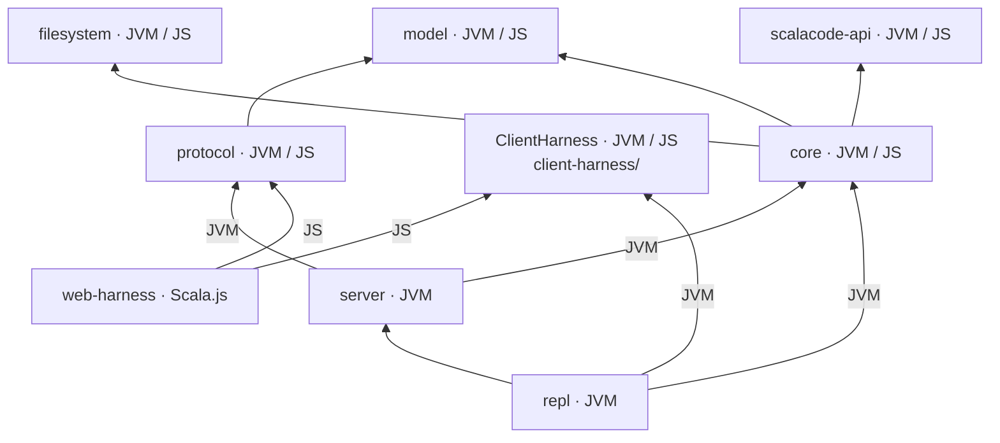

# Yallmo

**Yallmo** - *Yet Another Large Language Module Orchestrator* is an experimental Scala 3 and ZIO project for exploring the building blocks of LLM-agent applications.

## What is Yallmo?

Yallmo combines provider-neutral LLM models, structured agent turns, tool execution, local RAG, and a terminal REPL. Its central design is deliberately simple:

> A model may propose a response or a tool call; trusted application code decides what is available, validates arguments, executes approved work, and records the result.

This keeps the model useful as a planner without making it the authority for side effects.

## Goal

The first version of Yallmo extracted the LLM and TTS logic from my ASAR application (an augmented-reality adventure-story experience for travelers). The first version also added a simple REPL agent harness.

Yallmo is now a personal laboratory for learning how to manage context and knowledge in AI-agent systems, and how to orchestrate agent loops.

- Experimenting with Scala's new capture-checking feature, different technologies, and model types beyond LLMs—such as System One decision models.
- Orchestrating across multiple providers, including local ones.
- Defining code and architectural ownership between humans and agents.
  - as a developer, I want to be able to work on different levels of abstraction on different parts of the code.
- Capturing intent, requirements, and assumptions.
- Reviewing, measuring, and inspecting agent flows.
  - Like spans between agents, iterations and tasks/flows.
  - Tasks fail in the first interaction many times because of the same reason. We should be able to analyze and detect those deficient. 
- Live collaboration working space.
  - Can two/multiple people work on a project among side automated agents?
- Research
  - What is a Durable Agent harness
    - [Pi.dev Durable](https://earendil.com/posts/pi-durable/)
  - UTCP vs MCP - what are the pros and cons?
  - UCP

The project aims to keep the important boundaries small and explicit: transcripts, providers, capabilities, approval, orchestration, and storage. It is exploratory software; APIs and experiments may change.

## Personal reflection - What I'm learning

Scala may be a better fit for LLM-assisted development than I initially expected. Some time ago, I thought Scala would be too complicated for this kind of workflow. Given how common Python is in AI tooling and publicly available code, I expected it to be the natural choice: models would probably be more fluent in it. That may still be true, depending on the model and the task. But part of this project is figuring out what that fluency means in practice—not just generating code, but maintaining a working codebase as it grows and changes.

Working with Scala has made me appreciate how much the compiler helps in that process. It gives both me and the agent concrete feedback about changes, catches many mistakes before runtime, and helps keep refactoring manageable. That does not guarantee correct behavior, but it is a useful feedback loop when an agent is making changes across a project.

The reason Scala feels like a better fit to me is maintainability. I may not be impartial, because maintainability matters a lot to me as a developer, and LLMs are still getting better. But I want a codebase I can understand and an architecture I have reviewed and approved. Letting an agent write more of the code should not mean giving up on thinking about it or taking responsibility for the result.

There is also a more personal question here. I loved writing code myself, and letting an agent write so much of it makes me question what I loved about it. Was it writing the code, understanding it, or building things and figuring out how they work? Maybe it was all of those. I'm still working out what I want to keep doing myself and what I'm happy to delegate.

I'm still exploring the trade-offs, but this experience has made me less certain that the language a model seems most fluent in is necessarily the best language for maintaining a project together. A model's fluency in Scala can improve, even if getting there takes effort and investment. I don't want to choose a language only for what models can do today; I also want to consider what will help me understand and maintain the project over time.

## Documentation

- [Mental model](docs/MENTAL_MODEL.md) — responsibilities, execution flow and runtime ownership; start here for the architecture.
- [Plans and delivery status](docs/PLANS.md) — active work, open acceptance checks.
- [Setup and running](docs/HOW_TO_RUN.md)
- [JSON/YAML configuration and explicit migration](docs/CONFIG_AGENT_PROVIDER.md#json-and-yaml-configuration)
- [Interactive REPL](docs/REPL.md) — startup, connections, commands and retained feature details.
- [Client controls — quick reference](docs/CLIENT_CONTROLS.md) — keyboard/mode tables for the website and REPL, dictation and ClientHarness.
- [Browser audio setup, privacy and manual checks](browser-STT-TTS/README.md) — plain loopback page, no frontend installation.
- [Capabilities architecture](docs/Capabilities_Architecture.md) — configuration inheritance, restrictions, enforcement flow, and REPL voice policy.
- [ChatGPT subscription profiles](docs/HOW_TO_RUN.md#chatgpt-subscription-profiles)
- [Attachments and blob storage](lixo/completed/orchestration/ATTACHMENTS_AND_BLOB_STORAGE_PLAN.md) — retained recordings, reference-only messages, ingestion APIs, and storage limits.
- [Orchestrator website and API](server/README.md) — Scala.js/Laminar SPA, Vite development and JVM asset packaging.
- [Shared SDLC planning tools](plan-tool/README.md) — agent tools, task/intent journals and the HTTP-backed web inspector.
- [Local RAG demo](RAG.md)
- [System One / Jev decision protocol](docs/system_one/System_One_Overview.md)
- [Conversation graph](docs/CONVERSATION_GRAPH.md) — interactive session/message DAG inspector with live 2-second snapshot polling and unnamed branch composer.

## Project layout

- `model/` — JVM/JS provider-neutral models and orchestration state.
- `filesystem/` — shared rooted filesystem capabilities and JSONL helpers; JVM-only NIO implementation.
- `scalacode-api/` — JVM/JS runtime API for restricted Scala snippets; no application-module dependencies.
- `core/` — shared agent execution/configuration and in-memory storage; JVM-only providers, disk storage, process tools and RAG.
- `protocol/` — JVM/JS JSON-RPC envelopes and application wire types; depends only on `model`.
- `client-harness/` — **ClientHarness**, JVM/JS command catalog, input-mode policy and dictation key lifecycle shared by the clients.
- `repl/` — the JVM interactive terminal client and lazy scoped browser audio bridge.
- `server/` — JVM-only JSON-RPC WebSocket host and packaged SPA over an existing orchestrator.
- `web-harness/` — Scala.js/Laminar session inspector and Chat UI, with Vite for development and bundling.
- `browser-STT-TTS/` — packaged browser microphone/speech page and dependency-free Node tests.

### Module dependencies

Arrows point from a module to its direct build dependencies. JVM/JS labels select the matching cross-project variant;
the root project only aggregates these modules.

This is a build graph, not a deployment diagram: the connected REPL and website communicate with a separately running
server over JSON-RPC/WebSocket. ClientHarness is independent of the server, protocol, core and model modules.
`scalacode-api` has no application-module dependencies; restricted snippets compile against it and Scala/ZIO, not the whole host classpath.
`browser-STT-TTS/` and the shared browser-audio JavaScript are assets, not sbt modules; they are packaged by the clients/server.
