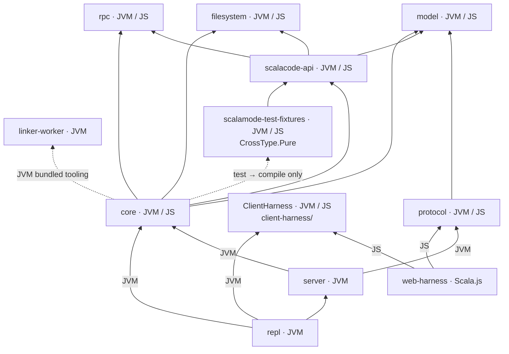

# Yallmo

**Yallmo** - *Yet Another Large Language Module Orchestrator* is an experimental Scala 3 and ZIO project for exploring the building blocks of LLM-agent applications.

**The future of AI is local!**
I have zero doubt about it! Primarily because of the importance and power of sovereignty.
So I’m investing accordingly, both financially and by expanding my knowledge and developing my skills.

## What is Yallmo?

Yallmo combines provider-neutral LLM models, structured agent turns, tool execution, and RAG. Its central design is heavily inspired by Pi.dev and deliberately kept simple.

It tries to put you in a *strategic* command center in control of a *tactical* army of agents.
Yeah, you can be very good at some technologies, but LLMs have more than 10,000 hours in everything that is even minimally known/popular.
Moreover, they can RTFM for anything new. (Not to mention that an open model can also be trained to specialize in something new and specific.)

Today, where we still need a human is in long-term strategic planning!

> A model may propose a response or a tool call; trusted application code decides what is available, executes approved work, and records the result.

This keeps the model useful as a planner without making it the authority for side effects.

## Goal

The first version of Yallmo extracted the LLM and TTS logic from my ASAR application (an augmented-reality adventure-story experience for travelers). The first version also added a simple REPL agent harness.

Yallmo is now a personal laboratory for learning how to manage context and knowledge in AI-agent systems, and how to orchestrate agent loops.

- Optimize for small context windows!
- Keep the codebase clean and maintainable. AI will be the dog saying everything is fine when the house is burning down in the background.
  - The goal is not to review all the code or even understand it exactly, but it should not be burning.
  - Don't overtest, and have a plan to review and delete tests. No point in spending tokens to keep useless and duplicate tests.
  - Keep a consistent language
- Experimenting with Scala's new capture-checking feature, different technologies, and model types beyond LLMs—such as System One decision models.
- Orchestrating across multiple providers, including local ones.
- Defining code and architectural ownership between humans and agents.
  - as a developer, I want to be able to work on different levels of abstraction on different parts of the code.
- Capturing intent, requirements, and assumptions.
- Reviewing, measuring, and inspecting agent flows.
  - Like spans between agents, iterations and tasks/flows.
  - Tasks fail in the first interaction many times because of the same reason. We should be able to analyze and detect those deficient. 
- Live collaboration working space.
  - Can two/multiple people work on a project among side automated agents?
- Research
  - What is a Durable Agent harness
    - [Pi.dev Durable](https://earendil.com/posts/pi-durable/)
  - UTCP vs MCP - what are the pros and cons?
  - UCP

The project aims to keep the important boundaries small and explicit: transcripts, providers, capabilities, approval, orchestration, and storage. It is exploratory software; APIs and experiments may change.

## Personal reflection - What I'm learning

Scala may be a better fit for LLM-assisted development than I initially expected. Some time ago, I thought Scala would be too complicated for this kind of workflow. Given how common Python is in AI tooling and publicly available code, I expected it to be the natural choice: models would probably be more fluent in it. That may still be true, depending on the model and the task. But part of this project is figuring out what that fluency means in practice—not just generating code, but maintaining a working codebase as it grows and changes.

Working with Scala has made me appreciate how much the compiler helps in that process. It gives both me and the agent concrete feedback about changes, catches many mistakes before runtime, and helps keep refactoring manageable. That does not guarantee correct behavior, but it is a useful feedback loop when an agent is making changes across a project.

The reason Scala feels like a better fit to me is maintainability. I may not be impartial, because maintainability matters a lot to me as a developer, and LLMs are still getting better. But I want a codebase I can understand and an architecture I have reviewed and approved. Letting an agent write more of the code should not mean giving up on thinking about it or taking responsibility for the result.

There is also a more personal question here. I loved writing code myself, and letting an agent write so much of it makes me question what I loved about it. Was it writing the code, understanding it, or building things and figuring out how they work? Maybe it was all of those. I'm still working out what I want to keep doing myself and what I'm happy to delegate.

I'm still exploring the trade-offs, but this experience has made me less certain that the language a model seems most fluent in is necessarily the best language for maintaining a project together. A model's fluency in Scala can improve, even if getting there takes effort and investment. I don't want to choose a language only for what models can do today; I also want to consider what will help me understand and maintain the project over time.

## Documentation

`ServerApplication` owns composition/lifetime; `AgentCatalog` caches complete executable agent generations. File reads/listings
use the selected agent read root when configured, otherwise workspace, independently of Scala RPC; Bash/Git stay workspace-bound.

- [Project glossary](yallmo-storage/skills/yallmo-glossary/SKILL.md) — definitions of agents, profiles, tools, functions, skills, providers, and memory, including planned concepts and open decisions.
- [Mental model](docs/MENTAL_MODEL.md) — responsibilities, execution flow and runtime ownership; start here for the architecture.
- [Service wiring and component boundaries](docs/SERVICE_WIRING.md) — startup composition, agent selection, execution/persistence diagrams, tool authorization and resource ownership.
- [Plans and delivery status](docs/PLANS.md) — active work, open acceptance checks.
- [Setup and running](docs/HOW_TO_RUN.md)
- [Docker and Sandbox — quick start](docker/README-DOCKER.md)
- [JSON/YAML configuration and explicit migration](docs/CONFIG_AGENT_PROVIDER.md#json-and-yaml-configuration)
- [Interactive REPL](docs/REPL.md) — startup, connections, commands and retained feature details.
- [Client controls — quick reference](docs/CLIENT_CONTROLS.md) — keyboard/mode tables for the website and REPL, dictation and ClientHarness.
- [Browser audio setup, privacy and manual checks](browser-STT-TTS/README.md) — plain loopback page, no frontend installation.
- [Capabilities architecture](docs/Capabilities_Architecture.md) — configuration inheritance, restrictions, enforcement flow, and REPL voice policy.
- [Typed RPC](rpc/README-RPC.md) — standalone service contracts, JVM/Node WebSocket clients, typed errors, streaming and scoped connection authority.
- [ChatGPT subscription profiles](docs/HOW_TO_RUN.md#chatgpt-subscription-profiles)
- [Attachments and blob storage](lixo/completed/orchestration/ATTACHMENTS_AND_BLOB_STORAGE_PLAN.md) — retained recordings, reference-only messages, ingestion APIs, and storage limits.
- [Orchestrator website and API](server/README.md) — Scala.js/Laminar SPA, Vite development and JVM asset packaging.
- [Shared SDLC planning tools](plan-tool/README.md) — agent tools, task/intent journals and the HTTP-backed web inspector.
- [System One / Jev decision protocol](docs/system_one/System_One_Overview.md)
- [Conversation graph](docs/CONVERSATION_GRAPH.md) — interactive session/message DAG inspector with live 2-second snapshot polling and unnamed branch composer.

## Scalamode

Scalamode evaluates restricted Scala snippets and returns the last expression's value. The public LLM tool accepts
only `{"code":"1 + 1"}`; backend selection is not a tool argument. Model-driven execution and the default JVM path
keep their existing selected-agent bindings, permissions and approval rules.

The operator **Scalamode** webpage has an execution dropdown: **JVM (`jvm`)** is the default; **JS / Node (`js-node`)**
selects a server-side Scala.js compiler and fresh Node runtime for the **same selected-agent function**. Bound hello,
rooted filesystem and custom services, original limits/dependency grants, argument validation and approval remain intact.
Custom functions must explicitly support executor rebinding; opaque functions are not replaced by name/schema matching.
Missing reviewed Scala.js products or unsupported dependency grants fail explicitly, with no JVM fallback.
Node **22.4+** with native WebSocket is required and probed at startup. A future `js-browser` backend is **not implemented**.
Compiler restrictions and reviewed APIs are defense in depth, **not an OS sandbox**.

When the selected agent exposes the `fs` read capability, list all direct entries in its filesystem root with:

```scala
fs.list(".").map(_.mkString("\n"))
```

Here `"."` is the agent's configured filesystem root, not the host machine's root directory. The webpage's default
example includes this expression commented out, so it still runs for agents without filesystem access.

The JS / Node page backend retains a server-scoped incremental fast linker for repeated runs and source edits,
but launches a **fresh Node process for every evaluation**; definitions are not available to subsequent submissions,
and runtime state does not persist.
The first link and links after a reset are slower. Compilation timing includes linking; execution timing includes
Node initialization/bootstrap and cleanup, not just evaluation (`executionSetupTime`, when present, is a subset).

Trusted startup extracts four bundled, reviewed JS API products (`scalacode-api`, `model`, `filesystem`, `rpc`) and
isolated linker tooling into server-owned scoped temporary storage, cleaned up at shutdown. Durable `--storage`
remains application data, not a compiler/artifact root. There are no `--scalamode-js-root` or `--scalamode-node`
executable configuration options: `node` and `scala-cli` must be on PATH, and the pinned compiler and dependency
caches must be provisioned for offline use. Bundling the reviewed APIs does **not** provision those full caches.
Use the normal server startup described in [Setup and running](docs/HOW_TO_RUN.md).

See the [Scalamode tool contract](docs/tools/TOOL-SCALA-SCRIPT.md) and
[reviewed API and host boundaries](scalacode-api/README-SCALACODE.md) for details.

## Typed RPC

The [`rpc/` module](rpc/README-RPC.md) (`fmgp.rpc`, artifact `yallmo-rpc`) is independent of Yallmo's model,
core, server and agent orchestration. It turns Scala service traits into typed remote clients and host dispatchers:

- `Rpc.derived[Service](serviceId, version)` generates a contract at compile time, without runtime reflection or dynamic proxies.
- `contract.bind(implementation)` exposes the host implementation; `contract.client(connection)` provides the same Scala interface remotely.
- Unary ZIO methods and server-to-client `ZStream` methods share one connection. Explicit codecs and error mappers preserve typed domain errors; byte streams use binary batches with pull-based back-pressure.
- Client protocol state is shared across JVM and Scala.js. JVM uses zio-http; Scala.js uses native **Node 22.4+ WebSocket**. The server and single-use ticket registry remain JVM-only; browser clients are not supported.
- The host owns the HTTP listener, service selection and authorization. Scoped tickets tie access and remote work to the invocation's lifetime; the transport does not grant filesystem access or automatically retry calls.

Scalamode uses this module to let both JVM and Node snippets call the **same host-side capabilities**, including
rooted filesystem services. This typed capability transport is separate from the application JSON-RPC API in
`protocol/`, which connects the website and REPL to the orchestrator.

See the [RPC guide](rpc/README-RPC.md) for runnable examples, authentication, resource ownership, limits and supported method signatures.

## Project layout

- `model/` — JVM/JS provider-neutral models and orchestration state; owns the canonical [ScalaCodeExecutor](model/shared/src/main/scala/fmgp/yallmo/tool/scalamode/ScalaCodeExecutor.scala) contract and defaults.
- `filesystem/` — shared rooted filesystem capabilities and JSONL helpers; JVM-only NIO implementation.
- `scalacode-api/` — reviewed JVM/JS snippet API and optional `ScalaCodeExecutorServices` capability; depends on model/filesystem/rpc, never core/server.
- `scalamode-test-fixtures/` — unpublished, test-only `CrossType.Pure` project; JVM and Scala.js compile the same [`src/main/scala` fixtures](scalamode-test-fixtures/src/main/scala/fmgp/yallmo/scalacode/fixture/CompiledServices.scala). Supplies narrow custom-service artifacts for core integration tests, never production runtime dependencies.
- `core/` — shared agent execution/configuration and in-memory storage; JVM-only providers, disk storage, process tools and RAG. `core/jvm` owns [ScalaCodeExecutors](core/jvm/src/main/scala/fmgp/yallmo/tool/scalamode/ScalaCodeExecutors.scala) and the internal `ScalaJsCompiler`, with shared invocation/program/process helpers.
- [linker-worker/](linker-worker/) — isolated JVM compiler/linker tooling; never evaluates submitted snippets.
- [`rpc/`](rpc/README-RPC.md) — standalone JVM/JS typed contracts, codecs and derivation for unary/streaming RPC; shared client state with JVM zio-http and native Node WebSocket adapters; ticket registry and server stay JVM-only.
- `protocol/` — JVM/JS JSON-RPC envelopes and application wire types; depends only on `model`.
- `client-harness/` — **ClientHarness**, JVM/JS command catalog, input-mode policy and dictation key lifecycle shared by the clients.
- `repl/` — the JVM interactive terminal client and lazy scoped browser audio bridge.
- `server/` — JVM-only JSON-RPC WebSocket host and packaged SPA over an existing orchestrator.
- `web-harness/` — Scala.js/Laminar session inspector and Chat UI, with Vite for development and bundling.
- `browser-STT-TTS/` — packaged browser microphone/speech page and dependency-free Node tests.

### Module dependencies

Solid arrows point from a module to its direct code dependencies. Dashed arrows show explicitly labeled test-only
dependencies or build-time resource packaging, not production code dependencies. JVM/JS labels select the matching
cross-project variant; the root project aggregates the main application modules.



This is a build graph, not a deployment diagram: the connected REPL and website communicate with a separately running
server over JSON-RPC/WebSocket. ClientHarness is independent of the server, protocol, core and model modules.
`scalacode-api` depends on model/filesystem/rpc, not core/server. Restricted snippets use reviewed API artifacts and
pinned dependencies, never the whole application classpath. JVM core packages isolated linker tooling as resources;
the server adds the four reviewed JS API products. Bundling tooling does not make it a snippet compile/link dependency.
The fixture project depends on `scalacode-api` and is used by core through `test->compile` only; its artifacts contain
reviewed helpers rather than test suites or test-framework dependencies and are not bundled into the application.
`browser-STT-TTS/` and the shared browser-audio JavaScript are assets, not sbt modules; they are packaged by the clients/server.
