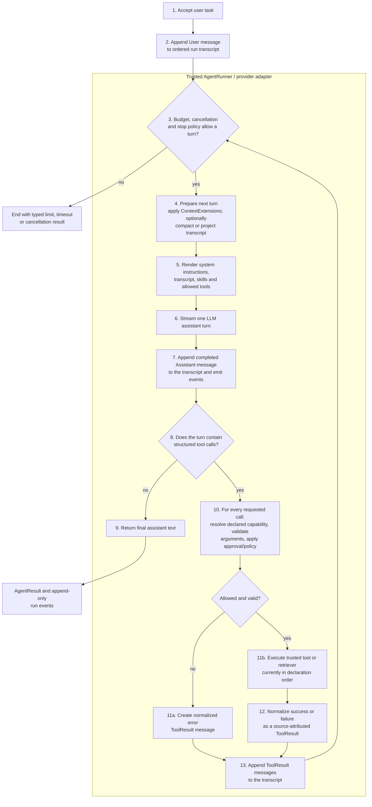
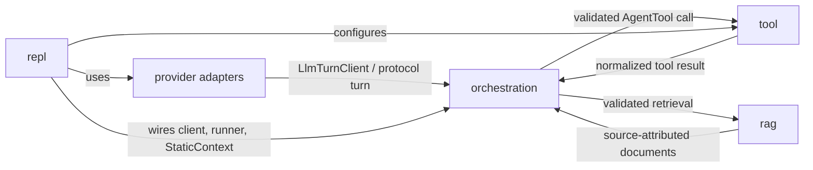

# Yallmo

**Yallmo** stands for **Yet Another Large Language Module Orchestrater**. It is a small Scala 3 / ZIO project for learning the building blocks of a **generative-AI system**: an LLM proposes a next step, while ordinary, trusted application code decides what may actually happen.

> The implementation is a Pi-inspired's turn-based agent loop: keep an ordered transcript, ask the model for one assistant turn, execute its validated tool calls, append normalized tool results, and continue only while work remains.

Yallmo supports both a strict JSON `AgentDecision` compatibility path and provider-native structured function calls. In both cases, the same trusted runner owns capability checks, approval, execution, and transcript updates.

The project also contains a local RAG implementation and provider adapters. Its orchestration package is deliberately small and explicit so that the safety boundary is easy to study.

I want Yallmo to be a laboratory. To fast test and measure ideas of how to 

## What is an AI agent?

A plain chat completion maps a prompt to an answer once. An agent adds a controlled feedback loop:

1. receive a goal;
2. inspect the task, prior results, and permitted capabilities;
3. propose either a final answer or an action;
4. let trusted code validate and execute that action;
5. feed the normalized result back into context; and
6. stop when it returns an answer.

The model is therefore a **planner/proposer**, not the authority that executes side effects. This mirrors the ReAct idea of interleaving reasoning and actions, while keeping tools behind application-controlled boundaries ([ReAct paper](https://arxiv.org/abs/2210.03629)).

## What problems does an agent solve?

Agents are useful when an answer needs work that a single model response cannot reliably do by itself:

| Need | Example | Agent capability |
| --- | --- | --- |
| Ground answers in private or changing knowledge | Answer from product manuals or a local lore collection | RAG retrieval with sources |
| Take a permitted action | Look up a status, format content, create a ticket | Explicit tool request and execution |
| Complete a multi-step task | Retrieve evidence, transform it, then summarize it | Repeated plan → act → observe turns |
| Apply different instructions or data to one task | Add user metadata, memory, or redaction | Ordered context extensions |
| Limit unsafe capability use | A model requests an email or other side effect | Capability allowlists and approval |

An agent is **not** automatically better for every prompt. A direct LLM call is usually simpler, faster, cheaper, and easier to test when no external information or action is needed. The most reliable designs start with the simplest workflow that solves the task and only introduce an agent loop when the task truly needs model-directed decisions ([Anthropic, *Building effective agents*](https://www.anthropic.com/research/building-effective-agents)).

## Pi-inspired agent-loop target

Pi's core loop is transcript-driven rather than plan-driven: an assistant turn either finishes with text or carries one or more tool calls. The runtime records every message, executes calls outside the model, turns outcomes (including failures) into tool-result messages, and asks the model again. Yallmo will use the same shape, while preserving its explicit ZIO capability and approval boundary.



**Trust boundary:** the model may select only from advertised capabilities and supplies untrusted arguments. `AgentRunner` owns lookup, schema validation, authorization, approval, execution, error normalization, budgets, and the decision to begin another turn. A failed or denied call is returned to the model as data, not silently dropped, so it can revise its next turn.

### Design rules borrowed from Pi

1. **One model response is one turn.** The runner preserves the user message, any assistant text, function calls, and every tool result in order. It does not call the model again after a response with no tool calls.
2. **Tool calls are structured messages.** The target provider adapter will translate native provider tool calls into typed `AgentAction` values. Until then, `LlmDecisionAgent` decodes the existing strict JSON `AgentDecision` protocol into those same trusted actions.
3. **Validate before execution; record after execution.** Unknown tools, invalid arguments, policy denials, truncation, and tool exceptions produce normalized error results in the transcript. They never become executable model text.
4. **Keep the transcript separate from the model payload.** Context extensions and eventual compaction may project a smaller prompt for a turn, but the complete run transcript and events remain available for audit and retry.
5. **Make concurrency deliberate.** Pi can run independent calls in parallel, but Yallmo will keep its current sequential default until a tool explicitly declares that parallel execution is safe.
6. **Bound every run.** Check turn/action/time limits before work, honour cancellation, and return a typed outcome rather than looping indefinitely.

The current implementation covers the append → decide → validate → execute → append cycle, capability allowlists, approval wrappers, run-wide turn/action/time budgets, and native structured function calls for OpenAI Codex Responses and Docker Model Runner. Streaming lifecycle events, durable session trees, compaction, queued steering, provider-aware retries, and Gemini native turns remain planned extensions.

### The three-turn demo, in plain language

`OrchestrationMainDemo` makes the loop visible without an API key:

1. The user asks for one fact about Faro.
2. `guideAgent` asks to retrieve from the `faro-guide` retriever.
3. The runner retrieves a source-attributed document and appends it to history.
4. The agent asks to call the advertised `format-guide` tool.
5. The runner runs the tool and appends its text result.
6. The agent returns that result as its final answer.

The demo uses scripted Scala code only so it runs without credentials. In normal use, `LlmDecisionAgent` calls an LLM to propose the next decision; its output can vary between calls. The runner, capability checks, and message flow stay the same.

## How this repository maps to the flow

| Responsibility | Main types | Location |
| --- | --- | --- |
| Trusted loop and capability checks | `AgentRunner` | [`AgentRunner.scala`](src/main/scala/fmgp/llm/orchestration/AgentRunner.scala) |
| Agent contract and LLM-backed agent | `Agent`, `LlmDecisionAgent` | [`Agents.scala`](src/main/scala/fmgp/llm/orchestration/Agents.scala) |
| Static configuration, run transcript, turns, actions, errors | `StaticContext`, `RunContext`, `AgentTurn`, `AgentDecision`, `LlmAction` | [`OrchestrationModels.scala`](src/main/scala/fmgp/llm/orchestration/OrchestrationModels.scala) |
| Tools, retrievers, and context transforms | `AgentTool`, `KnowledgeRetriever`, `ContextExtension` | [`Capabilities.scala`](src/main/scala/fmgp/llm/orchestration/Capabilities.scala) |
| Model-output protocol | `JsonAgentDecisionCodec` | [`JsonAgentDecisionCodec.scala`](src/main/scala/fmgp/llm/orchestration/JsonAgentDecisionCodec.scala) |
| Optional approval boundary | `ToolApproval.guard` | [`ToolApproval.scala`](src/main/scala/fmgp/llm/orchestration/ToolApproval.scala) |
| Runnable no-credential tour | `OrchestrationMainDemo` | [`OrchestrationMainDemo.scala`](src/main/scala/fmgp/llm/orchestration/OrchestrationMainDemo.scala) |
| Local Markdown-to-vector RAG demo | tokenizer, ONNX embeddings, cosine index | [`RAG.md`](RAG.md) and [`rag`](src/main/scala/fmgp/llm/rag) |
| Reusable local function tools | `ReadFileTool`, `ListFilesTool`, `BashTool` | [`tool`](src/main/scala/fmgp/llm/tool) |
| Interactive terminal composition root | `ReplMain`, `ReplSession`, `ReplTools` | [`repl`](src/main/scala/fmgp/llm/repl) |

## Package structure and relationships

The packages separate provider-neutral orchestration from concrete integrations and side effects:

| Package | Owns | Depends on / role in the system |
| --- | --- | --- |
| `fmgp.yallmo` | Provider-neutral LLM and TTS interfaces, requests, options, and debug capture | The shared boundary used by orchestration and provider implementations. `LlmTurnClient` is the one-turn interface used by native function-call agents. |
| `fmgp.yallmo.protocol` | Provider-neutral request, response, function-call, and JSON-schema models | Defines the wire-level data exchanged between `NativeFunctionAgent` and provider adapters; it does not execute calls. |
| `fmgp.yallmo.orchestration` | Agents, immutable context/transcript models, `AgentRunner`, capability interfaces, approval, and decision codecs | The trusted control plane. It depends on the neutral interfaces/models and invokes only tools or retrievers that were explicitly registered and advertised. |
| `fmgp.yallmo.tool` | Reusable local `AgentTool` implementations and their ZIO runtime services | Supplies concrete capabilities to the orchestration boundary. The REPL checks each tool's startup requirements before placing it in both its runner and `StaticContext`. |
| `fmgp.yallmo.rag` | Markdown chunking, embeddings, vector index, and RAG service | Implements `KnowledgeRetriever` from `orchestration`; retrieval results return to the runner as source-attributed transcript messages. |
| `fmgp.yallmo.provider` | Provider adapters and provider-specific mappers (`oai`, `openai`, `gemini`) | Implements the neutral LLM interfaces and converts provider payloads to/from `protocol` models. Providers propose calls; they never execute Yallmo tools. |
| `fmgp.yallmo.repl` | Interactive terminal UI/session and REPL-specific wiring | Composition root for the local REPL: creates configured tools, advertises their definitions in `StaticContext`, registers them in `AgentRunner`, and supplies a provider client. |



`repl` is intentionally not a new execution path: it is a composition layer. The execution path remains `provider → NativeFunctionAgent → AgentRunner → registered tool or retriever → AgentRunner → provider`. This keeps a provider's function-call payload separate from trusted local execution.

## Core concepts to study

### 1. Static configuration and run state are different types

`StaticContext` is fixed when a run begins. It contains the system prompt, advertised tools and retrievers, skills, and ordered `ContextExtension`s. `RunContext` contains only the ordered `messages` transcript that evolves from turn to turn.

Both are immutable values. A `ContextExtension` may inspect `StaticContext`, but can return only a new `RunContext`; it cannot add capabilities or alter instructions during a run. Each `AgentTurn` stores its textual assistant reply when one exists; a tool-only response instead appends `FunctionCallRequest` directly. `RunContext.messages` therefore preserves user, assistant, retrieval, and tool messages in order without fabricating an empty assistant message. It is still a linear, in-memory transcript, not durable memory, compaction, or a branchable conversation store.

### 2. Capabilities are declared twice

For a tool or retriever call to succeed, it must be both:

- present in the runner's global registry; **and**
- advertised in that agent's `StaticContext`.

This is capability-based access control: registering a powerful tool does not silently grant it to every agent.

### 3. Decisions are data, not executable model code

The LLM-backed agent asks the model to return exactly one JSON object:

```json
{"finalAnswer":"The answer for the user."}
```

or:

```json
{
  "actions": [
    {"kind":"retrieve_rag","retrieverKey":"knowledge","query":"Faro beaches"},
    {"kind":"call_external_tool","toolKey":"current-time","arguments":{}}
  ]
}
```

`JsonAgentDecisionCodec` parses that response into typed `AgentDecision` and `LlmAction` values. It rejects malformed, empty, or contradictory responses. The runner executes a batch in order, rather than concurrently, because a tool may mutate state or require approval.

### 4. Retrieval provides evidence; it does not make the model truthful

A RAG action returns `RagDocument`s with an id, source, text, and optional score. Those results are placed in the next model prompt. This can ground an answer in relevant material, but retrieved text is still untrusted input: it can be irrelevant, stale, malicious, or contain prompt-injection-like instructions. Preserve source attribution, constrain which corpora may be searched, and evaluate answer quality.

### 5. Approval protects side-effecting tools

For side-effecting tools, `ToolApproval.guard` can require a human or policy decision before the actual tool executes. Tool implementations must still validate model-produced arguments themselves. See [future work](FUTURE%20WORK.md) for a proposed run-wide budget.

## Run the learning demo

Prerequisites: a JDK compatible with the project and [sbt](https://www.scala-sbt.org/).

```bash
sbt "runMain fmgp.yallmo.orchestration.OrchestrationMainDemo"
```

Expected final output:

```text
Faro, the Algarve's capital, combines a walled old town with access to the region.
```

Run the tests:

```bash
sbt test
```

For the separate local ONNX RAG demo, including model download commands, see [`RAG.md`](RAG.md).

## Interactive RELP

See [`docs/RELP.md`](docs/RELP.md) for startup, commands, tool availability, and the complete voice-input
initialization, precondition, privacy, and data-flow documentation.

## Security and design checklist

Before connecting a real tool, ask:

- Is the tool explicitly advertised only to the agents that need it?
- Are all untrusted arguments parsed and validated against a schema at the tool boundary?
- Is a human or policy approval required for external side effects?
- Are retrieval sources allowlisted and their provenance preserved?
- Are tool results treated as untrusted data rather than instructions?
- Does the workflow need run-wide turn, action, time, cost, or rate limits?
- Are requests, decisions, approvals, calls, results, and failures recorded for auditing?
- Does the workflow really need a model-directed loop, or would deterministic code be safer?

These questions address common agentic risks such as prompt injection, excessive agency, and insecure tool use. See the [OWASP Top 10 for LLM Applications](https://owasp.org/www-project-top-10-for-large-language-model-applications/) and the [NIST AI Risk Management Framework](https://www.nist.gov/itl/ai-risk-management-framework) for broader risk-management guidance.

## Suggested learning path

1. Run and read `OrchestrationMainDemo`.
2. Read `AgentRunner.runLoop` and trace the context after every turn.
3. Read `WorkflowSuite` to see retrieval, tools, denied approval, context extensions, and JSON parsing tested in isolation.
4. Replace the scripted example agent with `LlmDecisionAgent` and a controlled `LlmClient` implementation.
5. Add one harmless read-only tool, then add argument validation and a denial test.
6. Add structured logging/events before considering write-capable tools or durable sessions.

## Further reading

- Yao et al., [*ReAct: Synergizing Reasoning and Acting in Language Models*](https://arxiv.org/abs/2210.03629) — the reasoning/action loop.
- Anthropic, [*Building effective agents*](https://www.anthropic.com/research/building-effective-agents) — when to use workflows versus agents.
- OWASP, [*Top 10 for LLM Applications*](https://owasp.org/www-project-top-10-for-large-language-model-applications/) — practical security risks.
- NIST, [*AI Risk Management Framework*](https://www.nist.gov/itl/ai-risk-management-framework) — organizational AI risk guidance.
- Project-specific details: [`ORCHESTRATION.md`](src/main/scala/fmgp/llm/orchestration/ORCHESTRATION.md).


## FABIO NOTES

replies-to, caused-by, derives-from, summarizes, retries, consumes-context

 - Nodes: user, system, assistant, tool call, tool result, retrieval/context, summary, retry, checkpoint.
 - Edges: replies-to, caused-by, derives-from, summarizes, retries, consumes-context.
 - Views:
     - complete DAG;
     - one selected path (“how did we get this answer?”);
     - ancestor/descendant neighborhood;
     - compare two branches;
     - chronological swimlanes by actor: User / LLM / Tool / System.
 - Interactions: click a node for full content and metadata; filter node types; collapse repeated/tool-heavy sections; search text; highlight context actually supplied to a selected LLM
   call.