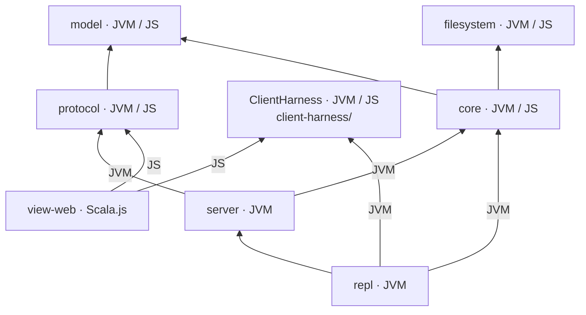

# Yallmo

**Yallmo** - *Yet Another Large Language Module Orchestrator* is an experimental Scala 3 and ZIO project for exploring the building blocks of LLM-agent applications.

## What is Yallmo?

Yallmo combines provider-neutral LLM models, structured agent turns, tool execution, local RAG, and a terminal REPL. Its central design is deliberately simple:

> A model may propose a response or a tool call; trusted application code decides what is available, validates arguments, executes approved work, and records the result.

This keeps the model useful as a planner without making it the authority for side effects.

## Goal

The first version of Yallmo extracted the LLM and TTS logic from my ASAR application (an augmented-reality adventure-story experience for travelers). The first version also added a simple REPL agent harness.

Yallmo is now a personal laboratory for learning how to manage context and knowledge in AI-agent systems, and how to orchestrate agent loops.

- Experimenting with Scala's new capture-checking feature, different technologies, and model types beyond LLMs—such as System One decision models.
- Orchestrating across multiple providers, including local ones.
- Defining code and architectural ownership between humans and agents.
  - as a developer, I want to be able to work on different levels of abstraction on different parts of the code.
- Capturing intent, requirements, and assumptions.
- Reviewing, measuring, and inspecting agent flows.
  - Like spans between agents, iterations and tasks/flows.
  - Tasks fail in the first interaction many times because of the same reason. We should be able to analyze and detect those deficient. 
- Live collaboration working space.
  - Can two/multiple people work on a project among side automated agents?

The project aims to keep the important boundaries small and explicit: transcripts, providers, capabilities, approval, orchestration, and storage. It is exploratory software; APIs and experiments may change.

## Documentation

- [Mental model](docs/MENTAL_MODEL.md) — responsibilities, execution flow and runtime ownership; start here for the architecture.
- [Plans and delivery status](docs/PLANS.md) — active work, open acceptance checks.
- [Setup and running](docs/HOW_TO_RUN.md)
- [Interactive REPL](docs/REPL.md) — startup, connections, commands and retained feature details.
- [Client controls — quick reference](docs/CLIENT_CONTROLS.md) — keyboard/mode tables for the website and REPL, dictation and ClientHarness.
- [Browser audio setup, privacy and manual checks](browser-STT-TTS/README.md) — plain loopback page, no frontend installation.
- [Capabilities architecture](docs/Capabilities_Architecture.md) — configuration inheritance, restrictions, enforcement flow, and REPL voice policy.
- [ChatGPT subscription profiles](docs/HOW_TO_RUN.md#chatgpt-subscription-profiles)
- [Attachments and blob storage](docs/orchestration/ATTACHMENTS_AND_BLOB_STORAGE_PLAN.md) — retained recordings, reference-only messages, ingestion APIs, and storage limits.
- [Orchestrator website and API](server/README.md) — Scala.js/Laminar SPA, Vite development and JVM asset packaging.
- [Local RAG demo](RAG.md)
- [System One / Jev decision protocol](docs/system_one/System_One_Overview.md)
- [Conversation graph](server/README.md#website-behavior-and-downloads) — implemented session/message inspector.

## Project layout

- `model/` — JVM/JS provider-neutral models and orchestration state.
- `filesystem/` — shared rooted filesystem capabilities and JSONL helpers; JVM-only NIO implementation.
- `core/` — shared agent execution/configuration and in-memory storage; JVM-only providers, disk storage, process tools and RAG.
- `protocol/` — JVM/JS JSON-RPC envelopes and application wire types; depends only on `model`.
- `client-harness/` — **ClientHarness**, JVM/JS command catalog, input-mode policy and dictation key lifecycle shared by the clients.
- `repl/` — the JVM interactive terminal client and lazy scoped browser audio bridge.
- `server/` — JVM-only JSON-RPC WebSocket host and packaged SPA over an existing orchestrator.
- `view-web/` — Scala.js/Laminar session inspector and Chat UI, with Vite for development and bundling.
- `browser-STT-TTS/` — packaged browser microphone/speech page and dependency-free Node tests.

### Module dependencies

Arrows point from a module to its direct build dependencies. JVM/JS labels select the matching cross-project variant;
the root project only aggregates these modules.

This is a build graph, not a deployment diagram: the connected REPL and website communicate with a separately running
server over JSON-RPC/WebSocket. ClientHarness is independent of the server, protocol, core and model modules.
`browser-STT-TTS/` and the shared browser-audio JavaScript are assets, not sbt modules; they are packaged by the clients/server.

## WIP & TODO & IDEAS

- [Future UserId identity model](docs/future-plan/UserId-future_identity_model.md) — one user connection with multiple acting AgentIds.
- [Add metadata to Blob and Preview](docs/future-plan/Blob-metadata-and-media-preview.md)

### WIP

Remaining work:
- 
- Add remote /tools and richer agent information.
- Migrate provider administration/login, voice execution, human interactions and diagnostics.
- Perform a real-provider, separate-process smoke test.
- Retire local compatibility code only after deciding feature parity.
- Authentication, cancellation/status APIs and richer run-management machinery.

The REPL connects to `ws://127.0.0.1:8080/rpc` by default; `--server` overrides it. Startup is client-only, with no
local fallback. Existing audio/voice, debug and other local feature implementations/tests are retained pending integration.

### TODO other

- Review test and check all test that extends FunSuite or `Unsafe.unsafe { unsafe ?=> ... }` and use munit-zio lib!
- TerminalVoiceModeStatus.remoteConnection Remove! 

### TODO - Agent Comands

Each agent should bring their own comments to the REPL.

### TODO - Newest Inference Engines

Docker Model Runner is no longer sufficient for the experiments I want to run. I want direct access to the latest **vLLM** and **llama.cpp** engines and APIs, without waiting for Docker Model Runner to expose their capabilities.

- **Incremental input and output:** stream text and audio chunks into supported backends and process them while more input is arriving; receive text and audio chunks incrementally. Streaming output alone is not enough. Actual support depends on the engine, model, and endpoint.
- **Realtime voice experiments:** try [Voxtral Mini 4B Realtime](https://huggingface.co/mistralai/Voxtral-Mini-4B-Realtime-2602) through [vLLM's Realtime API](https://docs.vllm.ai/en/latest/serving/online_serving/speech_to_text/#realtime-api) for incremental speech-to-text. Conversation and speech synthesis remain separate capabilities, composed as needed.
- **System One models:** experiment with constrained decision models alongside conversational models, keeping their contracts separate. Run **Laya in a custom Docker container** and integrate it through the [System One / Jev boundary](docs/system_one/System_One_Overview.md), rather than treating it as a chat-completion model.

### IDEA - /btw

Add a command that entres a conversation mode. Where its not allowed to use most of the tool. Specially, is not allowed to modify anything.
It can still have submode to search the files in the FS and search the Internet
When exiting this mode a summary will be written back into the context of the other.

The idea is to have a conversation, discuss ideas and understanding the options.

### IDEA - agents can share tools/functions with other agents

We have use capture-checking to make sure those tools don't space the resquet

