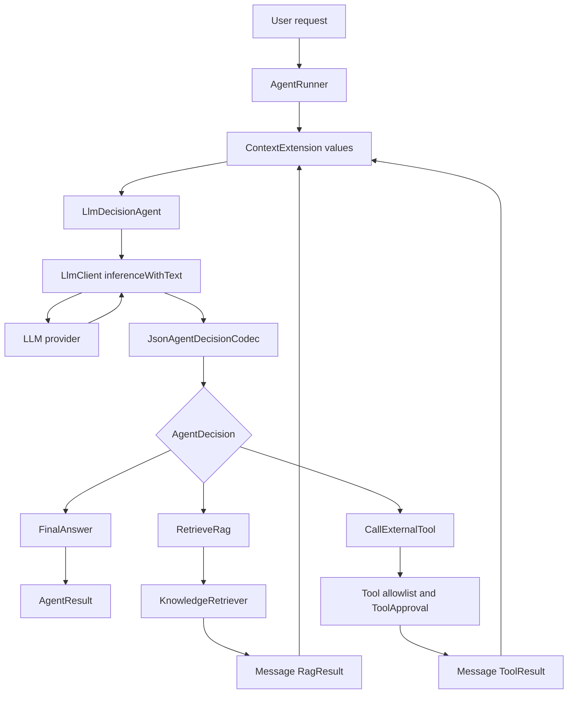

# Agent orchestration

`fmgp.yallmo.orchestration` is a bounded, model-directed agent loop. An `AgentInstance` proposes a decision, but
`AgentRunner` remains the trusted component that validates and executes retrieval and tool actions.

This replaces the removed `Workflow` AST. Application flows that do not need model-selected actions should use ordinary named ZIO methods;
`AgentRunner` is for flows where the model selects the next action.

## End-to-end flow



The `Extensions -> AgentInstance -> Client -> Provider -> Codec` path is one model turn. A retrieval or tool result is
appended to the current agent context, then the runner starts another turn. A final answer terminates the run.

A non-LLM `AgentInstance` can construct an `AgentTurn` directly in Scala; this is useful for tests and code-controlled
policies. Only `LlmDecisionAgent` calls `LlmClient`.

## Core contracts

Every decision-making implementation uses the same interface:

```scala
trait AgentInstance[R] {
  def id: AgentId

  def next(
      task: AgentTask,
      staticContext: StaticContext[R],
      runContext: RunContext
  ): ZIO[R, OrchestrationError, AgentTurn]
}
```

An `AgentTurn` records an optional textual assistant reply and carries a terminal answer or non-empty action batch:

```scala
final case class AgentTurn(
  assistant: Option[Message.Assistant],
  decision: AgentDecision
)
```

A native tool-only response has `assistant = None`; its `FunctionCallRequest` is appended directly to the transcript.
No empty assistant message is fabricated.

An agent cannot execute capabilities itself. Its decision is data:

```scala
enum AgentDecision {
  case FinalAnswer(text: String)
  case Actions(actions: Chunk[LlmAction])
}

enum LlmAction {
  case RetrieveRag(retrieverKey: String, query: RagQuery)
  case CallExternalTool(call: ExternalToolCall)
}
```

`AgentRunner` owns the registries and executes the actions in declaration order. It verifies that a requested tool or
retriever is both registered globally and advertised in the calling `StaticContext`. `run` starts with an empty
transcript and returns `AgentResult`; `runWithContext` accepts a prior `RunContext` and returns `AgentRun`, which makes
multi-prompt clients such as the REPL able to retain their transcript.

## Context

The runner separates context into two immutable values:

- `StaticContext[R]` is fixed for an entire run. It contains the `systemPrompt`, permitted tool and retriever
  definitions, skills, and ordered `ContextExtension[R]` transforms.
- `RunContext` contains only the ordered `messages` transcript. It produces a new value when a user or assistant
  message, retrieval result, or tool result is appended.

`ContextExtension.apply(staticContext, runContext)` returns `ZIO[R, OrchestrationError, RunContext]`. Extensions run
before every model turn and can load memory, add predefined RAG, redact data, or add request metadata. Its return type
prevents an extension from changing instructions or adding capabilities after a run starts.

## LLM decision protocol

`LlmDecisionAgent` renders the current context and calls the existing provider-neutral interface:

```scala
LlmClient.inferenceWithText(prompt, options, model)
```

The response is retained as an `Message.Assistant`; `AgentDecisionCodec` also turns it into a typed decision:

```scala
trait AgentDecisionCodec {
  def instructions: String

  def decode(
      response: String,
      staticContext: StaticContext[?]
  ): IO[OrchestrationError, AgentDecision]
}
```

`JsonAgentDecisionCodec` is the included codec. It requires exactly one JSON object and no Markdown.

Finish a run:

```json
{"finalAnswer":"The final response for the user."}
```

Request RAG:

```json
{
  "actions": [
    {
      "kind": "retrieve_rag",
      "retrieverKey": "knowledge",
      "query": "Faro beaches"
    }
  ]
}
```

Request a registered external tool:

```json
{
  "actions": [
    {
      "kind": "call_tool",
      "toolKey": "current-time",
      "arguments": {}
    }
  ]
}
```

## Guardrails

`AgentBudget` bounds one run. It limits:

- model turns
- action count
- total timeout

The runner returns typed `OrchestrationError` values for malformed decisions, unavailable capabilities, empty action
batches, rejected tool calls, and budget exhaustion.

`ToolApproval.guard` can wrap an `AgentTool` to require a human or policy decision before a model-selected call runs.

## Current and future provider integration

The current implementation uses `inferenceWithText` and strict JSON decoding so it works with the existing `LlmClient`
contract. A future `LlmClient` turn-level API should expose provider-native tool calls and stop reasons. That adapter can
produce the same `AgentDecision` and `LlmAction` values, leaving `AgentRunner`, authorization, budgets, and context
rules unchanged.

## Pi-inspired design mapping

Pi and this package share the important security boundary: a model proposes actions, while trusted runtime code owns
capability execution and decides whether another turn is needed. The concepts map as follows:

| Pi | This package | Notes |
| --- | --- | --- |
| Agent loop | `AgentRunner.run` / `runLoop` | It calls the agent, executes its requested actions, records results in context, and repeats until `FinalAnswer`. |
| Assistant reply | `AgentTurn.assistant` / `Message.Assistant` | The reply is appended before the runner acts on its decision. |
| Assistant tool call | `LlmAction` | It is declarative until `AgentRunner` resolves it against the per-agent capability allowlist. |
| Tool definition and execution | `AgentToolDefinition` / `AgentTool` | `ToolApproval.guard` is the policy or human-confirmation boundary. |
| Tool result message | `Message.ToolResult` | The next turn receives the normalized text result, not the tool implementation. |
| System prompt, skills, and context transforms | `StaticContext` and `ContextExtension` | Static configuration is fixed for a run; extensions return only updated `RunContext` values. |
| Active session branch | `RunContext.messages` | This is only the in-memory, linear history for one run. It is **not** a durable Pi-style session tree. |
| Context compaction and session persistence | Not implemented | Keep these outside the runner until ASAR needs resumable, branchable orchestration runs. |

Pi also supports parallel calls from one assistant message. This runner intentionally executes action batches in order:
ASAR tools may mutate state or require approval, so concurrency must be an explicit capability property rather than the
default.

### Recommended evolution

1. Rename `LlmAction` to `AgentAction` in the next intentionally breaking API revision. Non-LLM `AgentInstance`
   implementations already create these values, so the current name incorrectly implies that only an LLM can do so.
2. Add an append-only `AgentRunEvent` stream and extend `AgentRun` with those events. `AgentRun` already returns the
   final `AgentResult` and `RunContext`; events would add Pi-like audit, debug, and progress reporting without forcing
   durable session storage into the trusted execution loop.
3. Add durable session trees, compaction, and branch selection only when a product workflow needs pause/resume or
   alternative paths. They require stable entry IDs, JSONL/versioning, and explicit context projection; they should not
   be hidden inside `RunContext`.

## Runnable no-credential demo

The no-credential demo uses a scripted example agent to run three turns: retrieve source-attributed knowledge, invoke an advertised formatter tool,
and return the tool result.

```bash
sbt "yallmo/runMain fmgp.yallmo.orchestration.OrchestrationMainDemo"
```

It does not call an LLM provider, so it demonstrates the trusted loop and capability boundaries without credentials.
Swap the scripted example agent for `LlmDecisionAgent` once an `LlmClient` layer is provided.
