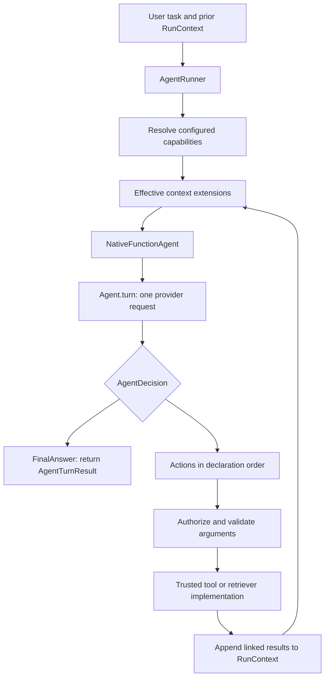

# Agent orchestration

`fmgp.yallmo.orchestration` is a bounded, model-directed agent loop. An `AgentInstance` proposes a decision;
`AgentRunner` validates and executes retrieval/tool actions. Application flows that do not need model-selected actions
should use ordinary named ZIO methods, not a second workflow interpreter.

## Ownership

| Component | Responsibility |
| --- | --- |
| `Agent` / `AudioAgent` | Named adapter performing one `AgentTurnRequest` → `AgentTurnResponse`; never executes tools |
| `OAIAgent` / `ChatGPTAgent` | Canonical validation, provider-specific mapping, and turn diagnostics |
| `OAILlmProvider` / `OpenAiCodexClient` | Provider inference and HTTP completion; neither is an `Agent` |
| `NativeFunctionAgent` | Assemble native requests, preserve continuations/call IDs, and propose decisions |
| `AgentRunner` | Capability checks, schema validation, approval guards, execution, budgets, and repetition |
| `RuntimeInstances` | Lazy named-agent/provider resolution and configured capability wrappers |
| `Orchestrator` | Public agent/session persistence API and blob ingestion/reads |
| `Storage` | Internal session/message/blob persistence; no agent resolution or execution |

Configuration and authorization are described in [Capabilities architecture](../../../../../../../docs/Capabilities_Architecture.md).

## End-to-end flow



A native tool-only response has no fabricated empty assistant message. Function-call requests and outputs retain their
call IDs. Provider reasoning/continuations remain typed payloads, separate from visible assistant text.

## Core contracts

A decision-making program implements `AgentInstance[R]`. Its `configuredContext` hook validates/filters capabilities
before extensions or actions run; `next` returns a proposed turn:

```scala
trait AgentInstance[R] {
  def id: AgentId
  def capabilities: AgentCapabilities
  def configuredContext(context: StaticContext[R]): ZIO[R, YallmoError, StaticContext[R]]
  def next(task: AgentTask, context: StaticContext[R], history: RunContext): ZIO[R, YallmoError, AgentTurn]
}

final case class AgentTurn(
    assistant: Option[MessagePayload.Assistant],
    decision: AgentDecision,
    additionalMessages: Chunk[MessagePayload] = Chunk.empty
)

enum AgentDecision {
  case FinalAnswer(text: String)
  case Actions(actions: Chunk[LlmAction])
}

enum LlmAction {
  case RetrieveRag(retrieverKey: String, query: RagQuery)
  case CallExternalTool(call: ExternalToolCall)
}
```

`AgentRunner.run` starts with an empty transcript and returns `AgentResult`. `runWithContext` accepts prior history and
returns `AgentTurnResult(result, runContext)`. A non-LLM program can propose these values directly for deterministic
policies/tests; it need not construct a provider request.

## Context and capabilities

- `StaticContext[R]` contains the system prompt, tool/retriever definitions, skills, and ordered context extensions.
- `RunContext` contains ordered `MessagePayload` values, not persisted envelopes. Appends produce a new context.
- `ContextExtension.apply(staticContext, runContext)` returns `ZIO[R, YallmoError, RunContext]`; it cannot change static
  capabilities after the run starts. Extensions may load memory, add RAG, redact context, or add request metadata.
- Omitted capability allowlists inherit the application's catalog; explicit empty lists disable a category.
- Native program and configured adapter restrictions intersect. Direct configured-adapter requests also filter tools.
- The runner requires both an effective advertised definition and a registered implementation before execution.

`ToolApproval.guard` can add human/policy approval around an authorized tool. Allowlists and approval are not a sandbox;
trusted Scala implementations retain their own permissions and resource-safety responsibilities.

## Native requests and blob readers

`NativeFunctionAgent.bind(adapter, orchestrator.readBlob)` explicitly binds a resolved adapter and its read-only blob
function. The REPL supplies this binding. Direct `Orchestrator.turn` calls replace the request's reader with the
orchestrator's Storage reader. Direct adapter callers can supply `AgentTurnRequest.readBlob`; its default is
`Blob.unavailable`, so audio cannot be sent without an available reader. The function is not serialized request content.

Audio is `MessagePayload.AudioAttachment(blobId, format, description)`, not inline bytes. OAI resolves full blobs,
rejects missing/empty/oversized content, and base64-encodes bytes for HTTP. Audio diagnostics are constructed from
references before wire encoding; accidental inline-audio request capture is refused. Captures are therefore not exact
audio wire bodies. Credential and continuation-ciphertext protections remain in place; prompt/tool/transcript text can
still be sensitive.

`ChatGPTAgent` rejects unsupported audio before authentication/network access. Audio capability is an adapter property,
not proof that a particular configured endpoint/model accepts it.

## Persistence and attachment ingestion

`Orchestrator` exposes ordinary message `append`, `readBlob`, and `appendWithBlobBytes` / `appendWithBlobStream` /
`appendWithBlobWriter`. The message must contain exactly one blob ID for these ingestion methods. The caller allocates
that ID before storage. Orchestrator appends the immutable message reference first, buffers produced bytes in memory,
then submits one full `Blob` to Storage. This is not provider audio streaming; finite input must fit in memory and callers
must bound it. A reference may be visible while its blob is still missing.

After successful message persistence, failed/interrupted/defective producers still store bytes collected so far, then
propagate their outcome if blob storage succeeds. Message and blob appends are not transactional. Duplicate IDs are
rejected without replacing existing content; an already-appended message is not rolled back.

Filesystem messages live in `objects.jsonl`; raw blobs live in `blobs/<uuid>`. Session refs retain complete immutable
message envelopes and parent-linked lineage. Message hashes cover references, not blob contents. There is no blob
lifecycle/completeness/integrity metadata, automatic cleanup, or legacy inline/redacted-audio decoder. Failed filesystem
writes and overlapping reads may expose partial bytes.

Exactly one Storage service owns each filesystem root. Callers must serialize message/session mutations across the
whole root, not just within a session; StorageFS has no internal writer lock. This matters before introducing parallel
sessions/workers. Durable session persistence belongs to Orchestrator, not to the runner's in-memory loop.

See [Attachments and blob storage](../../../../../../../docs/orchestration/ATTACHMENTS_AND_BLOB_STORAGE_PLAN.md) for the
full contract, compatibility changes, validation, and the open message-append failure-path finding.

## REPL voice is a separate application flow

The REPL-local `Transcriber` invokes an ordinary configured audio agent, independent of chat selection. It stores audio
in a generated transcription session before one fresh tool-free turn, then appends a valid assistant transcript before
offering text to the editable draft. Failure leaves stored audio intact. Draft discard does not delete recordings.
The active chat session/head/context is unchanged; no transcription exchange is implicitly imported into later chat or
voice requests. See [REPL voice](../../../../../../../docs/REPL.md#voice-input-lifecycle).

## Legacy JSON-decision protocol

`LlmDecisionAgent` remains a compatibility path. It renders context, calls `LlmProvider.inferenceWithText`, and decodes
text with `AgentDecisionCodec` / `JsonAgentDecisionCodec`. It does not resolve audio: audio history produces a logged
`SYSTEM ERROR: decision agents do not support audio input` marker and inference continues without bytes or metadata.

The JSON codec requires one object, without Markdown. Examples:

```json
{"finalAnswer":"The final response for the user."}
```

```json
{"actions":[{"kind":"retrieve_rag","retrieverKey":"knowledge","query":"Faro beaches"}]}
```

```json
{"actions":[{"kind":"call_tool","toolKey":"current-time","arguments":{}}]}
```

Deprecated provider-owned tool loops remain compatibility APIs; new tool-executing callers should use
`Agent` / `NativeFunctionAgent` / `AgentRunner` so configured policy and trusted execution remain on the path.

## Guardrails and verification

`AgentBudget` bounds model turns, action count, and total timeout. Actions execute sequentially. Tool failure, denial,
unknown tools, and malformed arguments become linked error outputs where applicable; retrieval failures remain typed
run failures. Expected errors use `YallmoError`.

Offline verification from the repository root:

```bash
sbt --batch 'model/testOnly *; core/testOnly *; repl/testOnly *'
```

Tests cover protocol/mappers, configured policy, linked action ordering/recovery, persistence/blob lifecycle boundaries,
and REPL isolation/draft behavior. Automated fixtures are not evidence of real microphone, browser playback, or remote
provider audio compatibility. Compaction, a typed durable run-event stream, and parallel tool execution remain separate
future work.
