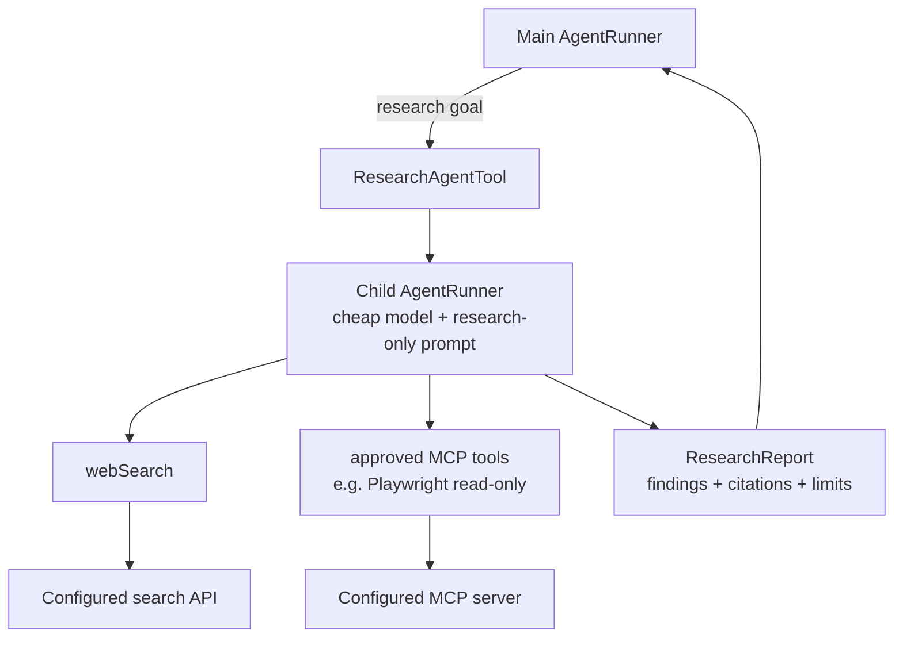

# Research sub-agent and web-search capability — plan

## Purpose

Deliver web research as a bounded **specialist sub-agent**, not as unrestricted browsing for the main agent. The main agent receives one `research` capability; the child researcher uses the internal read-only `webSearch` capability and, when configured, approved MCP tools such as a read-only Playwright profile.

The existing `BashTool` can invoke `curl`, but it is a broad local-command capability and is not the basis of web research.

## Capability hierarchy



The main agent decides what to say or do next. The researcher only investigates and returns evidence. It is not a one-shot agent: it uses the existing multi-turn `AgentRunner` loop so it can search, inspect results, refine a query, and write a final bounded report.

## Placement and proposed components

Low-level search code belongs in `fmgp.yallmo.tool` beside this plan. The child-run orchestration may live in a new `fmgp.yallmo.research` package, because it owns a nested `AgentRunner`, not a simple external integration.

| Component | Responsibility |
| --- | --- |
| `WebSearchClient` | provider-neutral typed search service |
| `WebSearchTool` | internal `AgentTool` wrapping the search client |
| `ResearchAgentProfile` | fixed system prompt, cheap model/client selection, child limits |
| `ResearchAgentTool` | main-agent-visible `research` tool; creates/runs one bounded child agent |
| `ResearchReport` | structured, cited, size-bounded child result returned to the parent |
| `ResearchPolicy` | allowed tools, domain rules, model/budget limits, report limits |

`webSearch` and `mcp.*` adapters are registered in the child runner but are **not** advertised to the main agent. The main agent sees only `research`; `ResearchAgentTool` is selected for its runner and static context through the normal `ReplTools` path.

## Main-agent interface

Suggested model-visible call:

```json
{
  "goal": "Find the current Scala 3 release notes and summarize breaking changes.",
  "maxSources": 5
}
```

The model cannot choose a child system prompt, model, provider endpoint, MCP server, credentials, browser profile, or additional tools. `goal` and the bounded source count are untrusted input validated by `ResearchAgentTool`.

Suggested normalized result:

```json
{
  "status": "completed",
  "answer": "…",
  "findings": ["…"],
  "sources": [
    {"title": "Release notes", "url": "https://…", "publisher": "scala-lang.org"}
  ],
  "limitations": ["No official migration note was found for …"],
  "truncated": false
}
```

The report is evidence, not authority: the parent must treat its text, citations, and quoted pages as untrusted data.

## Internal `webSearch` capability

`WebSearchTool` remains a dedicated read-only primitive rather than a model-facing general browsing tool.

| Feature | Requirement |
| --- | --- |
| Internal key | `webSearch` |
| Input | required `query`; optional bounded `maxResults` and `domains` |
| Provider | one configured API client using existing ZIO HTTP |
| Output | title, URL, snippet, rank, optional publication date, provider, truncation flag |
| Provenance | every result preserves source URL and provider identity |
| Availability | advertised only in eligible research-child contexts when configured/healthy |
| Safety | no model-provided endpoint, headers, credentials, or provider query syntax |

Provider configuration and credentials remain trusted application data. Do not place them in tool definitions, prompts, transcript messages, errors, or debug capture.

## Research-child policy

- Use a fixed research-only system prompt: locate evidence, cite sources, state uncertainty, and do not take external actions beyond advertised read-only tools.
- Use an explicitly configured cheaper/simple model through a child `Agent.turn(AgentTurnRequest)` call; it is not a single audio transcription request.
- Give each request an independent child transcript. Return only the bounded `ResearchReport` to the parent; retain child events/transcript only under explicit debug/audit policy.
- Inherit parent cancellation. Child timeout/cancellation must cancel its search/MCP work and clean up server processes.
- Forbid recursive `research` calls and child-agent spawning.
- Start with 4–6 child turns, 8–12 actions, a short wall-clock limit, and a report/output limit. All limits must be typed configuration, not prompt text.
- Start with no Bash, filesystem writes, repository mutation, browser JavaScript evaluation, authenticated browser state, form fill/click, uploads, downloads, or dialogs.

## Delivery phases

### 1. Research contract and child-run boundary

Define `ResearchAgentTool`, `ResearchReport`, child static context, cancellation propagation, budget partitioning, and report validation. Add scripted-child tests before connecting to the internet.

### 2. Search primitive

Add `WebSearchClient`, typed models/errors, one configured ZIO HTTP provider adapter, and `WebSearchTool`. Unit-test using a fake client and integrate with a local HTTP stub.

### 3. Researcher MVP

Build a child `AgentRunner` using the simple configured model and only `webSearch`. Verify it can perform several turns and return cited findings while the parent receives only the normalized report.

### 4. MCP/Playwright integration

When MCP support is ready, add approved read-only MCP adapters to the **child** static context. Do not change the main agent's capability set.

### 5. Optional page fetch

Consider a separate `fetchWebPage` primitive only if snippets and Playwright snapshots are insufficient. It must be HTTPS-only, revalidate redirects, block loopback/private networks, allow only approved content types, and bound response/text size.

## Tests and acceptance criteria

- A main-agent native function call can invoke `research`; the child performs multiple search turns and returns a cited, bounded report.
- `webSearch` is unavailable to the main agent and is unavailable to the child without healthy trusted configuration.
- Child failure, model invalid output, provider failure, timeout, oversized result, cancellation, and malformed report become bounded parent tool-result errors.
- Search credentials, child provider credentials, and browser/MCP credentials never enter model-visible data, parent transcript, or logs.
- Tests run with no external credentials or internet access.
