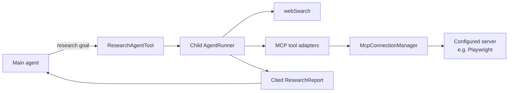
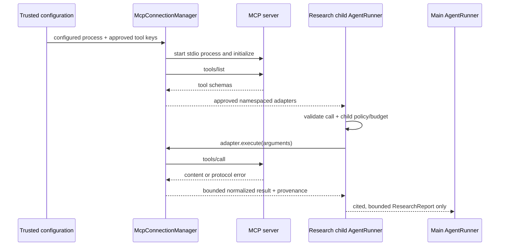

# MCP tool support for the research sub-agent — plan

## Purpose

Add a Model Context Protocol (MCP) **client** so trusted, configured MCP server tools can be adapted to Yallmo `AgentTool`s. The initial consumer is the bounded research sub-agent: MCP tools are internal research capabilities, not automatically available to the main agent.

A Playwright MCP server is one possible profile. It receives no special trust and is not a built-in capability.

## Scope

Implement the MCP tool lifecycle:

1. connect to a trusted configured server;
2. initialize and negotiate supported protocol capabilities;
3. obtain `tools/list`;
4. select approved tools from configuration;
5. convert supported input schemas into Yallmo `JsonSchema`;
6. expose one namespaced adapter per approved tool;
7. validate child-agent arguments and invoke `tools/call`;
8. normalize bounded content/error output into an `ExternalToolResult`.

The first transport is **stdio** to a locally launched, configured server. Add Streamable HTTP only after stdio lifecycle, cancellation, and test coverage are stable.

MVP exclusions: acting as an MCP server, resources, prompts, sampling, roots, elicitation, server-to-client callbacks, arbitrary server discovery, model-provided launch commands/URLs, and legacy transport compatibility by accident.

## Relationship to the research agent

The child receives a static context containing only reviewed tools. Main-agent access to `mcp.*` tools is denied by construction: those adapters are registered/advertised only in the child's runner. The same `AgentRunner` checks still apply inside the child.

## Placement and proposed components

MCP transport/adapter code belongs under `fmgp.yallmo.tool.mcp` beside this plan. It may depend on research policy interfaces but must not depend on a particular model/provider.

| Component | Responsibility |
| --- | --- |
| `McpServerConfig` | trusted server identity, command/args, working directory, environment allowlist, approved tools, limits, risk profile |
| `McpTransport` | bounded JSON-RPC request/response transport, cancellation, close |
| `StdioMcpTransport` | supervises one process; framed stdin/stdout, bounded stderr, startup/shutdown/timeout handling |
| `McpConnectionManager` | initialize, `tools/list`, connection state, retry/backoff, selected adapter creation |
| `McpProtocol` | typed JSON-RPC/MCP messages, IDs, errors, content, schema conversion |
| `McpToolAdapter` | `AgentTool` wrapper for one configured MCP tool; invokes `tools/call` and normalizes output |
| `McpToolPolicy` | per-server/per-tool allowlist, risk class, approval, rate/concurrency, and research-child eligibility |

Use collision-safe namespaced keys such as `mcp.playwright.browser_snapshot`. Duplicate, malformed, unsupported, or unapproved schemas are rejected and reported as unavailable; never silently weaken argument validation.

## Call flow

MCP metadata, tool descriptions, and tool output are remote untrusted data. They cannot change the child prompt, activate a tool, alter policy, or grant a capability.

## Policy and security

### Server configuration

- Server command/URL, arguments, working directory, and environment are static trusted configuration—not main- or child-model input.
- Launch child processes with an environment allowlist; never pass the complete host environment by default.
- Bound startup, request, idle, and shutdown time; capture limited stderr diagnostics; kill/reap processes on cancellation or REPL exit.
- Redact credentials, authorization headers, cookies, screenshots, and private browser data from logs/debug export.

### Tool exposure

- A server tool must be in both `tools/list` and a configured allowlist before an adapter exists.
- Register/advertise adapters only in the research child unless a future explicit policy grants a different agent access.
- Apply child action/time/output budgets plus per-server rate and concurrency limits.
- Normalize process crashes, invalid JSON-RPC, protocol errors, oversized output, and timeouts as bounded child tool errors; do not terminate the parent run.
- Use `ToolApproval` or successor policy for side effects, not a system-prompt warning.

### Playwright profile

| Class | Initial research-child policy |
| --- | --- |
| Navigation, page snapshot, screenshot | allowed only for public/configured browsing; output/retention limits |
| Clicks and form fill | disabled; explicit future opt-in and approval required |
| Dialogs, downloads, uploads | disabled pending data-handling design |
| Browser evaluation / arbitrary code | disabled; never expose by default |
| Authenticated profile/cookies | isolated ephemeral context only by default; separate credential policy |

Snapshots, screenshots, URLs, cookies, and downloads may contain sensitive data. Define retention, redaction, and debug-export behavior before enabling the associated tools.

## Delivery phases

### 1. Contract and fixture

Define configuration, risk classes, protocol models, schema-subset behavior, and a local fixture stdio MCP server. Test the protocol without a real Playwright installation.

### 2. Stdio MVP

Implement transport framing, initialization, `tools/list`, `tools/call`, request IDs, cancellation, clean close, and conversion of selected schemas to Yallmo schemas.

### 3. Research-child integration

Add reviewed MCP adapters to a research child's `StaticContext`, with no main-agent exposure. Exercise them through `ResearchAgentTool` and ensure only the normalized report crosses the parent boundary.

### 4. Reliability and REPL diagnostics

Add reconnect/backoff, connection state, per-server bounds, approval policy, safe debug events, and `/tools` diagnostics for selected/blocked/unavailable research tools.

### 5. Playwright read-only profile and remote transport

Provide a small Playwright read-only allowlist. Separately evaluate Streamable HTTP, authentication, resources/prompts/sampling, and MCP-server mode.

## Definition of done for the MCP MVP

- A configured fixture server exposes one allowlisted harmless tool as a namespaced adapter available only to the research child.
- A child run can use that tool, handle failure/cancellation, and return a bounded cited report to the parent.
- Main-agent `StaticContext` contains `research` but no `mcp.*` adapter by default.
- `sbt test` passes without external credentials, internet access, or a real Playwright installation.
