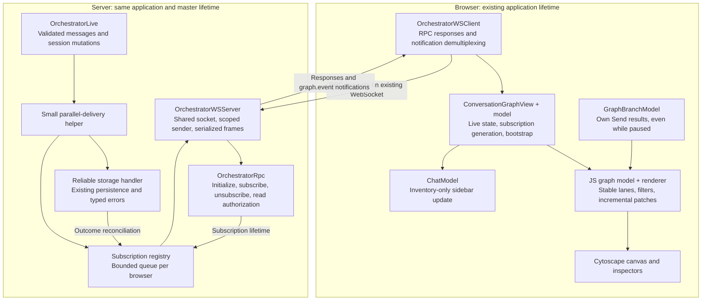
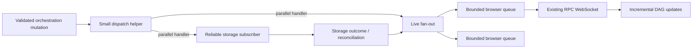
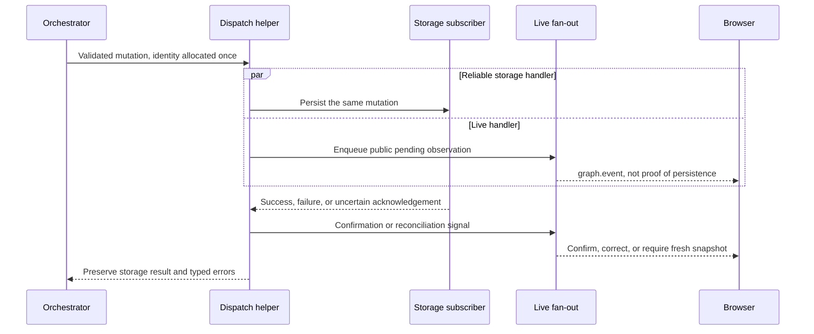
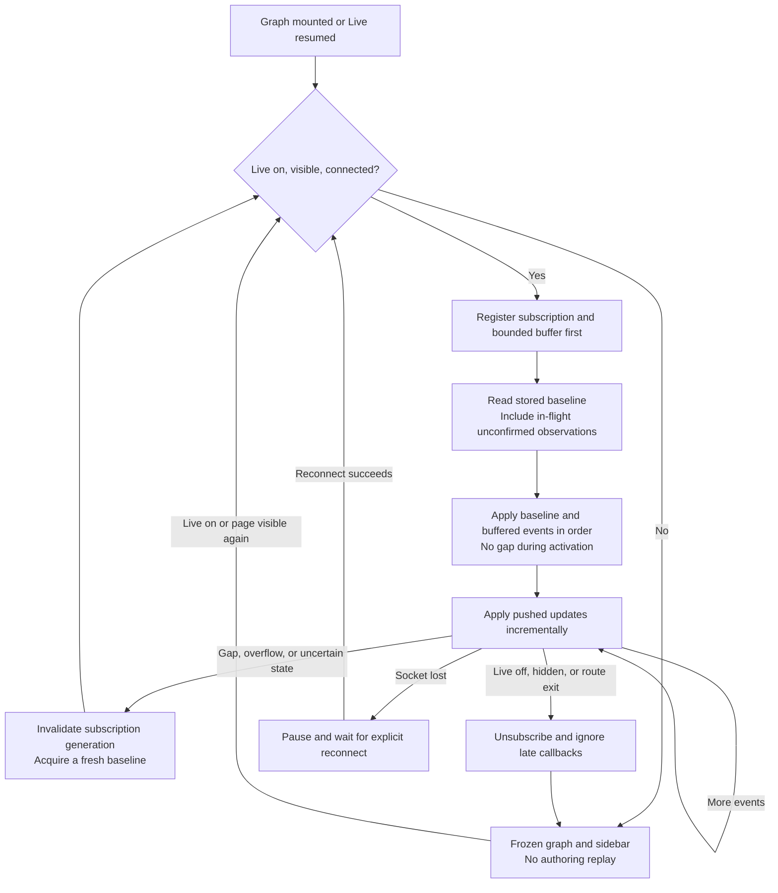
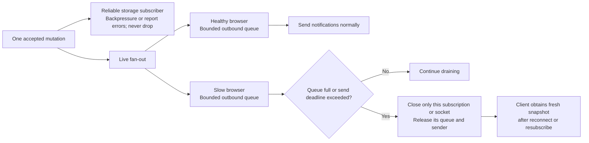

# Handoff plan: push-based Conversation graph updates

**Status: planning only; not implemented by this document.**

## 1. Goal and operator decisions

Replace the graph's two-second snapshot polling with a subscription over the **existing `/rpc` WebSocket**. Push new message/session events and update the existing DAG incrementally.

The operator explicitly chose:

- **Storage is a subscriber/handler, not a prerequisite for live delivery.** Deliver an accepted mutation to storage and live subscribers **in parallel**.
- Keep the code concise. Put the parallel-versus-sequential decision in one small ZIO dispatch helper, not a new framework or configurable strategy hierarchy.
- Add an inline comment at that helper explaining the ordering choice and how to change it to sequential delivery later.
- Browser subscriptions must have bounded buffering. A slow browser may be disconnected and recover from a snapshot. **Storage must not lose events or be evicted using this browser policy.**

Do **not** silently implement storage-first delivery instead. Conversely, do not call a parallel live event proof of successful persistence. The implementation must make that distinction correct internally and in the wire contract, without adding permanent explanatory UI text.

This plan does not request implementation, a new event service, a durable event log, or a migration to event-sourced storage.

## 2. Starting workspace and existing behavior

Read the actual supplied working tree, not just `HEAD`. At planning time `HEAD` was `0773e95`, but most graph work below is **modified or untracked**. A clean checkout of that commit will not contain this feature. Preserve unrelated edits, including the observed `docs/sdlc/` deletions and new `sdlc/` directory; they are not this task.

Current implementation:

- Scala 3.10.0, ZIO 2.1.27, ZIO HTTP 3.11.6, Laminar 17.2.1, Scala.js, Vite and Cytoscape 3.34.4. Inspect `build.sbt` and `web-harness/vite/package.json` before editing.
- One initialized WebSocket belongs to `App`; requests and responses already use JSON-RPC over it.
- `ConversationGraphView` owns a two-second timer and visibility listener. `ConversationGraphModel` reads `messages.list`, `sessions.list`, then every `sessions.get` in batches of four. Session summaries currently omit heads.
- Live defaults on. Off removes the timer, invalidates old read replies and freezes background graph/sidebar changes. Turning on catches up. Hidden/disconnected pages pause. Reconnect is explicit; writes are never replayed.
- Graph reconnect suppresses Chat-owned session-list/history reads. Retained saved Chat histories are marked stale and reloaded on return before Send. Preserve this fix.
- The JS graph model accumulates immutable messages by ID, allocates stable coordinates and reusable lanes, and maintains mutable session pointers below their heads.
- Filters are All / Current / Current + siblings. Current includes **all descendants plus ancestry**; sibling mode also includes the nearest fork's subtree. Global search finds hidden nodes. Filtering never changes storage or composer state.
- Hover previews are passive. Click/search/sidebar selects a persistent inspector; hover must not change the composer parent. Existing mobile inspector recovery happens after explicit search/session viewport navigation.
- Graph and Chat share full-height layout/header/composer styles. The canvas flexes between toolbar and bottom composer. Do not reintroduce the removed title, legend, instruction paragraphs, Refresh button, Pin/Close buttons or node-list disclosure.
- `branches.submit` creates an unnamed branch under the exact selected message, executes the configured managed agent/tool loop, and creates/moves **no session**. Its terminal IDs merge even while Live is off. Captured input, selection revisions, unknown-outcome review gates and independent Chat drafts must remain correct.
- Existing storage/persistence is best-effort in places, not a transactional durability or exactly-once guarantee. Session CAS conflicts and lost write acknowledgements already have careful semantics.

Last independently checked baseline: **85 JavaScript tests, 138 web Scala tests**, production build and mocked desktop/mobile browser checks. Earlier branch/backend regression runs covered 306 core tests, 62 selected server tests and 31 protocol tests on each platform. These are historical results, not permission to skip rerunning affected suites. The production build has a known large-chunk warning. No live external provider acceptance was performed.

## 3. Source map / reading order

All paths below are relative to the repository root.

| Area | Read first / change only as necessary |
|---|---|
| Current graph behavior | `docs/CONVERSATION_GRAPH.md`, `web-harness/README.md` |
| Current wire/security contract | `server/PROTOCOL.md`, `server/README.md` |
| Domain boundary | `model/shared/src/main/scala/fmgp/yallmo/orchestration/Orchestrator.scala`, `AgentExecution.scala`, `Storage.scala` |
| Actual mutation paths | `core/jvm/src/main/scala/fmgp/yallmo/orchestration/OrchestratorLive.scala` |
| Storage invariants | `core/shared/src/main/scala/fmgp/yallmo/orchestration/storage/StorageInMemory.scala`, `StoreageUtils.scala`; `core/jvm/src/main/scala/fmgp/yallmo/orchestration/storage/StorageFS.scala` |
| Process/application ownership | `server/src/main/scala/fmgp/yallmo/server/application/ServerApplication.scala`, `ApplicationRuntime.scala`, `SessionSubmission.scala` |
| Protocol DTOs/envelopes | `protocol/shared/src/main/scala/fmgp/yallmo/server/protocol/YallmoProtocol.scala`; `protocol/shared/src/main/scala/fmgp/yallmo/server/jsonrpc/JsonRpc.scala` |
| RPC dispatch and connection lifecycle | `server/src/main/scala/fmgp/yallmo/server/OrchestratorRpc.scala` |
| WebSocket output/lifetime | `server/src/main/scala/fmgp/yallmo/server/OrchestratorWSServer.scala`, `RpcWire.scala`, `WebSocketText.scala` |
| JVM client | `server/src/main/scala/fmgp/yallmo/server/OrchestratorWSClient.scala`, `OrchestratorClient.scala`, `OrchestratorWSClientTransport.scala` |
| Browser transport | `web-harness/src/main/scala/fmgp/yallmo/view/web/OrchestratorWSClient.scala` |
| Frontend ownership | `web-harness/src/main/scala/fmgp/yallmo/view/web/App.scala`, `ConversationGraphView.scala`, `ConversationGraphModel.scala`, `ChatModel.scala`, `ChatView.scala` |
| Branch composer | Same web package: `GraphBranchModel.scala`, `GraphBranchView.scala` |
| Incremental rendering/filtering | `web-harness/vite/conversation-graph.js`, `conversation-graph-model.js`, `conversation-graph-search.js`, `conversation-graph-inspector.js`, `conversation-graph-bootstrap.js`, `style.css` |

Important traps:

1. Both current WebSocket clients reject any server envelope containing `method`. Push notifications will currently terminate the connection. Add strict notification demultiplexing; do not weaken response validation.
2. `JsonRpc.Notification` already exists. `initialize.notifications` is currently empty. Advertise only notifications actually implemented.
3. `OrchestratorWSServer` already serializes frame writes through a semaphore and has bounded request-worker admission. Notifications must share safe egress, without consuming one long-lived RPC request worker or blocking ordinary replies/control traffic behind a slow stream.
4. A separate typed streaming RPC PoC exists in `rpc/README-RPC.md`. It is independent of the application protocol and currently has **no JS WebSocket transport**. Do not replatform the application just to reuse it.
5. Hooking only `persistMessage` misses prompt/session paths. Audit `submit`, `submitBranch`, `managedSubmit`, `appendToLatestSession`, `invoke`, managed/standalone rebase, `createSession`, participant updates, `fork`, and acknowledgement-failure recovery. Some use `putMessagesAndUpdateSession`; others use `compareAndSetSessionHead` or `putMessage`.
6. Direct external-process filesystem writes do not automatically pass through an in-process event dispatcher. Cross-process watching is outside this change; document that limitation rather than claiming universal coverage.

## 4. Small architecture

The following diagrams describe the **planned push implementation**, not the current polling behavior. Solid arrows are calls/data delivery; no arrow implies a durable transaction.

### Components and ownership



The branch-response arrow is intentionally separate: pausing Live must not suppress the result of an explicit Send.

### Event flow



“Subscriber” need not mean detached fire-and-forget consumption. The simplest first implementation can be two typed handler effects invoked by a single helper. Storage completion/errors still belong to the calling orchestration operation. Browser delivery means bounded enqueue, not waiting for every browser to render.

Illustrative policy location, **not drop-in production code**:

```scala
// Intentionally parallel: live events may arrive before storage succeeds.
// Replace zipPar with zip here to sequence storage before live delivery.
storageSubscriber(event).zipPar(liveSubscribers(event))
```

Preserve the storage result and typed errors; do not turn a failed put into success with `.ignore`. Storage outcome reconciliation must run on success/failure/interruption as appropriate. Consider `Exit`/finalizers deliberately: `zipPar` is fail-fast, and changing an `.exit`-wrapped variant to `zip` does not by itself mean “notify only after successful storage.” Test the chosen helper's exact behavior.

Keep message allocation/validation before dispatch: IDs, timestamps, author and parent are assigned once, and both handlers see the same immutable identity. Preserve parent-before-child storage order and existing writer-drain behavior. Do not run tools again to repair a delivery failure.

A small ordered mutation boundary or per-session ordering gate is acceptable if needed. It must cover only the mutation/dispatch, never an entire agent turn or WebSocket lifetime. Parallel subscriber delivery does not require concurrently writing a child before its parent or racing session outcomes out of order.

### Parallel delivery sequence



Storage can finish before the pending notification reaches a browser. The implementation must ensure a late pending duplicate cannot undo a confirmation; this sequence illustrates responsibilities, not a guaranteed network arrival order. Subscriber handlers run in parallel even though the outcome is necessarily known later.

## 5. Event meaning: parallel is intentionally optimistic

Use names such as `message.upsert` or `message.observed`, **not `message.stored` for the pre-ack event**.

Minimum useful information:

- Public message snapshot, immutable message ID, an operation identity, and whether persistence is pending or confirmed.
- Canonical session metadata/head, including counts/participants needed by the sidebar; a session revision/order marker.
- Storage outcome / resnapshot-required notification when an earlier optimistic observation cannot be confirmed.
- Subscription identity and stream sequence/order information.

Reuse `MessageSnapshot.from`: private provider continuation payloads, credentials, raw causes and server paths must not reach the wire. Internal storage subscribers can receive richer domain data; the browser receives only its authorized public projection.

### Required correctness choices

- **Session CAS intent is not a published head.** It may be delivered in parallel as an intent, but must not be presented as a successful canonical pointer change. The smallest recommendation is to update the graph's published session pointer from the resulting canonical session outcome. If optimistic pointer movement is implemented instead, it needs explicit pending state and correction on conflict/failure.
- Storage confirmation must not be lost if storage finishes before the parallel live handler. Order pending/terminal events consistently, or make terminal state dominate a late pending duplicate for the same operation.
- A failed acknowledgement can mean **unknown**, not definitely absent. Do not promise rollback, delete real stored messages, or replay authoring requests.
- The current JS model retains every message it has seen. A plain snapshot reload therefore **does not remove an optimistic ghost**. Track unconfirmed live observations separately from confirmed inventory, or implement an equally explicit reconciliation path. A small overlay map is sufficient; a durable journal is not required. Remove/reconcile only unconfirmed observations; never delete storage or discard unrelated stored branches.
- Keep versions/order for mutable session state. Message-ID deduplication alone cannot prevent a late pointer update from moving B back to stale A. Include concurrent CAS and A → B → A cases in tests.
- Cover actual successful state changes recovered after a lost storage acknowledgement, not merely the happy `.tap` branch.

The exact event DTO names are implementation choices; these semantics are not optional. Do not invent a session-removal API solely for this feature. Add removal events only for an actually supported mutation path.

## 6. Subscribe, initial state and reconnect

Suggested additive protocol surface:

- `graph.subscribe` — starts a connection-owned subscription and returns initial state plus subscription/stream metadata.
- `graph.unsubscribe` — idempotently closes that subscription, not the shared socket.
- `graph.event` — JSON-RPC notification, no request ID, carrying typed message/session/outcome events.
- A resnapshot path, either an explicitly named read or re-subscribing. Reuse existing snapshot projections where practical.

A process-local subscription ID/counter and a **bounded initialization buffer** are enough initially. No persistent cursor store or historical replay service is requested. Server restart changes stream identity; reconnect/resume obtains a new snapshot.

Required handshake behavior:

1. Register the subscriber/buffer **before** reading initial state.
2. Capture the start watermark, obtain canonical inventory/session state, then apply buffered events in order and continue live delivery. Prevent a gap while switching from buffer to normal streaming.
3. Deal explicitly with notifications arriving before the subscribe response. A client-generated subscription nonce echoed on notifications, or server-side buffering until activation, are small options. Do not assume frame ordering between independent response and notification fibers.
4. Existing inventory/session reads are non-atomic. Do not discard all buffered events through an end watermark on the false assumption the snapshot represents that exact instant.
5. **Parallel-storage race:** an event emitted just before subscription may still be absent from storage during initial reads. Include currently unconfirmed/in-flight observations in the bootstrap, or use a tested equivalent barrier/reconciliation scheme. Register-before-read alone does not cover this case. Bound any retained in-flight state and clear it on confirmed outcomes; it is not an indefinite event log.
6. Duplicate immutable upserts must be harmless. Old connection/subscription generations, stale snapshots and stale mutable revisions must not overwrite current state.
7. On buffer overflow, sequence gap, restart or uncertain reconciliation: invalidate the feed and reload a fresh baseline. Never silently continue from a known gap.

No automatic replay of `turn.submit`, `branches.submit`, `agents.invoke` or tools. Existing explicit reconnect behavior may be retained. Do not introduce automatic reconnect without a separately documented, tested decision.

### Subscription and Live lifecycle



These are read/subscription recovery paths only. They never retry Send, tools, or agent execution. Buffer overflow during initialization also follows the resync path rather than returning an incomplete baseline.

## 7. Backpressure and ownership

For each browser subscription, use bounded buffering with an explicit overflow path. Choose named, tested constants for event count and payload/byte limits; 256 events was an illustration, not an approved capacity requirement. Respect existing `RpcWire.MaxMessageBytes` and UTF-8/frame validation. Oversized events must cause an explicit failure/resync/close, not silent omission.

- If a browser cannot drain its outbound buffer, terminate **that subscription or socket** with an actionable, sanitized reason (existing 1013 overload handling is a useful precedent).
- Stop its sender and release queue/listeners on unsubscribe, disconnect, scope close and failed initialization.
- Do not block storage, agent execution or other subscribers on its network speed.
- A globally backpressured `Hub.bounded` can let the slowest browser stall everyone. A sliding/dropping hub can silently lose events. Do not choose either without implementing the required per-subscriber overflow detection and resync/disconnect behavior.
- Storage remains reliable: never drop its events or evict it as a slow browser. Reuse current ordered writers or a bounded, backpressured handler with acknowledgement. Surface errors through existing typed persistence/acceptance semantics.
- Fan-out must not create an unbounded number of send fibers/tasks. Reuse one scoped sender per connection/subscription and the existing frame-write synchronization. Do not claim a server queue measures actual browser rendering speed unless application acknowledgements exist.

Bind the dispatcher/subscription registry to the same application/master lifetime as storage, not to each RPC invocation. Two application instances must not share events. Read-only initialized viewers may subscribe under the same trusted-host policy as inventory reads; subscriptions grant no authoring rights. Unsubscribed/legacy clients must not receive unsolicited notifications.

### Slow browser isolation



A slow browser must not hold up the storage handler or another browser. Closing the subscription is not cancellation of the agent work, and recovery is not replay of that work.

## 8. Frontend changes

1. Add strict response-versus-notification demultiplexing to the browser client. Keep pending request IDs/timeouts separate from subscription callbacks; reject malformed envelopes, duplicate keys and wrong generations as before.
2. Extend the JVM client only as needed for compatibility/subscription support. It also currently rejects `method` envelopes. Clients that never subscribe should keep working unchanged.
3. Replace the graph polling timer with the connection-owned subscription. Remove dead timer/snapshot-poll plumbing rather than leaving two simultaneous live mechanisms.
4. Live on / visible / connected / mounted: bootstrap and subscribe. Live off, page hidden or route unmount: invalidate callbacks, unsubscribe, and freeze graph/sidebar background state. Resume gets a fresh baseline before applying subsequent events. Do not reconnect merely because Live was toggled.
5. Reconcile public message IDs into `conversation-graph-model.js`; reuse `patchGraph`, stable positions/routes, `applyGraphVisibility` and session-marker movement. Do not recreate Cytoscape, fit on every event, or recompute coordinates for existing messages. Small event batching per render frame is fine; avoid a generic scheduler.
6. Upsert session metadata/head directly into the graph and call the existing inventory-only sidebar update. Avoid repeated full `sessions.get` calls for every event and avoid Chat transcript reloads. Keep session replacement snapshots distinct from incremental upserts so one event does not erase other sessions.
7. Preserve composer draft, explicit parent, selection revisions, chosen branch filter, global search, hover/persistent inspector behavior and full-height shared Chat layout. A background event must not adopt a branch head as the Send parent.
8. Own `branches.submit` responses still merge while Live is off. Deduplicate against earlier pushed observations. Do not clear unknown-outcome review gates because an event arrived. Sessionless branching must remain sessionless.
9. Keep paused reconnect behavior: no hidden Chat inventory/history refresh bypass. Returning to Chat must still reload a marked-stale saved history before Send.

## 9. Implementation sequence

Use small testable changes, not an all-at-once protocol rewrite:

1. **Define contracts and invariants.** Add minimal domain delivery/event DTOs and protocol subscribe/notification shapes. Write codec tests and pending-versus-confirmed/CAS semantics tests first.
2. **Add the small parallel dispatcher.** Centralize the `zipPar` policy and required inline comment. Wire every relevant mutation path without double storage writes. Prove parallel starts and reliable storage error/drain behavior with promises/fake storage.
3. **Add scoped fan-out and bootstrap.** Implement bounded browser queues, initialization buffering, pending-observation bootstrap, sequencing, failure reconciliation and unsubscribe. Test deterministic races without sleeps.
4. **Add transport demultiplexing and server sender.** Extend capability advertisement, authorization and both clients as required. Verify normal responses and notifications can interleave on one socket during long execution.
5. **Switch the graph to events.** Reuse rendering/state, replace polling, preserve Live/visibility/reconnect/pause behavior and sidebar safety. Do not expand UI scope.
6. **Review and iterate.** Run the acceptance matrix below, fix findings, then update `docs/CONVERSATION_GRAPH.md`, `web-harness/README.md`, `server/PROTOCOL.md` and `server/README.md` to describe implemented behavior. Keep this plan's status honest.

If delegated, maintain one writer per cwd/worktree. This checkout is dirty, so do not create a supposedly equivalent clean worktree without first preserving all required changes. Use read-only independent review for concurrency/persistence semantics.

## 10. Required acceptance tests

### Domain/storage

- Promise-coordinated test shows storage and live handlers start in parallel; live can arrive before storage completes.
- Same immutable ID/parent/time goes to both handlers; switching the helper to sequential delivery is a local change, not a second pipeline.
- Storage failure/unknown acknowledgement is observable; no false durable success, silent loss, duplicate prompt or tool replay.
- Parent-before-child storage, prompt-before-execution, managed writer drain, stale appends, managed/standalone rebase and actual execution audit remain correct.
- No missing events for normal append/submit, sessionless branch, standalone invoke, copied artifacts, session creation/fork, participant change, CAS movement and acknowledged-state recovery.
- Branch events create/update **zero session pointers**. Conflicting session proposals do not become false published heads. Late/duplicate outcomes and A → B → A do not regress mutable state.
- Storage-backed success/terminal IDs and redacted public projections retain existing guarantees on memory and filesystem/reopen.

### Subscription/transport

- Multiple subscribers see changes without additional polling; non-subscribers receive none.
- Initial subscription races: before registration, during snapshot reads, between snapshot and activation, notification-before-response, and pre-subscribe pending storage absent from the canonical snapshot.
- Duplicate events, snapshot/event overlap, reordered outcomes, stale connection/subscription IDs, event gaps, initialization overflow and server restart recover predictably.
- One slow subscriber fills its bounded queue and is closed/resynced; a healthy subscriber/storage continue. Test cleanup and bounded memory/fibers.
- Scope shutdown, unsubscribe during initialization, repeated subscribe/unsubscribe and disconnect during a long branch do not hang or cancel unrelated owned execution.
- Viewer/Operator capability checks, redaction, strict envelopes, UTF-8 fragmentation, notification size limits and interleaved response IDs remain correct. Existing JVM/REPL clients still work.

### Graph/browser

- New prompt/tool/reply nodes and session heads/sidebar counts update from push **without a two-second timer or recurring inventory reads**.
- Existing node identity/coordinates, pan/zoom, All/Current/siblings preferences, descendants, search input and composer draft/parent remain stable.
- Live off ignores already buffered/in-flight old-generation events and freezes graph/sidebar across reconnect. Live on resnapshots and catches up. Own explicit branch results still appear while paused and are deduplicated later.
- Unknown/failed optimistic message is reconciled without deleting storage or unrelated confirmed branches; no permanent ghost caused by the accumulating JS map.
- Desktop hover remains passive; click persists; mobile search/sidebar cards stay within viewport. Bottom composer and independently scrollable Chat remain correct on narrow/short viewports.
- No removed documentation/status text, title or Refresh/Pin/Close controls return.
- Synthetic browser/agent fixtures only unless the operator separately authorizes real provider calls.

## 11. Validation commands and handoff evidence

Run from the repository root; inspect task names locally if the build changes. Pi `bash.timeout` is in **seconds**, normally 120, not 120000. Inspect logs in bounded chunks. Load the Scala, ZIO and Laminar skills before implementing their respective changes. The compiler uses `-Wunused:all -Werror`.

```sh
npm --prefix web-harness/vite test
sbt 'webHarness/testOnly *'
sbt 'protocol/testOnly *YallmoProtocolSuite'
sbt 'protocolJS/testOnly *YallmoProtocolSuite'
sbt 'core/testOnly *OrchestratorBranchSuite *OrchestratorSubmitSuite *ManagedHistory*Suite *OrchestratorRebase*Suite'
sbt 'server/testOnly *ServerSubmissionSuite *SessionSubmissionSuite *OrchestratorRpcSuite *OrchestratorWSClientTransportSuite *OrchestratorWebSocketSuite'
# Also run every newly added event/subscription suite on its relevant platform.
sbt 'webHarness/fastLinkJS'
sbt 'webHarness/fullLinkJS'
npm --prefix web-harness/vite run build
git diff --check
```

Use separate sbt invocations where needed by the local thin client; `testOnly *` avoids an incremental `testQuick` run reporting zero tests. After Scala validation, run scalafmt on **explicit changed paths** (wildcard file paths have failed here), and avoid unrelated formatter churn. The Vite production alias imports `web-harness/target/scalajs-prod/main.js`; dev uses `scalajs-dev`.

Temporary browser scripts may still exist under `/tmp/` (`yallmo-shared-layout-parent.cjs`, `yallmo-parent-descendants.cjs`, `yallmo-parent-final-interactions.cjs`). They are examples, not portable repository tests, and some assert polling-specific behavior. Adapt fixtures to the new event protocol and commit appropriate focused regression tests; do not report old scripts as push verification without changing their assertions.

Final implementation handoff must list: changed paths, actual event/ordering/acceptance semantics, buffer bounds and slow-consumer policy, bootstrap/reconnect algorithm, exact passing/blocked checks, remaining limitations and whether any real provider call occurred. Do not claim push is implemented merely because WebSocket polling still passes.

## Copyable task for the next agent

> Implement `docs/CONVERSATION_GRAPH_PUSH_PLAN.md` against the current dirty working tree. Preserve the existing graph/composer/session semantics and unrelated edits. Storage and live delivery must be parallel subscribers/handlers through one concise ZIO helper with the requested inline ordering comment; do not replace that decision with storage-first delivery. Make pending/confirmed state, session CAS outcomes, bootstrap races and slow-client recovery correct without a durable event journal or generic framework. Replace polling with subscription-driven incremental graph/sidebar updates. Add deterministic concurrency, protocol, lifecycle and browser tests; review and fix findings before declaring completion. Do not commit, run external providers, or change unrelated files without authorization.
