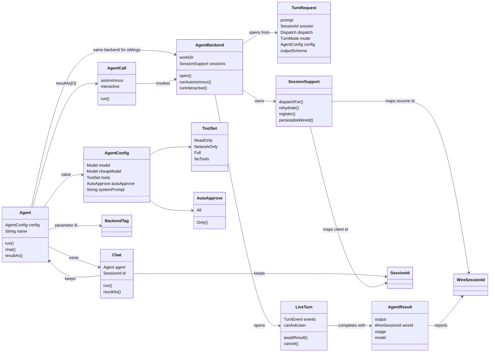
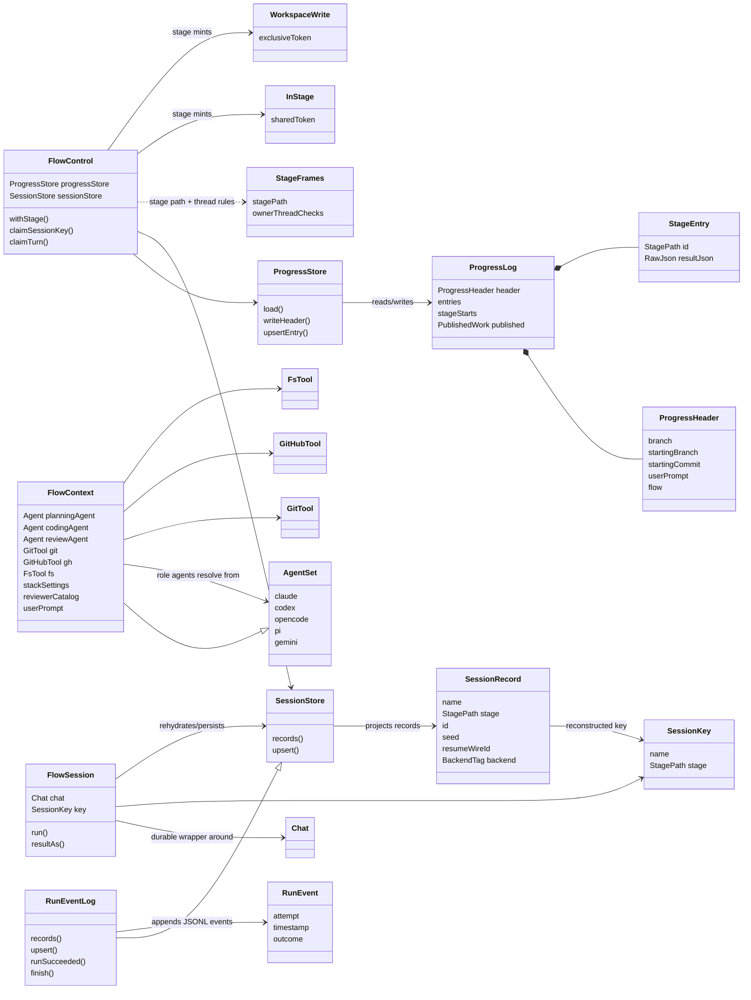
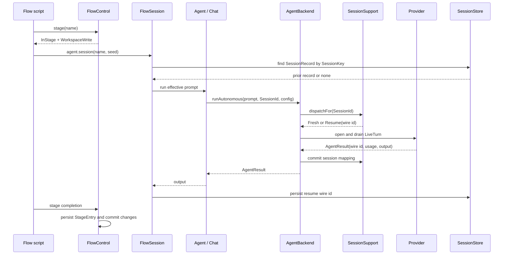

# Orca main models

This describes the external Orca project, not Yallmo's implemented models. Source/ADR paths below are relative to an
Orca checkout. It is a source-based map of Orca's two core modules, not a replacement for its ADRs. It focuses on the public or load-bearing models in `tools` and `flow`;
backend wire DTOs and renderer-specific models are intentionally omitted.

**Type parameters:** `B` is a `BackendTag` (Claude, Codex, OpenCode, Pi, or
Gemini). It prevents a session or result from one backend being used with
another. `O` is the `JsonData`-backed structured output type requested from an
agent.

## 1. Tools: agent, turn, and conversation models

`Agent` is an immutable, configured handle. Calls such as `withReadOnly`,
`withModel`, and `cheap` create sibling agents that retain the same
`AgentBackend`, so they share session bookkeeping and the lifecycle close
latch. `LiveTurn` is deliberately one in-flight turn, **not** a conversation;
`SessionSupport` determines whether its `SessionId` starts fresh or resumes a
backend conversation.

## 2. Flow: ambient context, stage authority, and durable state

`FlowContext` is broadly shareable runtime access. `FlowControl` is separate
and exclusive: it is the authority to begin a stage. Starting a stage supplies
both narrower tokens: `InStage` gates agent calls and may cross a review fork;
`WorkspaceWrite` gates workspace mutations and cannot cross one. The
`ProgressLog` is committed branch state. `RunEventLog` is the machine-local,
append-only JSONL cache; as a `SessionStore`, it projects `SessionRecord`s from
that log because backend session handles are machine-local.

## 3. How a durable agent call crosses the two modules

A `FlowSession` is the durable bridge: it uses an ordinary `Chat` for the
actual in-process conversation, but adds seed/preamble handling and persists
the resume wire id after each successful turn. In contrast, `agent.chat()` is
only an in-attempt `Chat`; it is suitable for parallel review fan-out but is
not resumable.

## 4. Review models

```mermaid
flowchart LR
    Catalog[ReviewerCatalog] --> Definition[Reviewer<br/>name, description, prompt, file pattern]
    Base[reviewAgent: Agent] --> Build[buildReviewers]
    Definition --> Build
    Build --> ReviewerAgent[ReviewerAgent<br/>definition + read-only Agent]
    ReviewerAgent --> Selector[ReviewerSelector]
    Selector --> Selected[Selected reviewers]
    Selected --> Fanout[reviewOnce / parallel review turns]
    Fanout --> Result[ReviewResult]
    Result --> Findings[List ReviewFinding]
    Findings --> Report[ReviewReport<br/>findings by reviewer]
    Report --> Loop[reviewAndFixLoop]
    Loop --> Fixer[FlowSession / coding agent]
    Fixer --> Loop
    Loop --> Open[OpenFindings]

    classDef readonly fill:#e6f0ff,stroke:#2f64a3,color:#222;
    class ReviewerAgent readonly;
    classDef state fill:#e6ffed,stroke:#167c3a,color:#222;
    class Open state;
```

`Reviewer` is a definition, while `ReviewerAgent` is the operational pairing of
that definition with a specifically named, prompted, read-only `Agent`. Review
turns produce `ReviewFinding` values; the loop aggregates them into
`OpenFindings`, asks a fixer to address them, then repeats up to its configured
limit.

## Source map

| Concern | Primary source files |
| --- | --- |
| Agent and ephemeral conversations | `tools/src/main/scala/orca/agents/{Agent,AgentCall,Chat,AgentConfig}.scala` |
| Backend turn/session SPI | `tools/src/main/scala/orca/backend/{AgentBackend,TurnRequest,LiveTurn,SessionSupport}.scala` |
| Flow capabilities and sessions | `flow/src/main/scala/orca/{FlowContext,FlowControl,Session,StageFrames}.scala` |
| Progress and run state | `flow/src/main/scala/orca/progress/ProgressLog.scala`, `flow/src/main/scala/orca/sessions/SessionRecord.scala` |
| Review domain | `flow/src/main/scala/orca/review/{ReviewLoop,Reviewers,ReviewFinding,ReviewReport}.scala` |

For lifecycle invariants and design rationale, read `adr/0018-stage-bound-flow-runtime.md` in the Orca checkout.
For its earlier architectural overview, see `adr/README.md` there; these ADRs are not part of Yallmo's documentation.
