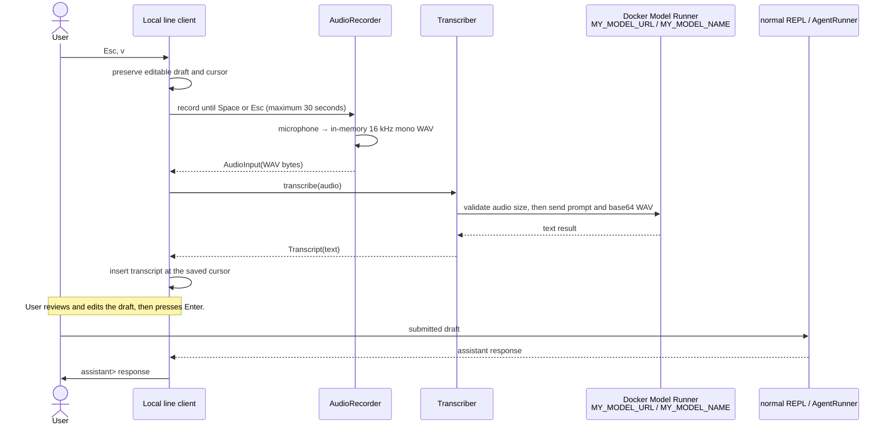

# Interactive RELP

> The source package is `fmgp.yallmo.repl`. This file is named `RELP.md` to retain the project’s historical spelling.

The interactive client preserves one in-memory `RunContext` across submitted prompts while keeping its
`StaticContext` fixed for the session. It is a composition layer over `ReplApplication`, `ReplSession`, and
`AgentRunner`; it does not create a second agent execution path.

## Start the line client

Create a gitignored `.env` file with the Docker Model Runner endpoint and model. For the local
[`gdict`](../../sandbox/gemma-dictation/gdict)-compatible audio endpoint, use the engine API prefix—not the final
`/chat/completions` route:

```dotenv
MY_MODEL_URL=http://localhost:12434/engines/llama.cpp/v1
MY_MODEL_NAME=ai/gemma4:E4B
```

```bash
# Keep sbt attached to this terminal so JLine can use its TTY.
sbt --server -no-server "run --ui=line"

sbt --server -no-server "repl/run --ui=auto --storage ./zzz"
```

`--ui=auto` selects the JLine line editor only when an interactive terminal is available. It otherwise selects plain
I/O. Use `--ui=plain` for pipes and simple streams; `--ui=line` fails rather than degrading on a dumb terminal.
`--ui=tui` is reserved for the future full-screen UI.

## Commands

| Command | Meaning |
| --- | --- |
| `/help` | Show commands. |
| `/history` | Render the current agent transcript. |
| `/tools` | Show the startup availability snapshot for agent tools. |
| `/debug print` | Print the current transcript as Pi-style JSONL. |
| `/debug export` | Replace `~/.yallmo/yallmo-debug.log` with the current snapshot. |
| `/debug request` | Print the latest raw request payload sent by the current session to the LLM provider. |
| `/log <trace\|debug\|info\|warning\|error\|fatal\|off>` | Set the minimum application log level for subsequent REPL turns. The default is `error`; use `off` to suppress them. |
| `/new [name]` | Start a fresh session. With `--storage`, persist it immediately; provide `name` to choose its ID. |
| `/session list` | List sessions held by the configured storage; the active session is marked with `*`. |
| `/session resume <id>` | Restore a stored session by ID. Use `--storage <directory>` to retain it across REPL processes. |
| `/exit` | Exit the client. |

A REPL starts with no selected session. Without `--storage`, sessions use process-local in-memory storage. `/new`
creates an empty session named `main-YYYYMMDD-HHMMSS` (UTC), or `/new <name>` creates the requested safe name. If a
prompt is submitted before `/new`, the REPL creates the same timestamped session automatically. Session IDs are shown
by `/session list`; use `/session resume <id>` to restore one.

Press Ctrl+C twice consecutively in line mode to exit. Prefix a prompt with `//` to send a literal prompt beginning
with `/`. Provider request captures are written under `debug/` relative to the REPL's startup directory and can contain
prompt and tool-result content; `/debug request` displays only the most recent capture from the current session. Captures
are not automatically cleaned up. Use `/debug request` only in an appropriate local terminal. Provider continuations are
redacted before capture.

## Voice input lifecycle

Voice input is a local input feature, not an agent tool. It is not advertised in `StaticContext`, cannot be requested by
the model, and does not appear in `/tools`.

### Editable voice insertion

In the local `--ui=line` client, the prompt uses JLine's Vi editing maps. While editing a draft, press `Esc`, then
`v` to enter local recording mode. Speak, press `Space` to stop, or `Esc` to cancel. The client transcribes the audio
and inserts the text at the original cursor position; it does **not** submit the draft. Press `Enter` only after making
any desired edits. A 30-second capture limit remains in effect. On capable terminals, a persistent bottom status bar
shows `[INSERT]`, `[COMMAND]`, `[RECORDING]`, or `[TRANSCRIBING]` together with the relevant keys; it is hidden when
the terminal cannot support a JLine status bar.

`Esc` first switches from normal text insertion to JLine's Vi command map. `v` is a terminal-client keybinding, not a
REPL command, so no `ReplApplication` state or agent transcript changes until the draft is later submitted. In command
mode, `q` submits the typed `/exit` command and closes the REPL.



### Initialization

At REPL startup, `ReplMain` builds these components:

1. `OAILlmProvider` for ordinary LLM generation, loading `OAIConfig` from `MY_MODEL_URL` and
   `MY_MODEL_NAME`.
2. `OAIAgent`, which uses that provider for native conversation turns and stateless audio transcription.
3. `AudioRecorder`, a local Java Sound implementation. It does **not** open the microphone at startup.
4. `Transcriber`, which owns the transcription-only system prompt and makes one audio-only request per call.
5. `LineTerminalRepl`, which invokes `AudioRecorder` and `Transcriber` for the editable `Esc v` keybinding.

The microphone is opened only by `AudioRecorder.record` or `AudioRecorder.recordUntil`. The recorder prefers 16 kHz,
16-bit mono PCM, but can capture common 24/44.1/48 kHz mono or stereo device formats and converts them to 16 kHz mono
before encoding the WAV entirely in memory. `Transcriber` submits that audio in a single tool-free, history-free model
request. The resulting transcript is written into the existing local JLine buffer.

### Preconditions

A voice request proceeds only when all of the following hold:

| Boundary | Required condition | Failure behavior |
| --- | --- | --- |
| Client | It runs in the local interactive `--ui=line` client. Plain/piped mode has no voice binding. | No recording or agent turn. |
| Invocation | Editable voice is started with `Esc v`. | The draft is unchanged. |
| Local audio | The JVM has microphone permission and Java Sound supports a convertible 16/24/44.1/48 kHz mono or stereo `TargetDataLine`. | `Voice input failed`; state or draft remains unchanged. |
| Payload | The recorded WAV is non-empty and at most 1 MiB. A maximum 30-second capture is approximately 960 KiB plus header. | `OAIAgent` rejects it before HTTP. |
| Model Runner | `MY_MODEL_URL` is reachable, `MY_MODEL_NAME` identifies an audio-capable model, and it accepts the `input_audio`/WAV chat-completions dialect used by `gdict`. | A bounded HTTP/protocol error is displayed; no text is submitted. |
| Response | `OAIAgent` receives non-blank `choices[0].message.content`. | A protocol error is displayed; no text is submitted. |

`OPENAI_API_KEY`, `ffmpeg`, and a recording file are not required by Yallmo’s implementation. The independent
`gdict` script uses `ffmpeg` for its macOS capture path; Yallmo uses Java Sound instead.

### Privacy and SSH boundary

The raw WAV and base64 representation exist only in memory for the audio transcription request. They are not written to disk, placed
in REPL history, or emitted through the provider payload debug facility. The returned transcript is normal untrusted
user input. Editable voice text remains only in the local draft until the user explicitly submits it.

Microphone access belongs to the machine running the REPL process. If `yallmo` is launched on a remote SSH host,
`Esc v` attempts to use that remote host’s microphone—not the local SSH client’s microphone. Local capture with a
remote Model Runner needs a future client/server transport boundary.

## Agent tools

At startup, the REPL selects from `readFile`, `listFiles`, `bash`, and `repositoryChanges` in `fmgp.yallmo.tool`.
A selected tool is placed in both the runner and the agent's static context only when its requirement passes:

- filesystem tools require an accessible workspace directory;
- `bash` requires Bash on `PATH`;
- `repositoryChanges` additionally requires Git on `PATH` and a Git work tree.

`repositoryChanges` is read-only and supports `status`, `unstaged` (`git diff`), and `staged` (`git diff --staged`).
File paths are relative to the REPL startup directory; `../` traversal is intentionally supported. `bash` has the
process’s permissions, a 30-second default timeout, and a 64 KiB returned-output limit; run it only in an appropriate
workspace.

## Troubleshooting

If sbt reports `FileSystemException` for a `target/.../zinc/inc_compile_3.zip` file, remove the stale generated cache
and retry:

```bash
rm -rf target
sbt run
```
