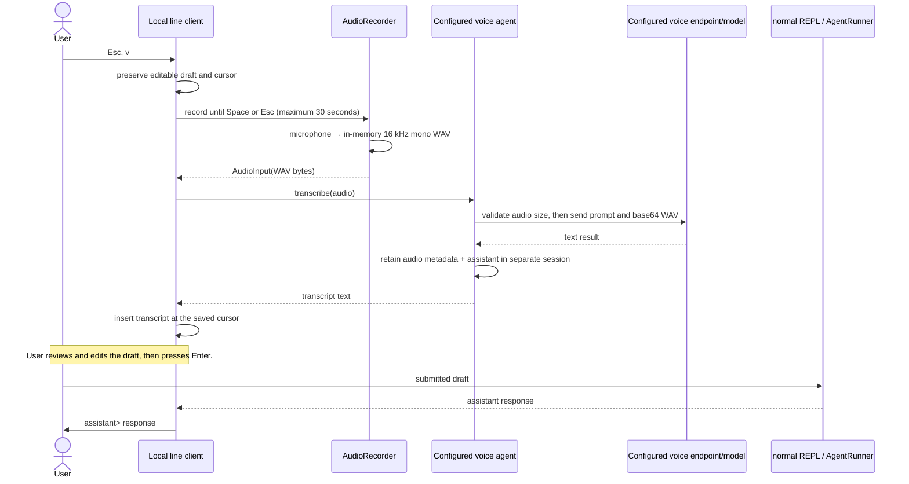

# Interactive REPL

> The source package is `fmgp.yallmo.repl`. This file is named `REPL.md` to retain the project’s historical spelling.

The interactive client preserves one in-memory `RunContext` across submitted prompts while keeping its
`StaticContext` fixed for the session. It is a composition layer over `ReplApplication`, `ReplSession`, and
`AgentRunner`; it does not create a second agent execution path.

## Start the terminal client

`--config <file>` is required. Missing files are initialized privately with the JVM user name, empty catalogs and no
selected agent. See [setup](HOW_TO_RUN.md) and the sanitized [example](examples/repl-config.json).

```bash
# Keep sbt attached to this terminal so JLine can use its TTY.
sbt --server -no-server "repl/run --config ./yallmo.json"
sbt --server -no-server "repl/run --config ./yallmo.json --agent bob --storage ./zzz"
```

`--agent` overrides `defaultAgentId`; absent both, startup stays unselected and prompts are rejected without an agent
or tool call. Commands remain available. Press `Esc`, `a` to choose an agent from the loaded configuration.
The old `--provider`/`--model` flags are removed. Models, prompts and
optional thinking settings belong in each agent's `config` object. `userName` supplies the human message-author ID.

The REPL always uses the JLine client, with editable input, history, completion, menus, status and voice support.
An interactive terminal is required; dumb terminals and redirected streams fail without fallback. There is no
`--ui` option or alternate terminal implementation.

## ChatGPT subscription generation

Configure a `ChatGPTAgent` referencing a named `ChatGPT` provider profile and select its agent ID. A logged-out profile
does not prevent startup; inference requires its literal credentials. Separate profiles never fall back to
a different profile or a paid platform API. In the line UI, inspect a ChatGPT profile in PROVIDER to
log in and save credentials privately to that profile's config. Restart is required to use them; login does not
switch agents or update the running provider snapshot. Token refresh still stays only in memory.
See [setup, privacy and limitations](OPENAI_SUBSCRIPTION.md).

## Conversation labels

The input prompt uses the configured human `userName`, e.g. `yallmo(fabio)>`. Replies use the actual responding agent
ID, e.g. `assistant(bob)>`. Selecting Eve changes subsequent replies to `assistant(eve)>` without changing the session.
`/history` loads the current session's stored messages and labels user messages and assistant replies with their
original authors, including after an agent switch or session resume. Output starts with `### Session history '<session_name>'`
and ends with `### END OF SESSION`. Before a session exists, history is empty and the header uses `no session`.
Names are sanitized for terminal safety. These labels are presentation only: message payloads, provider requests and
stored author IDs are not rewritten.

## Active-agent footer

Capable terminals show one bottom status line: local INSERT/NORMAL/PROVIDER/AGENTS/voice hints on the left and
`<agent-id> (<provider> - <model> • <thinking-level>)` on the right. Provider labels are configured instance IDs,
such as `local` or `chatgpt-2`, not just adapter types. All values come from the selected native agent's configuration;
unselected startup has no invented agent/model footer. Unspecified thinking
is shown as `default` (not `off`, and not a claim about the server's effective default); explicit levels are lowercase.
Agent selection in AGENTS updates this footer together with the chat runtime and system prompt. It does not change voice configuration.
Login and session commands do not change the selected agent.

The footer reflows on terminal resize using display-column widths. On narrow terminals metadata takes priority over
local hints and is truncated with an ellipsis as needed. Configured labels have ANSI/control characters removed.
Terminals without status-bar support omit the footer.

## Line-editor modes

The REPL starts in `[NORMAL]`. Press `i` to enter `[INSERT]` and type a draft; `Esc` returns to NORMAL.
After ordinary submissions, subsequent prompts retain the INSERT default. Menu handoffs restore their own mode and draft.
NORMAL is an explicit command/navigation map rather than the full Vi editor.

| Mode | Keys |
| --- | --- |
| `[INSERT]` | Type a draft, `Enter` to submit, `Esc` for NORMAL. `p` and `a` are ordinary text. |
| `[NORMAL]` | `p`: PROVIDER, `a`: AGENTS, `i`: edit, `v`: JVM voice input, `m`: browser microphone, `t`: speak latest assistant reply, `q`: exit. Only `i` enters INSERT. `Esc` and unrecognized keys do nothing. Non-editing Vi movement and arrow keys remain available. |
| `[PROVIDER]` | `Up`/`Down` (or `j`/`k`): select; `Enter`: inspect/New/confirm; `r`: refresh list; ChatGPT details only: `Enter` or `l` for browser login; `Esc`: back, then NORMAL; `Ctrl+C`: cancel form. |
| `[AGENTS]` | Lists configured agents, types, provider IDs and models; marks the active agent. `Up`/`Down` or `j`/`k`: highlight, `Enter`: activate, `Esc`/`Ctrl+C`: cancel to NORMAL, `i`: edit. |

The footer displays controls for the active mode; AGENTS does not repeat that hint in its list. Navigation does not submit or change the chat draft or
cursor; `Enter` in menus/forms never submits a chat prompt. Catalog actions erase their transient prompt and redraw in place,
without adding `yallmo>` lines to scrollback. The chat cursor is hidden while either picker is open and restored on return,
login handoff, interruption or exit. From PROVIDER, press `Esc` back to its list, then `Esc` to
NORMAL and `i` to edit the original draft. AGENTS also supports `i` directly. Profile login bypasses command parsing,
chat buffers and history. The managed menu is cleared during private auth input and restored to the **same profile's
details** after success, cancellation, timeout or failure, with credential presence reloaded from disk. The exact chat
draft and cursor remain unchanged; no global credentials are read or modified.

Agent selection is **independent of sessions**: selecting a different agent keeps the current session ID, complete
conversation, editable draft, log level and last provider-request capture. Subsequent replies use the newly selected
runtime and are saved with that agent's identity; previous message authors are unchanged. Any session can be resumed
with `/session resume <id>` regardless of the selected agent, without changing that selection. Agent selection itself
never creates or resumes a session; the usual first-turn session creation and explicit session commands are unchanged.
Opaque provider continuation data from before a switch or resume is retained in the transcript but excluded from
requests to the new binding; ordinary conversation messages are preserved. Selecting the current agent is a no-op. Resolution failures keep the previous agent and conversation and show an error
inside the picker. Selection is process-local; it does not rewrite `defaultAgentId` or reload the config. Empty catalogs
show setup guidance. Agent creation/deletion is not implemented.

`/login` is not a REPL command: it is treated like any unknown command and excluded from help and Tab completion.
Login is available only inside the selected ChatGPT provider’s details; there is no global login action.

## Provider catalog

`Esc p` opens every configured provider in the explicit `--config` file, even with no selected agent. Arrow keys and
`Enter` open configuration details: ID, type, sanitized endpoint and credential presence. Presence is **not** a validity
or successful-authentication check. Listing, inspection and creation do not initialize providers, perform OAuth or
contact endpoints. `r` rereads the file. AGENTS selects the active agent; PROVIDER does not select or assign a provider.

Select **New provider**, choose a type with arrows and `Enter`, and enter an exact, case-sensitive ID:

- **OAI**: also enter an absolute HTTP(S) base URL with a host, for example ID `local-extra` and URL
  `http://localhost:12434/v1`. The URL is hidden while typing; review omits userinfo, query and fragment.
- **ChatGPT**: for example ID `subscription-extra`; no endpoint or secret is requested. The trusted adapter default
  endpoint is shown, and the saved profile is logged out. Inspect it to log in, even without a selected agent.

Only **ChatGPT details** offer selectable **Login (browser)** (or **Re-login** when credentials
are present). Use `Enter`, or `l` scoped to those details. OAI details have no login actions; the provider
list has no global login entries or `l` actions. Bracketed pastes cannot trigger menu actions. No browser is opened
automatically. Paste a browser callback only at the private hidden redirect prompt, never in chat. Empty input,
`cancel`, Ctrl+C or EOF cancels browser input; Enter/Ctrl+C/EOF cancels browser exchange. Authentication is timeout bounded.
Saved feedback means only that the selected profile's credentials were persisted to the private config, with an
explicit restart notice. It does not mean the active agent/runtime is now logged in. Cancellation/failure does not
write credentials. Other profiles are never a fallback.

Forms support typing and Backspace (append/erase, not a general cursor editor), with a visible 4096-unit UTF-16 field
limit. `j`/`k`/`l`/`d` are ordinary form text. `Enter` advances to review; only the explicit **Save provider** confirmation
writes. `Esc` goes back; leaving type selection or `Ctrl+C` abandons the draft. **Cancel** also abandons it. Validation
or save failure retains the form for correction/retry. Once publication starts, cancellation is not a rollback.
Form values and menu actions never enter chat history, agent transcripts or command parsing. IDs are displayed with
terminal-control/format characters sanitized; malformed configured endpoints show `<invalid endpoint>`. Credentials,
URL userinfo/query/fragment and filesystem exception contents are not rendered. Store the config in a trusted private
directory: saved OAI URLs can themselves contain sensitive values even though summaries hide them.

A successful save refreshes the menu and atomically replaces the same config file using a same-directory private
`rw-------` temporary file. Existing provider credentials, agents, defaults, user settings and unknown JSON values are
preserved semantically; whitespace/object layout may change. Duplicate IDs/JSON keys and invalid configurations fail
without clobbering the file. Missing, symlink and nonregular targets are refused by the menu (startup separately
initializes missing configs). POSIX permissions and atomic replacement are required; unsupported filesystems fail
closed, with no non-atomic fallback. This is atomic publication, not an fsync/power-loss durability guarantee.

The running registry retains an immutable **startup configuration snapshot**. AGENTS can switch between agents in
that snapshot. To use a newly saved provider, configure an agent referencing its ID and restart to load those definitions.
Provider edit/delete and live config reload are not implemented. Saves are serialized only within this catalog instance; coordinate external writers because
another process racing between read and replace can lose updates. Do not edit concurrently.

## INSERT commands

| Command | Meaning |
| --- | --- |
| `/help` | Show commands. |
| `/history` | Render the current agent transcript. |
| `/tools` | Show the startup availability snapshot for agent tools. |
| `/debug print` | Print the current transcript as Pi-style JSONL. |
| `/debug export` | Replace `~/.yallmo/yallmo-debug.log` with the current snapshot. |
| `/debug request` | Print the latest raw request payload sent by the current session to the LLM provider. |
| `/log <trace\|debug\|info\|warning\|error\|fatal\|off>` | Set only the terminal log level for subsequent REPL turns (default `warning`). `info`/`debug`/`trace` can lower it, and `off` suppresses terminal logs. File logging independently remains INFO and above. |
| `/new [name]` | Start a fresh session. With `--storage`, persist it immediately; provide `name` to choose its ID. |
| `/session list` | List sessions held by the configured storage; the active session is marked with `*`. |
| `/session resume <id>` | Restore a stored session by ID. Use `--storage <directory>` to retain it across REPL processes. |
| `/exit` | Exit the client. |

A REPL starts with no selected session. Without `--storage`, sessions use process-local in-memory storage. `/new`
creates an empty session named `main-YYYYMMDD-HHMMSS` (UTC), or `/new <name>` creates the requested safe name. If a
prompt is submitted before `/new`, the REPL creates the same timestamped session automatically. Session IDs are shown
by `/session list`; use `/session resume <id>` to restore one.

Press Ctrl+C twice consecutively to exit. Prefix a prompt with `//` to send a literal prompt beginning
with `/`. Provider request captures are written under `debug/` relative to the REPL's startup directory and can contain
prompt and tool-result content; `/debug request` displays only the most recent capture from the current session. Captures
are not automatically cleaned up. Use `/debug request` only in an appropriate local terminal. Provider continuations are
redacted before capture.

## Log files and terminal filtering

With `--storage <directory>`, general lifecycle events are appended to `<directory>/logs/repl.log`; agent-runner events use
`<directory>/logs/agent-runners/`. Terminal output starts at WARNING; `/log` can select any supported terminal level, including
INFO/DEBUG/TRACE or OFF. File output independently defaults to INFO and above: `/log` never changes its threshold, including
`/log off`. DEBUG/TRACE events are excluded from files by default. Without `--storage`, durable log files are not enabled.

Browser audio logs record service start/stop and port, startup failure, browser connect/reconnect, and disconnect reasons
(`explicit`, `heartbeat_timeout`, `service_shutdown`). Ordinary heartbeat polls are not logged. Setup URL tokens, client IDs,
recording bytes and spoken assistant text are not included in these lifecycle messages.

## Voice input lifecycle

Voice input is a local input feature, not an agent tool. It is not advertised in `StaticContext`, cannot be requested by
the model, and does not appear in `/tools`.

Voice requires an explicit top-level `transcriberAgent` reference to a configured audio-capable agent (currently
`OAIAgent` with an OAI provider). Its `config.model` and `config.systemPrompt` must be explicit and nonblank.
Its effective tools/retrievers/skills/extensions must all be empty; set all four `capabilities` allowlists to `[]`.
Missing references disable voice with a local message before recording; invalid explicit settings fail startup locally.
There is no selected-chat/provider fallback. Voice works with text-only or no selected chat agent, and switching chat
agents never rebinds it. The transcriber remains selectable in the normal AGENTS menu.

See the secret-free [configuration example](examples/repl-config.json). Replace its placeholder models with models
supported by your endpoint. Startup validates local adapter/configuration only, not authentication, endpoint health or
remote model audio compatibility; those remain unverified until a successful invocation.

### Editable voice insertion

In the terminal client, INSERT uses JLine's Vi insert map and NORMAL uses explicit command/navigation bindings. While editing a draft, press `Esc`, then
`v` for the JVM microphone or `m` for the browser microphone (setup below) to enter recording mode. Speak, press `Space` to stop, or `Esc` to cancel. The client transcribes the audio
and inserts the text at the original cursor position; it does **not** submit the draft. Press `Enter` only after making
any desired edits (`i` enters INSERT). A 30-second capture limit remains in effect. On capable terminals, a persistent bottom status bar
shows `[INSERT]`, `[NORMAL]`, `[PROVIDER]`, `[AGENTS]`, `[VOICE]` (waiting for actual microphone start), `[RECORDING]`, or `[TRANSCRIBING]` together with the relevant keys; it is hidden when
the terminal cannot support a JLine status bar.

`Esc` first switches from INSERT to NORMAL; pressing it again in NORMAL does nothing. `v` and `m` are terminal-client keybindings, not
REPL commands. They do not change the active chat session, head, context or continuation. Every successful exchange
is retained separately before draft insertion, even if the draft is later discarded: a generated `transcription-<uuid>`
session contains human-authored metadata-only audio as root and the transcriber-authored assistant transcript as its child.
No user-supplied session name is needed. These sessions appear in normal listings, but are never implicitly resumed or
imported into ordinary chat or later voice requests. Without `--storage` retention is process-local; with it retention
survives restart. A storage failure is reported explicitly and leaves the draft unchanged.
In NORMAL, `q` submits the typed `/exit` command and closes the REPL. Voice completion, cancellation or failure returns to NORMAL;
press `i` to edit. Cancellation, failure and empty transcripts preserve the exact draft and NORMAL cursor. Capture completion/error/deadline
returns without requiring another key.



### Browser microphone and explicit speech

1. In NORMAL, press `m` (or `t`) to start the browser bridge lazily. Its setup URL is printed only while the webpage is disconnected,
   not during connected recording or speech. With no enabled page, the action fails
   locally without submitting anything; text and JVM `v` remain available. Open the **exact** `http://127.0.0.1:5180/#token=…` URL.
2. In a focused desktop browser with AudioWorklet, Web Audio and `speechSynthesis`, click **Enable audio** and grant microphone
   permission. The click requests an “Audio enabled.” speech test. Keep the tab open; the microphone stream remains open/indicated
   while enabled, although recording buffers exist only for an explicit `m` operation. **Disable audio** releases it.
3. Return to the REPL and press `m`. `[VOICE]` waits for actual capture acknowledgement; `[RECORDING]` is not shown merely because
   the page is connected. Speak, then `Space` stops and inserts the transcript at the saved insertion point; `Esc` discards it without
   transcription. Capture is capped at 30 seconds. This does not submit the draft; review/edit it and press Enter yourself.
4. NORMAL `t` explicitly speaks the latest nonblank **assistant text in the current conversation**, including resumed sessions.
   New/changed sessions use their own transcript, never cached user/tool text. Missing replies or a disconnected page produce local
   errors. Speech waits asynchronously so editing stays responsive; a new `t` replaces previous speech. There is no automatic TTS
   on assistant replies, no history submission, and no agent tool. Browser start/end events, not enqueueing, determine completion;
   events still cannot prove audible output.

The server binds `0.0.0.0` on the config file’s top-level `browserAudioPort` (default `5180`) for Docker compatibility and closes,
cancelling pending operations, when the REPL exits. Newly created files include `"browserAudioPort": 5180`; older files without it
use 5180 without being rewritten. Valid ports are 1–65535. Edit the file and restart to change it. No bind-address environment variable
is used. If the configured port is occupied, startup fails locally without switching ports; text and JVM voice remain usable. The listener accepts connections on all IPv4 interfaces; use firewall rules and publish Docker only with
`-p 127.0.0.1:5180:5180`. The browser URL and Host/Origin checks use `127.0.0.1` with the configured port (5180 in these examples); keep the Docker host/container ports identical.
See [Docker setup](../browser-STT-TTS/README.md#docker). Assets are
packaged classpath resources, not served from the working directory. Only one enabled page may connect. A random fragment token is
kept in page memory and used in authenticated API headers; exact Host/Origin checks, no CORS, deadlines and bounded WAV uploads protect
the boundary. **Keep the printed setup URL private.** The page removes its fragment from the address bar/history entry; after reload,
reopen the original URL. Never share it or expose/forward the listener publicly.

Browser WAV is canonical in-memory 16 kHz mono PCM16, at most **960,044 bytes** (30 seconds plus 44-byte header). Only stopped,
valid audio goes through the configured transcription agent; cancelled/failed audio is discarded. Speech text is sent only by
`t` and lives in memory, but browser/OS speech engines may use **network services**: local synthesis is not guaranteed.

Permission revocation, autoplay rules, suspended audio contexts, device loss and background/frozen tabs may interrupt audio even after
setup. Focus the page and explicitly Enable again; permissions and background execution are not permanent guarantees. Failed operations
are not replayed. If a disconnect was uncertain, wait five seconds before reconnecting. Setup is not a browser extension and requires no
frontend installation or external encoder. See [browser audio details and manual acceptance checklist](../browser-STT-TTS/README.md).

### Initialization

At REPL startup, `ReplMain` builds these components:

1. `ConfigFile` loads/initializes the required config; `RuntimeInstances` owns lazy connections and named agents.
   The explicit/default chat selection and the independently referenced `transcriberAgent` are resolved locally.
2. `ReplStartup.application` validates all capability IDs against the available catalogs and checks that the
   transcriber's effective capabilities are empty. Core `ConfiguredAgentSettings` provides shared model/prompt decoding.
3. `AudioRecorder`, a local Java Sound implementation, does **not** open the microphone at startup.
4. `Transcriber` makes exactly one shared `AgentTurnRequest` per invocation: only the current direct `AudioInput`
   followed by configured `Instructions`, no history/continuation/context features/tool definitions, `ToolChoice.None`,
   `parallelToolCalls = false`. It does not use the conversational runner or execute tools. Calls, unsupported results,
   blank text or incomplete/non-stop responses fail without follow-up turns.
5. `TerminalRepl` invokes the same configured voice service for editable `Esc v` / `Esc m`; its browser server starts
   only on the first enabled `m` or `t` and lives in the REPL scope. Disabled voice does not start capture or the server.

The JVM recorder prefers 16 kHz, 16-bit mono PCM, but can capture common 24/44.1/48 kHz mono or stereo formats and
converts them to 16 kHz mono before encoding WAV entirely in memory. Original encoded size and captured-frame duration
are retained locally. Browser duration comes from the validated canonical WAV sample count. Neither path adds an
external decoder. Size/duration/description are persistence/debug metadata, never model input.

### Preconditions

A voice request proceeds only when all of the following hold:

| Boundary | Required condition | Failure behavior |
| --- | --- | --- |
| Client | It runs in the local interactive terminal client. | No recording or agent turn. |
| Invocation | Editable voice is started with NORMAL `v` or `m`. | The draft is unchanged. |
| Microphone | `v`: JVM microphone permission and a convertible Java Sound `TargetDataLine`; `m`: the connected setup page has enabled browser audio. | Local setup/audio error; state, draft and cursor remain unchanged. |
| Payload | The recorded WAV is non-empty and at most 1 MiB. A canonical 30-second 16 kHz PCM16 capture is 960,044 bytes including its header. | `OAIAgent` rejects it before HTTP. |
| Model Runner | The configured transcription OAI endpoint is reachable, its agent model is audio-capable, and it accepts the `input_audio`/WAV chat-completions dialect used by `gdict`. | A bounded HTTP/protocol error is displayed; no text is submitted. |
| Response | A completed text-only assistant result with nonblank content. | A protocol error is displayed; no text is submitted. |

`OPENAI_API_KEY`, `ffmpeg`, and a recording file are not required by Yallmo’s implementation. The independent
`gdict` script uses `ffmpeg` for its macOS capture path; Yallmo uses Java Sound instead.

### Privacy and SSH boundary

The raw WAV and base64 representation exist only in memory for the audio transcription request. They are not written to disk, placed
in REPL history, or emitted through the provider payload debug facility. Storage receives the live identity but retains
only empty audio bytes and original metadata. Restored audio cannot be replayed. Assistant transcripts are retained
normally in their separate sessions independently of draft discard; transcripts and descriptions may contain sensitive
text. The editable transcript is untrusted user input and is never automatically submitted to chat. Existing debug paths
remain audio-safe; no transcription debug section or hash lookup command is added.

Microphone access belongs to the machine running the REPL process. If `yallmo` is launched on a remote SSH host,
`Esc v` attempts to use that remote host’s microphone—not the local SSH client’s microphone. Browser `m` instead uses the device
running the setup page. Same-machine loopback is the supported default; an optional SSH loopback tunnel must preserve the exact same
port and canonical host on both ends, for example:

```sh
ssh -N -L 127.0.0.1:5180:127.0.0.1:5180 user@host
```

Open the original setup URL unchanged locally. `localhost`, a different forwarded port, or an occupied local port will fail the
Host/Origin boundary. This does not expose a remote listener or guarantee browser/SSH audio support.

## Agent tools

At startup, the REPL selects from `readFile`, `listFiles`, `bash`, and `repositoryChanges` in `fmgp.yallmo.tool`.
A selected tool is placed in both the runner and the agent's static context only when its requirement passes:

- filesystem tools require an accessible workspace directory;
- `bash` requires Bash on `PATH`;
- `repositoryChanges` additionally requires Git on `PATH` and a Git work tree.

`repositoryChanges` is read-only and supports `status`, `unstaged` (`git diff`), and `staged` (`git diff --staged`).
File paths are relative to the REPL startup directory; `../` traversal is intentionally supported. `bash` has the
process’s permissions, a 30-second default timeout, and a 64 KiB returned-output limit; run it only in an appropriate
workspace.

## Troubleshooting

If sbt reports `FileSystemException` for a `target/.../zinc/inc_compile_3.zip` file, remove the stale generated cache
and retry:

```bash
rm -rf target
sbt "repl/run --config ./yallmo.json"
```
