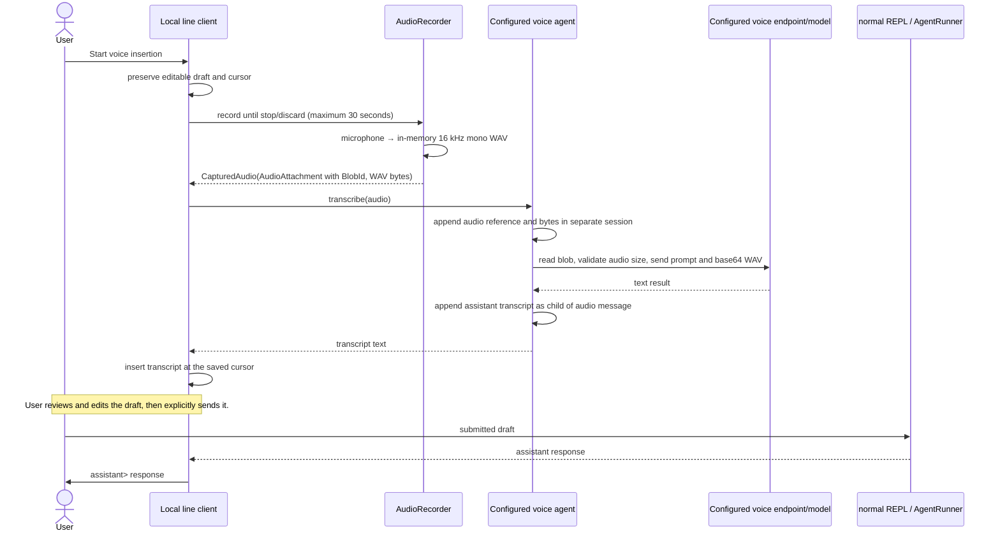

# Interactive REPL

> The source package is `fmgp.yallmo.repl`. This file is named `REPL.md` to retain the project’s historical spelling.

For keyboard shortcuts and modes, use the [client controls quick reference](CLIENT_CONTROLS.md).

The REPL entry point is client-only. It connects to `ws://127.0.0.1:8080/rpc` by default; `--server` overrides
that endpoint. Configuration, providers, tools, storage and prompt execution belong to a separately running server.
No embedded application, recorder or browser bridge starts as a fallback.

## Start the terminal client

```bash
mkdir -p ./server-storage
sbt 'server/run --storage ./server-storage --config ./yallmo.json --workspace .'
# Separate interactive terminal; --server is optional for the default loopback endpoint:
sbt --server -no-server 'repl/run --user-name operator --agent bob'
```

`--user-name <id>` is required; the claimed human ID sent to the server is `user-<id>`, not authentication.
`--agent <id>` is optional. Without a selection prompts cause no writes/session creation; use the agent picker to choose.
`--log-level` defaults to `warning`. `--config`/`--storage` are server-only. `--transcriber-agent` is rejected while
connected voice integration is pending; it never activates a local fallback.

**Feature preservation:** audio/voice, browser audio, debug snapshots/exports/request captures and their tests are
retained. Their former embedded-terminal workflow is documented later in this guide. They are not removed or claimed
broken merely because connected wiring is pending. `/debug request` is now connected as described below;
audio/voice and `/debug print|export` retain their existing implementations but are not enabled remotely.

## Server connection

```bash
# Server owns private configuration (including bob) and a separate existing storage root:
mkdir -p ./server-storage
sbt 'server/run --storage ./server-storage --config ./private/server.json --workspace .'
# Another interactive terminal:
sbt --server -no-server 'repl/run --user-name alice --server ws://127.0.0.1:8080/rpc --agent bob --log-level warning'
```

**Trusted environment only:** access is assumed already authenticated outside the server; there is no server authentication.
Configured server + initialized claimed human enables Operator with `sessions.create`, `turn.submit` and
`diagnostics.request`, for REPL and browser clients regardless of Origin or peer address. Required `--user-name` supplies
an impersonable claimed author, **not an authenticated identity**. Host/Origin are unrestricted; anonymous clients stay
read-only. Keep all access paths trusted and never expose/proxy publicly. The listener always binds to `0.0.0.0`
for trusted Docker/multi-machine access (see [server deployment](../server/README.md#production)).
A server started without `--config` remains read-only; the client notice/help/completions reflect negotiated capabilities.

An override endpoint must be a `ws`/`wss` URI with no credentials, query or fragment. No address discovery, local
fallback or automatic reconnect/replay exists. Connection failure exits, including at the default endpoint.
Connected startup does not load local `yallmo.json`, construct local runtime/tools/providers, or acquire recorder/browser/
OAuth/transcription/TTS services, **even when prompts are enabled**. Negotiated provider login is a WebSocket-only
adapter with terminal-private input, not client-local OAuth or credential persistence. `--config`/`--storage` remain server-only;
`--transcriber-agent` fails before connection, including when the default endpoint is used. The existing recorder-free terminal runner is used.

Connected commands: `/help`, `/session list`, `/session resume <id>`, `/history`, `/log <level>`, `/exit`; permitted
Operators also get **prompts and `/new [name]`**. When `diagnostics.request` is advertised, `/debug request` is also
available in help/completion. Negotiated Operators also get server provider listing/login in the provider picker
(see [connected controls](CLIENT_CONTROLS.md#connected-repl-keys)). `/tools`, `/debug print|export`, provider creation,
voice/TTS, fork and upload remain unavailable; no remote capability silently activates a local service. The agent picker chooses a per-client agent
preference. Use initialize's configured assistant IDs when supplied, not mixed human/presence `agents.list` IDs.
Server selection validation is independent. Provider/model metadata is unknown and no active local runtime is invented.
The cached initialization result determines capability; reading it does not issue a second initialize.

### Connected provider login

When all four `providers.*` methods are advertised for an Operator, the provider picker lists existing server profiles
and offers browser login/re-login in ChatGPT details. No agent selection or chat session is required. Remote provider
creation and editing forms are not available. [The controls guide](CLIENT_CONTROLS.md#connected-repl-keys) gives the
key sequence and private callback workflow. Endpoints and tokens are not exposed by remote provider summaries.

The callback never enters chat parsing, buffers or persistent history. The private input guard restores terminal
settings, draft and cursor, including cancellation/timeout cleanup. The existing socket sends Start, Complete and
best-effort Cancel requests; the server owns PKCE validation, exchange, private persistence and live activation.
A successful active result requires no restart or agent reselection; saved-only results explicitly require restart.
Completion is not subject to the JVM client's short read timeout. Lost replies or abandonment after completion may
have been sent are **uncertain**, not proof that no credentials were saved. Never retry automatically; reload providers
before starting again. Start wait loss may leave a pending attempt until replacement, disconnect or server expiry.
Viewers and older servers retain their existing behavior with no provider widgets or local fallback.

### `/debug request`

After a prompt, run `/debug request` to display the server's latest captured provider request for the selected session.
This reads the actual capture, not a request reconstructed from public history, and does not run an agent or read a
client-local file. Failed provider turns retain their captures; a tool loop exposes its last captured request.
No session/capture means an explicit absence message. Read failures leave the selected session and preferences unchanged.

Reconnect and `/session resume <id>` can read a retained capture without resubmitting. The index is process-local and
bounded to 128 captured sessions; restart/eviction/deletion may make older captures unavailable. A new execution clears
the previous association until it completes. Captures over 256 KiB are rejected safely. Viewers/older servers without
the advertised diagnostic capability do not expose this command.

**Sensitive data:** encrypted continuations remain redacted, but conversation/tool text is not generally scrubbed.
Output carries a warning and terminal controls are sanitized. No server filesystem path or HTTP credentials are returned.

### Prompt and session state

Select `--agent <id>` or choose an agent in the picker **before prompting**: no selection means explicit guidance and zero writes/session
creation. The first prompt calls `sessions.create` once, immediately retains the returned ID in its resulting state,
then calls `turn.submit` once. Later prompts reuse that ID. `/new [name]` explicitly creates a remote session when
permitted and clears last-known head/reset intent. Failed create preserves the previous session. No client `Session`,
`MessageData`, core persistence, duplicate prompt preappend, transcript fabrication or private provider state is used.
Remote runContext remains empty. Success renders the actual durable delta, not the whole conversation repeatedly.

Fresh `/history`/resume/outcomes track the last-known head. A known head is sent as `expectedHead`; absent knowledge
omits the condition (not a made-up empty-head requirement). Busy/stale-head leaves client state intact and directs a
refresh before manual retry. Resume requests `resetContinuation` on the next turn; selection change also requests reset,
and the server independently detects binding changes. No client continuation offset crosses the wire. Visible history
is preserved; server restart derives fresh opaque-continuation boundaries. Local continuation semantics are unchanged.

Accepted execution failure retains the prompt, returned snapshot/head/session, and shows safe failure text. An Unknown
outcome (including lost transport reply, defect or shutdown) is **not proof of nonacceptance**: work may still complete.
The created/known session ID is retained; refresh `/history`, or reconnect and `/session resume <id>` plus `/history`,
before **manual resend**. No automatic create/submit retry, replay, deduplication, exactly-once, run registry, status or
cancel API exists. Lost create response can leave an unknown empty session: inspect `/session list` before deciding.
Closing/Ctrl+C only abandons the local wait; accepted application-owned work survives disconnect. Restart the client
and resume to observe durable completion. Server shutdown stops work/finalizers before releasing storage/tools/lease;
a terminal Unknown outcome may carry the best safe snapshot, never a rollback guarantee.

Public snapshots/deltas render original role/content/author/tool/blob references with unsafe display controls removed.
Bodies retain multiline text/tabs and normalize carriage returns; metadata stays single-line. Failed reads retain
session/preferences. `/log` respects actual CLI log level initially and the current preference for later remote calls.

Initialize sends `clientName: "yallmo-repl"` and `userId` once; clientName is not privilege. Human presence is cleaned on
disconnect, while submitted dynamically registered authors may remain in the registry for process lifetime. Same-name
viewers are deduplicated; neither registration nor presence is identity verification. Independent sessions execute
concurrently. Short filesystem mutation coordination is separate from nonwaiting same-session turn exclusion; provider/
tool execution is never held under a storage mutex. Legacy/separate root owners still must not write the same root.

## Retained embedded feature reference

The remaining sections describe existing audio/voice, debug and other embedded feature implementations. Their code
and tests are retained for follow-up integration, but `ReplMain` never enters this path. Connected startup and its
currently enabled commands above are authoritative; there is no CLI local-mode flag or fallback.

## ChatGPT subscription generation

Configure a `ChatGPTAgent` referencing a named `ChatGPT` provider profile and select its agent ID. A logged-out profile
does not prevent startup; inference requires its literal credentials. Separate profiles never fall back to
a different profile or a paid platform API. In the line UI, inspect a ChatGPT profile in PROVIDER to
log in and save credentials privately to that profile's config. This retained **embedded** flow requires restart and
does not update its running snapshot. The current **connected** picker instead uses server-owned live activation as
described above; successful active login needs no restart or reselection. Automatic refresh still stays only in memory.
See [setup and credential limitations](HOW_TO_RUN.md#chatgpt-subscription-profiles).

## Conversation labels

The input prompt uses the supplied `--user-name`, e.g. `yallmo(fabio)>`. Replies use the actual responding agent
ID, e.g. `assistant(bob)>`. Selecting Eve changes subsequent replies to `assistant(eve)>` without changing the session.
`/history` loads the current session's stored messages and labels user messages and assistant replies with their
original authors, including after an agent switch or session resume. Output starts with `### Session history '<session_name>'`
and ends with `### END OF SESSION`. Before a session exists, history is empty and the header uses `no session`.
Names are sanitized for terminal safety. These labels are presentation only: message payloads, provider requests and
stored author IDs are not rewritten.

## Active-agent footer

Capable terminals show one bottom status line: current-mode/action hints on the left and
`<agent-id> (<provider> - <model> • <thinking-level>)` on the right. Provider labels are configured instance IDs,
such as `local` or `chatgpt-2`, not just adapter types. All values come from the selected native agent's configuration;
unselected startup has no invented agent/model footer. Unspecified thinking
is shown as `default` (not `off`, and not a claim about the server's effective default); explicit levels are lowercase.
Agent selection in AGENTS updates this footer together with the chat runtime and system prompt. It does not change voice configuration.
Login and session commands do not change the selected agent.

The footer reflows on terminal resize using display-column widths. On narrow terminals metadata takes priority over
local hints and is truncated with an ellipsis as needed. Configured labels have ANSI/control characters removed.
Terminals without status-bar support omit the footer.

## Agent selection and login

Keyboard shortcuts, mode tables, picker behavior and retained terminal audio controls are documented only in the
[client controls quick reference](CLIENT_CONTROLS.md). This section covers session and credential behavior.

Agent selection is **independent of sessions**: selecting a different agent keeps the current session ID, complete
conversation, editable draft, log level and last provider-request capture. Subsequent replies use the newly selected
runtime and are saved with that agent's identity; previous message authors are unchanged. Any session can be resumed
with `/session resume <id>` regardless of the selected agent, without changing that selection. Agent selection itself
never creates or resumes a session; the usual first-turn session creation and explicit session commands are unchanged.
Opaque provider continuation data from before a switch or resume is retained in the transcript but excluded from
requests to the new binding; ordinary conversation messages are preserved. Selecting the current agent is a no-op. Resolution failures keep the previous agent and conversation and show an error
inside the picker. Selection is process-local; it does not edit or reload the server config. Empty catalogs
show setup guidance. Agent creation/deletion is not implemented.

Login is scoped to the selected ChatGPT provider’s details in the provider picker.
The managed catalog is cleared during private authentication input and restored to the same profile's details after
success, cancellation, timeout or failure, with credential presence reloaded from disk. The exact chat draft/cursor
remain unchanged; no global credentials are read or modified.

## Provider catalog

The provider catalog exposes every configured provider, even with no selected agent. Inspecting a profile shows
its ID, type, sanitized endpoint and credential presence. Presence is **not** a validity
or successful-authentication check. Listing, inspection and creation do not initialize providers, perform OAuth or
contact endpoints. Refresh rereads the file. Agent selection is separate; the provider catalog does not select or assign a provider.

Select **New provider**, choose a type, and enter an exact, case-sensitive ID:

- **OAI**: also enter an absolute HTTP(S) base URL with a host, for example ID `local-extra` and URL
  `http://localhost:12434/v1`. The URL is hidden while typing; review omits userinfo, query and fragment.
- **ChatGPT**: for example ID `subscription-extra`; no endpoint or secret is requested. The trusted adapter default
  endpoint is shown, and the saved profile is logged out. Inspect it to log in, even without a selected agent.

Only **ChatGPT details** offer selectable **Login (browser)** (or **Re-login** when credentials
are present). OAI details have no login actions. Bracketed pastes cannot trigger menu actions. No browser is opened
automatically. Paste a browser callback only at the private hidden redirect prompt, never in chat.
Private-input cancellation controls are listed in the [client controls guide](CLIENT_CONTROLS.md#retained-terminal-audio-and-provider-controls).
Authentication is timeout bounded.
Saved feedback means only that the selected profile's credentials were persisted to the private config, with an
explicit restart notice. It does not mean the active agent/runtime is now logged in. Cancellation/failure does not
write credentials. Other profiles are never a fallback.

Forms use append/erase editing, not a general cursor editor, with a visible 4096-unit UTF-16 field limit.
Only the explicit **Save provider** confirmation writes; cancelling abandons the draft. Validation
or save failure retains the form for correction/retry. Once publication starts, cancellation is not a rollback.
Form values and menu actions never enter chat history, agent transcripts or command parsing. IDs are displayed with
terminal-control/format characters sanitized; malformed configured endpoints show `<invalid endpoint>`. Credentials,
URL userinfo/query/fragment and filesystem exception contents are not rendered. Store the config in a trusted private
directory: saved OAI URLs can themselves contain sensitive values even though summaries hide them.

A successful save refreshes the menu and atomically replaces the same config file using a same-directory private
`rw-------` temporary file. Existing provider credentials, agents, defaults, user settings and unknown JSON values are
preserved semantically; whitespace/object layout may change. Duplicate IDs/JSON keys and invalid configurations fail
without clobbering the file. Missing, symlink and nonregular targets are refused by the menu (startup separately
initializes missing configs). POSIX permissions and atomic replacement are required; unsupported filesystems fail
closed, with no non-atomic fallback. This is atomic publication, not an fsync/power-loss durability guarantee.

The running registry retains an immutable **startup configuration snapshot**. AGENTS can switch between agents in
that snapshot. To use a newly saved provider, configure an agent referencing its ID and restart to load those definitions.
Provider edit/delete and live config reload are not implemented. Saves are serialized only within this catalog instance; coordinate external writers because
another process racing between read and replace can lose updates. Do not edit concurrently.

## Slash commands

| Command | Meaning |
| --- | --- |
| `/help` | Show commands. |
| `/history` | Render the current agent transcript. |
| `/tools` | Show the startup availability snapshot for agent tools. |
| `/debug print` | Print the current transcript as Pi-style JSONL. |
| `/debug export` | Replace `~/.yallmo/yallmo-debug.log` with the current snapshot. |
| `/debug request` | Print the latest provider-request capture for the current session; audio uses blob references, not its exact wire body. |
| `/log <trace\|debug\|info\|warning\|error\|fatal\|off>` | Set only the terminal log level for subsequent REPL turns (default `warning`). `info`/`debug`/`trace` can lower it, and `off` suppresses terminal logs. |
| `/new [name]` | Start a fresh in-memory session; provide `name` to choose its ID. |
| `/session list` | List sessions held in memory; the active session is marked with `*`. |
| `/session resume <id>` | Restore an in-memory session by ID within this process. |
| `/exit` | Exit the client. |

A REPL starts with no selected session. Sessions use process-local in-memory storage. `/new`
creates an empty session named `main-YYYYMMDD-HHMMSS` (UTC), or `/new <name>` creates the requested safe name. If a
prompt is submitted before `/new`, the REPL creates the same timestamped session automatically. Session IDs are shown
by `/session list`; use `/session resume <id>` to restore one.

For a selected agent, each submitted user prompt is saved in memory before the agent runner starts; a failed save
prevents inference.
The prompt remains in session history after an agent error, timeout or cancellation. Generated assistant/tool messages
are still saved only after a successful run. Prompts rejected because no agent is selected are not saved.

This ordering is enforced by the core `Orchestrator.submit` API, not by REPL persistence callbacks. Other clients can
use the same operation with an execution configured by `runner.execution(agent, staticContext)`. `Orchestrator.turn`
remains a low-level provider call without session persistence.

Interruption and exit controls are listed in the [client controls guide](CLIENT_CONTROLS.md#connected-repl-keys).
Prefix a prompt with `//` to send a literal prompt beginning
with `/`. Provider request captures are written under `debug/` relative to the REPL's startup directory and can contain
prompt and tool-result content; `/debug request` displays only the most recent capture from the current session. Captures
are not automatically cleaned up. Use `/debug request` only in an appropriate local terminal. Provider continuations are
redacted before capture.

## Terminal logging and debug exports

Terminal output defaults to WARNING. Use `--log-level <trace|debug|info|warning|error|fatal|off>`
to set the initial threshold for startup (including tool availability logs) and subsequent REPL turns. Values are
case-insensitive; both `--log-level debug` and `--log-level=debug` work. `/log` can change the terminal level later.
The REPL does not install durable lifecycle or agent-runner log files. Explicit `/debug export` and provider-request
captures described above remain available and can contain sensitive content.

Browser audio logs record service start/stop and port, startup failure, browser connect/reconnect, and disconnect reasons
(`explicit`, `heartbeat_timeout`, `service_shutdown`). Ordinary heartbeat polls are not logged. Setup URL tokens, client IDs,
recording bytes and spoken assistant text are not included in these lifecycle messages.

## Voice input lifecycle

Voice input is a local input feature, not an agent tool. It is not advertised in `StaticContext`, cannot be requested by
the model, and does not appear in `/tools`.

Voice requires an explicit `--transcriber-agent <id>` selection to a configured audio-capable agent (currently
`OAIAgent` with an OAI provider). Its `config.model` and `config.systemPrompt` must be explicit and nonblank.
Its effective tools/retrievers/skills/extensions must all be empty; set all four `capabilities` allowlists to `[]`.
An absent flag disables voice before recording; missing IDs or invalid explicit settings fail startup locally.
There is no selected-chat/provider fallback. Voice works with text-only or no selected chat agent, and switching chat
agents never rebinds it. The transcriber remains selectable in the normal AGENTS menu.

See the secret-free [configuration example](examples/yallmo.json). Replace its placeholder models with models
supported by your endpoint. Startup validates local adapter/configuration only, not authentication, endpoint health or
remote model audio compatibility; those remain unverified until a successful invocation.

### Editable voice insertion

For activation, stop/discard keys, mode transitions and draft-preservation rules, use the
[retained terminal controls reference](CLIENT_CONTROLS.md#retained-terminal-audio-and-provider-controls).
The following describes data flow and persistence, not additional bindings.

Voice insertion does not submit a prompt or change the active chat session, head, context or continuation. Every successful exchange
is retained separately before draft insertion, even if the draft is later discarded: a generated `transcription-<uuid>`
session contains a human-authored audio reference as root and the transcriber-authored assistant transcript as its child.
Audio is stored before inference; an inference failure leaves the audio message/blob without an assistant transcript.
No user-supplied session name is needed. These sessions appear in normal listings, but are never implicitly resumed or
imported into ordinary chat or later voice requests. Messages and blobs are process-local and do not survive restart.
A storage failure is reported explicitly and leaves the draft unchanged.



### Browser microphone and explicit speech

1. Use a browser audio action from the [retained controls reference](CLIENT_CONTROLS.md#retained-terminal-audio-and-provider-controls)
   to start the bridge lazily. Its setup URL is printed only while the webpage is disconnected, not during connected
   recording or speech. With no enabled page, the action fails locally without submitting anything; text and JVM voice
   remain available. Open the **exact** `http://127.0.0.1:5180/#token=…` URL.
2. In a focused desktop browser with AudioWorklet, Web Audio and `speechSynthesis`, click **Enable audio** and grant microphone
   permission. The click requests an “Audio enabled.” speech test. Keep the tab open; the microphone stream remains open/indicated
   while enabled, although recording buffers exist only for an explicit capture operation. **Disable audio** releases it.
3. Return to the REPL and explicitly capture or discard audio using the central controls reference. Capture is capped
   at 30 seconds and waits for acknowledgement from the page before reporting recording. Insertion never submits the draft.
4. The speech action explicitly reads the latest nonblank **assistant text in the current conversation**, including resumed sessions.
   New/changed sessions use their own transcript, never cached user/tool text. Missing replies or a disconnected page produce local
   errors. Speech waits asynchronously so editing stays responsive; a new speech request replaces previous speech. There is no automatic TTS
   on assistant replies, no history submission, and no agent tool. Browser start/end events, not enqueueing, determine completion;
   events still cannot prove audible output.

The server binds `0.0.0.0` on the config file’s top-level `browserAudioPort` (default `5180`) for Docker compatibility and closes,
cancelling pending operations, when the REPL exits. Newly created files include `"browserAudioPort": 5180`; older files without it
use 5180 without being rewritten. Valid ports are 1–65535. Edit the file and restart to change it. No bind-address environment variable
is used. If the configured port is occupied, startup fails locally without switching ports; text and JVM voice remain usable. The listener accepts connections on all IPv4 interfaces; use firewall rules and publish Docker only with
`-p 127.0.0.1:5180:5180`. The browser URL and Host/Origin checks use `127.0.0.1` with the configured port (5180 in these examples); keep the Docker host/container ports identical.
See [Docker setup](../browser-STT-TTS/README.md#docker). Assets are
packaged classpath resources, not served from the working directory. Only one enabled page may connect. A random fragment token is
kept in page memory and used in authenticated API headers; exact Host/Origin checks, no CORS, deadlines and bounded WAV uploads protect
the boundary. **Keep the printed setup URL private.** The page removes its fragment from the address bar/history entry; after reload,
reopen the original URL. Never share it or expose/forward the listener publicly.

Browser WAV is canonical in-memory 16 kHz mono PCM16, at most **960,044 bytes** (30 seconds plus 44-byte header). Only stopped,
valid audio goes through the configured transcription agent; capture cancelled or failed before ingestion is discarded.
Once ingestion begins, failure or interruption does not delete the stored audio. Speech text is sent only by
the explicit speech action and lives in memory, but browser/OS speech engines may use **network services**: local synthesis is not guaranteed.

Permission revocation, autoplay rules, suspended audio contexts, device loss and background/frozen tabs may interrupt audio even after
setup. Focus the page and explicitly Enable again; permissions and background execution are not permanent guarantees. Failed operations
are not replayed. If a disconnect was uncertain, wait five seconds before reconnecting. Setup is not a browser extension and requires no
frontend installation or external encoder. See [browser audio details and manual acceptance checklist](../browser-STT-TTS/README.md).

### Initialization

At REPL startup, `ReplMain` builds these components:

1. For the retained embedded adapter, tests/callers supply a human and runtime to `ReplStartup.fromRuntime`. The server-owned
   `ApplicationRuntime.load(Chunk(human))`; no config or credentials are returned. The runtime owns lazy connections
   and agent registration. Only explicit chat/transcriber flags are resolved. Safe summaries and `browserAudioPort`
   reach the UI, not the raw config.
2. `ReplStartup.application` validates all capability IDs against the available catalogs and checks that the
   transcriber's effective capabilities are empty. Core `ConfiguredAgentSettings` provides shared model/prompt decoding.
3. `AudioRecorder`, a local Java Sound implementation, does **not** open the microphone at startup.
4. `Transcriber` makes exactly one shared `AgentTurnRequest` per invocation: only the current `MessagePayload.AudioAttachment`
   followed by configured `Instructions`, no history/continuation/context features/tool definitions, `ToolChoice.None`,
   `parallelToolCalls = false`. It does not use the conversational runner or execute tools. Calls, unsupported results,
   blank text or incomplete/non-stop responses fail without follow-up turns.
5. `TerminalRepl` invokes the same configured voice service for editable JVM/browser voice insertion; its browser server
   starts only on the first enabled browser audio action and lives in the REPL scope. Disabled voice does not start capture or the server.

The JVM recorder prefers 16 kHz, 16-bit mono PCM, but can capture common 24/44.1/48 kHz mono or stereo formats and
converts them to 16 kHz mono before encoding WAV entirely in memory. Browser WAV uses a validated canonical header.
Neither path adds an external decoder. Blobs store only raw bytes; no lifecycle status, size metadata, or duration is stored.
Only format and optional description accompany the blob reference in the message; size is computed from captured/read bytes,
not persisted as metadata. Description is not sent to the model; format is required for wire encoding.

### Preconditions

A voice request proceeds only when all of the following hold:

| Boundary | Required condition | Failure behavior |
| --- | --- | --- |
| Client | It runs in the local interactive terminal client. | No recording or agent turn. |
| Invocation | Editable voice is explicitly started through a retained terminal audio action. | The draft is unchanged. |
| Microphone | JVM capture needs microphone permission and a convertible Java Sound `TargetDataLine`; browser capture needs an enabled, connected setup page. | Local setup/audio error; state, draft and cursor remain unchanged. |
| Payload | The recorded WAV is non-empty and at most 1 MiB. A canonical 30-second 16 kHz PCM16 capture is 960,044 bytes including its header. | `OAIAgent` rejects it before HTTP. |
| Model Runner | The configured transcription OAI endpoint is reachable, its agent model is audio-capable, and it accepts the `input_audio`/WAV chat-completions dialect used by `gdict`. | A bounded HTTP/protocol error is displayed; no text is submitted. |
| Response | A completed text-only assistant result with nonblank content. | A protocol error is displayed; no text is submitted. |

`OPENAI_API_KEY`, `ffmpeg`, and a recording file are not required by Yallmo’s implementation. The independent
`gdict` script uses `ffmpeg` for its macOS capture path; Yallmo uses Java Sound instead.

### Privacy and SSH boundary

Audio messages contain a `BlobId`, never WAV bytes. Normal REPL recordings and messages are held in memory.
For server-owned filesystem storage (standalone `--storage <directory>`), blobs use `<directory>/blobs/<uuid>` as raw
bytes without metadata or framing; `objects.jsonl` stores only message envelopes and references. This filesystem
mode is not a local REPL launch option; explicit `--server` uses the server's chosen storage. `readBlob(id)` returns the stored bytes; missing blobs
are reported explicitly. No lifecycle or integrity status is tracked. Failed/cancelled producers retain bytes collected
so far, and those bytes remain readable even though the ingestion operation reports its failure or interruption.
Orchestrator buffers stream/writer input in memory and appends the full blob to Storage after production; the message
is visible first. Storage accepts blobs and messages separately. Provider adapters receive a `readBlob` function.
Provider HTTP requests resolve audio to base64; debug captures instead contain blob references and format. They are
not exact wire bodies for audio. Terminal/history rendering does not load bytes. Existing credential and continuation
protection remains unchanged. Normal loading supports only the current `MessagePayload.AudioAttachment` schema.
For a server-owned filesystem store with legacy `AudioInput` records, stop all writers and recover into a **new** directory:

```sh
sbt "core/runMain fmgp.yallmo.orchestration.storage.RecoverLegacyAudio ./zzz ./zzz-recovered"
```

Open the recovered store with standalone `server/run --storage ./zzz-recovered` (viewer unless also configured). Connect the REPL with explicit `--server` for history.
Recovery leaves the source unchanged and preserves sessions,
transcripts, forks and existing blobs. Previously redacted recordings become explicit unavailable-audio context
notices: the old format discarded their bytes, so playback/transcription cannot be restored. Message IDs and
references are updated together. Current-schema hashes are checked; redacted legacy audio hashes cannot be verified.
Nonempty inline audio is rejected for manual recovery rather than silently discarded. The destination must not
already exist; keep the original as a backup. Alternatively, start with an empty storage directory.
Recordings are retained even if transcription fails or the draft is discarded; there is no automatic blob cleanup or
recording-deletion command. Treat the entire storage directory and its backups as sensitive, not just `objects.jsonl`.
See [Attachments and blob storage](orchestration/ATTACHMENTS_AND_BLOB_STORAGE_PLAN.md) for duplicate-ID behavior,
partial filesystem reads/writes, buffering limits, and the single-writer storage contract.
Assistant transcripts remain in their separate sessions independently of draft discard; transcripts and descriptions
may contain sensitive text. The editable transcript is untrusted user input and is never automatically submitted to chat.
No transcription debug section or hash lookup command is added.

Microphone access belongs to the machine running the REPL process. If `yallmo` is launched on a remote SSH host,
JVM capture attempts to use that remote host’s microphone—not the local SSH client’s microphone. Browser capture instead uses the device
running the setup page. Same-machine loopback is the supported default; an optional SSH loopback tunnel must preserve the exact same
port and canonical host on both ends, for example:

```sh
ssh -N -L 127.0.0.1:5180:127.0.0.1:5180 user@host
```

Open the original setup URL unchanged locally. `localhost`, a different forwarded port, or an occupied local port will fail the
Host/Origin boundary. This does not expose a remote listener or guarantee browser/SSH audio support.

## Agent tools

At startup, the REPL selects from `readFile`, `listFiles`, `bash`, and `repositoryChanges` in `fmgp.yallmo.tool`.
A selected tool is placed in both the runner and the agent's static context only when its requirement passes:

- filesystem tools require an accessible workspace directory;
- `bash` requires Bash on `PATH`;
- `repositoryChanges` additionally requires Git on `PATH` and a Git work tree.

`repositoryChanges` is read-only and supports `status`, `unstaged` (`git diff`), and `staged` (`git diff --staged`).
File paths are relative to the REPL startup directory; `../` traversal is intentionally supported. `bash` has the
process’s permissions, a 30-second default timeout, and a 64 KiB returned-output limit; run it only in an appropriate
workspace.

## Troubleshooting

If sbt reports `FileSystemException` for a `target/.../zinc/inc_compile_3.zip` file, remove the stale generated cache
and retry:

```bash
rm -rf target
sbt "repl/run --user-name operator"
```
