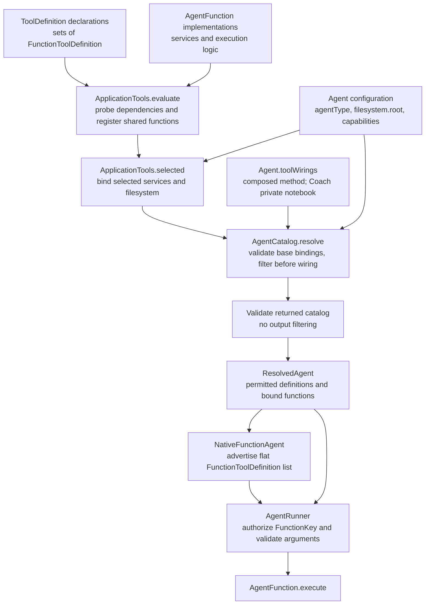

# Agent tool wiring

**Parent:** [Service wiring and component boundaries](SERVICE_WIRING.md).

This page describes how tool declarations become callable functions for a selected agent, and what those functions depend on.

## Definitions versus execution

The contracts `ToolKey`, `ToolDefinition`, `FunctionKey` and `FunctionToolDefinition` live in `fmgp.yallmo.tool`, with their sources in the shared `model` module. A tool groups complete function definitions:

```scala
trait ToolDefinition {
  def name: ToolKey
  def functions: Set[FunctionToolDefinition]
}
```

| Type | Responsibility |
| --- | --- |
| `ToolKey` | Opaque identifier for a tool group, such as `sdlc` or `coach`. |
| `FunctionKey` | Opaque identifier for one callable operation, such as `sdlc_read_task`. |
| `ToolDefinition` | Declares a tool's name and the functions it exposes. Contains no execution logic. |
| `FunctionToolDefinition` | A function's name, description and input schema. The same type is used in declarations, orchestration and native model requests. |
| `AgentFunction[R]` | Binds one `FunctionToolDefinition` to an `execute` implementation and its required environment. |
| `ScalamodeFunction[R]` | Scalamode-specific subtype owning explicit default-binding and executor-rebinding opt-in hooks. |
| `AgentTool[R]` | Groups bound `AgentFunction[R]` implementations under a `ToolDefinition`. |
| `ToolWiring` | Alias for one ordinary function: `Seq[AgentTool[Any]] => IO[YallmoError, Seq[AgentTool[Any]]]`. |

`AgentFunction`, `AgentTool` and the top-level `ToolWiring` alias live together in shared `model`, retaining the `fmgp.yallmo.orchestration` package. `Agent.toolWirings(tools: Seq[AgentTool[Any]]): IO[YallmoError, Seq[AgentTool[Any]]]` defaults to `ZIO.succeed(tools)`. Agents compose utility functions explicitly inside this method; there is no wiring wrapper, extra agent hierarchy or local-function marker trait.

`AgentFunction` exposes only `definition` and `execute`. Scalamode integration lives in `fmgp.yallmo.tool.scalamode.ScalamodeFunction` in shared `model`, with explicit `withExecutor` and default-binding opt-in hooks. Environment binding and approval guards preserve that explicit integration; opaque wrappers do not acquire it from a matching name or schema.

The built-in objects in [the model's tool declarations][declarations] implement `ToolDefinition` and own their function keys and schemas. `FunctionKey` itself contains no built-in catalog or tool back-reference. Membership comes from `ToolDefinition.functions`, never from parsing a name prefix.

The former `AgentToolDefinition` and `AgentFunctionDefinition` types have been removed.

## Configuration → agent tools



1. **Declare:** each `ToolDefinition` exposes a set of complete `FunctionToolDefinition`s. For example, `SdlcToolDefinition` exposes the five planning operations; `CoachToolDefinition` exposes the three notebook operations.
2. **Register:** [`ApplicationTools.evaluate`][registration] probes dependencies and supplies available shared `AgentFunction`s. `ApplicationTools.ToolDefinitions` is the shared declaration catalog; Coach is agent-local, not part of that shared catalog.
3. **Bind:** [`ApplicationTools.selected`][registration] binds read functions to the agent filesystem, otherwise the workspace. Bash/Git keep the workspace; SDLC keeps server storage. Coach constructs its own private notebook functions. A binding can also select API descriptions, such as a code-only compiled Scala service.
4. **Wire:** [`AgentCatalog.resolve`][catalog] validates base keys/memberships, filters the base catalog by effective policy, then calls `adapter.toolWirings(filteredTools)` once. The returned catalog is validated but **not filtered again**. Wiring owns additions and internal composition order. Duplicate tool/function keys or mismatched declarations/implementations fail with `InvalidConfig`; replacement is explicit, never a silent merge.
5. **Keep definitions aligned:** [`ToolDefinition.available`][tool-definition] selects available base implementations and their bound schema variants. Wiring must return matching declarations and implementations. A separate available-ID catalog remembers base and final output IDs (including denied base IDs); `AgentCapabilities.validateIds` checks explicit policies after wiring so local IDs work and typos/unavailable IDs still fail, without constructing a restricted output context. Internal intermediate catalogs are not inspected by the resolver.
6. **Expose:** `ResolvedAgent.context.functions` contains the permitted flat `FunctionToolDefinition` list; `context.tools` contains the matching `ToolDefinition`s. `ResolvedAgent.functions` carries the bound implementations, and `.tools` provides their `AgentTool` grouping. Registration alone does not grant permission.
7. **Advertise:** [`NativeFunctionAgent`][native] puts the same permitted definitions into `AgentTurnRequest.tools` without converting them to another definition type. `request.toolGroups` carries host-only membership metadata for direct-request filtering; provider mappers do not send that catalog.
8. **Execute:** [`AgentRunner`][runner] resolves the requested `FunctionKey`, requires an effective advertised definition and a registered implementation, validates arguments against the selected schema, then calls `AgentFunction.execute`. Direct tool-call invocation uses the same checks without requiring model inference.

The server also retains an **earlier eager validation** in `ServerApplication.make`: every configured agent's explicit IDs must exist in startup-available definitions, with a hard-coded notebook-definition supplement for Coach agents. Unknown IDs on unselected agents fail server construction. The resolver supports later-stage local IDs, but future consumers beyond Coach must account for this startup integration constraint as well; selected-agent wiring has not replaced the server's eager check.

### Explicit utility composition

Factories return ordinary functions using the `ToolWiring` alias; agents opt in by composing them inside `toolWirings`. For example, using already-bound fake or application functions:

```scala
import fmgp.yallmo.model.*
import fmgp.yallmo.orchestration.*
import fmgp.yallmo.tool.*
import zio.*

object ExampleToolWiring {
  def add(tool: AgentTool[Any]): ToolWiring =
    tools => ZIO.succeed(tools :+ tool)

  def replace(tool: AgentTool[Any]): ToolWiring =
    tools => ZIO.succeed(tools.filterNot(_.name == tool.name) :+ tool)
}

// Inside an Agent implementation; services/functions are captured at initialization:
// override def toolWirings(tools: Seq[AgentTool[Any]]): IO[YallmoError, Seq[AgentTool[Any]]] =
//   for {
//     added <- ExampleToolWiring.add(notebook)(tools)
//     replaced <- ExampleToolWiring.replace(selectedVariant)(added)
//   } yield replaced
```

The default method preserves the permitted base catalog. Coach first calls `delegate.toolWirings(tools)` and then adds its notebook. Factories can add, remove or replace tools, but must update a replaced function's declaration as well as its implementation. Wiring runs at resolution, not on LLM turns; successful resolution is cached until generation invalidation (for example credential replacement). Resolution filters **only before** wiring; trusted factories own the capabilities they add and there are no filtering boundaries between composed calls. Existing lower-level request filtering remains independent of this resolution contract. Wiring is not a sandbox for arbitrary code or hidden captured authority.

`ConfiguredAgent` forwards the delegate's wiring but its lower-level `turn` method only filters the request's supplied `toolGroups`. It does not infer ownership from function names or execute wiring per turn. Callers bypassing resolved invocation must supply matching membership metadata for group-restricted functions (including configured Coach); without it those functions are safely removed. Normal resolved direct/session invocation already supplies the final catalog.

### What configuration controls

An agent-definition fragment can restrict tools and choose a read root:

```yaml
filesystem:
  root: /srv/private/reader
capabilities:
  tools: [filesystem]
  functions: [readFile, listFiles]
```

`capabilities.tools` names `ToolKey`s; `capabilities.functions` names `FunctionKey`s. Both restrictions must pass. A function allowlist can narrow a tool's available operations, but cannot re-enable a disabled tool.

This **selects existing capabilities**, not new implementations or dependencies. Explicitly naming an unknown or unavailable tool/function fails validation. Read functions must already be registered; an agent root alone does not install them.

| Configuration / agent | Result |
| --- | --- |
| `tools` and `functions` omitted | Inherit available functions, subject to the agent's built-in restrictions. |
| `tools: [filesystem]` | Permit the filesystem tool's available functions. |
| `functions: [readFile]` | Permit only this function, subject to any tool-group restriction. |
| `tools: []` or `functions: []` | Disable all callable functions. Other capability categories remain independent. |
| `CoachAgent` | At most the `coach` tool and its three private notebook functions; configuration can narrow, not widen, that policy. |
| `FolderStructureAgent` | No callable functions, including direct tool-call invocation. |

Old per-operation `capabilities.tools` lists must move to `capabilities.functions` to preserve their exact restrictions. For the full enforcement flow, see [Capabilities architecture](Capabilities_Architecture.md).

## Tool groups, functions and dependencies

Each row below is one callable function. A function must be both available and permitted by the selected agent.

| Tool group | Function | Description | Dependencies |
| --- | --- | --- | --- |
| `filesystem` | `readFile` | Read a UTF-8 file. | `FsRead`: agent root, otherwise workspace. Registration requires an accessible workspace. |
| `filesystem` | `listFiles` | List sorted direct directory entries. | Same `FsRead` binding and registration requirement as `readFile`. |
| `bash` | `bash` | Run a shell command and return bounded output/status. | `BashExecutor`, Bash on `PATH`, workspace working directory. |
| `repositoryChanges` | `repositoryChanges` | Inspect Git status, staged diff or unstaged diff. | `GitClient`, Git on `PATH`, workspace that is a Git work tree. |
| `scalamode` | `scalamode` | Evaluate restricted Scala code. | `ScalaCodeExecutor`, Scala CLI and provisioned compiler/runtime dependencies. ChatGPT defaults include hello plus rooted filesystem reads/mutations when both native read/list functions are permitted; the executor owns invocation-scoped local RPC. |
| `sdlc` | `sdlc_list` | Search/page task and intent summaries. | Shared `SdlcService`, backed by server-storage `FsRead` / `FsWrite`. |
| `sdlc` | `sdlc_read_task` | Read task snapshots by ID. | Same shared `SdlcService`; task journal. |
| `sdlc` | `sdlc_set` | Create/update task snapshots with revision checks. | Same shared `SdlcService`; task journal and reference validation. |
| `sdlc` | `sdlc_read_intent` | Read intent snapshots by ID. | Same shared `SdlcService`; intent journal. |
| `sdlc` | `sdlc_set_intents` | Create/update intent snapshots with revision checks. | Same shared `SdlcService`; intent journal and task-reference validation. |
| `coach` | `coach_list_applications` | List application summaries and revisions. | Coach-private `FsRead & FsWrite` and notebook semaphore. |
| `coach` | `coach_get_application` | Read one complete application record. | Same Coach-private filesystem and notebook semaphore. |
| `coach` | `coach_save_application` | Save an application snapshot or unsent draft with a revision check. | Same Coach-private filesystem and notebook semaphore; appends to the notebook journal. |

### Scope matters

- **Read functions:** paths are relative to the selected root; the filesystem rejects absolute paths, parent traversal and symlinks. Selecting a private root works independently of Scalamode service opt-in.
- **Bash/Git:** the workspace is their working directory. An agent's read root does not relocate them or sandbox Bash.
- **Scala:** the base executor is code-only. ChatGPT defaults expose hello and rooted filesystem reads/mutations for a complete native read/list grant, using executor-owned scoped local RPC. Custom bindings and partial grants are preserved. All bindings use the same `scalamode` name and code-only schema; explicit native exact-delegation wiring captures only filtered functions. See [Scala tool restrictions](tools/TOOL-SCALA-SCRIPT.md).
- **SDLC:** all five functions share server-storage journals at `sdlc/tasks.jsonl` and `sdlc/intents.jsonl`. They need no Bash/Git/Scala dependency. See [SDLC tools](sdlc/README-SDLC.md).
- **Coach:** only the selected Coach gets its notebook functions, backed by `applications.jsonl` under its agent root. Saving a draft does not send a message, submit an application or book an interview.

## Implementation references

- [ToolDefinition contract and availability filtering][tool-definition] · [FunctionToolDefinition schema][function-definition] · [built-in declarations][declarations].
- [AgentFunction and AgentTool execution types][execution-types] · [registration and selected-function binding][registration] · [agent selection][catalog].
- [Capability filtering][policy] · [native request assembly][native] · [runner permission/schema checks][runner].
- [Read/list implementations][filesystem] · [Bash][bash] · [Git inspection][git] · [Scala][scala].
- [SDLC implementation][sdlc] · [shared planning service][sdlc-service] · [Coach notebook implementation][coach].

[tool-definition]: ../model/shared/src/main/scala/fmgp/yallmo/tool/ToolDefinition.scala
[function-definition]: ../model/shared/src/main/scala/fmgp/yallmo/tool/FunctionToolDefinition.scala
[declarations]: ../model/shared/src/main/scala/fmgp/yallmo/tool/
[execution-types]: ../model/shared/src/main/scala/fmgp/yallmo/orchestration/AgentTool.scala
[registration]: ../server/src/main/scala/fmgp/yallmo/server/application/ApplicationTools.scala
[catalog]: ../core/jvm/src/main/scala/fmgp/yallmo/orchestration/AgentCatalog.scala
[policy]: ../core/shared/src/main/scala/fmgp/yallmo/orchestration/config/AgentCapabilities.scala
[native]: ../core/shared/src/main/scala/fmgp/yallmo/orchestration/NativeFunctionAgent.scala
[runner]: ../core/shared/src/main/scala/fmgp/yallmo/orchestration/AgentRunner.scala
[filesystem]: ../core/jvm/src/main/scala/fmgp/yallmo/tool/FileSystemTools.scala
[bash]: ../core/jvm/src/main/scala/fmgp/yallmo/tool/BashTool.scala
[git]: ../core/jvm/src/main/scala/fmgp/yallmo/tool/RepositoryChangesTool.scala
[scala]: ../scalacode-api/jvm/src/main/scala/fmgp/yallmo/tool/scalamode/ScalaTool.scala
[sdlc]: ../core/shared/src/main/scala/fmgp/yallmo/tool/sdlc/SdlcTools.scala
[sdlc-service]: ../core/shared/src/main/scala/fmgp/yallmo/tool/sdlc/SdlcService.scala
[coach]: ../core/jvm/src/main/scala/fmgp/yallmo/agents/CoachApplicationTools.scala

### Opt-in Scalamode read-service stage

The canonical `ScalaCodeExecutor` pure contract/defaults/compiler pin belong to **shared model**. Shared
`ScalamodeToolDefinition`, `ScalaTool`, `ScalamodeService`, the API-only `ScalaCodeExecutorServices` capability/extension
and wiring factory belong to **scalacode-api**, retaining `fmgp.yallmo.tool.scalamode`. Service overrides opt into the
capability; external selective callers import `fmgp.yallmo.tool.scalamode.executeWithServices`. Base-only executors
reject services without pure fallback. The API module depends only on
model/filesystem/rpc (plus pinned libraries), never core/server. Core alone owns
[`ScalaCodeExecutors`](../core/jvm/src/main/scala/fmgp/yallmo/tool/scalamode/ScalaCodeExecutors.scala):
`ApplicationTools.live` installs `.live`, and explicitly configured host/test construction uses `.layer(...)`.
Process execution/compiler/source/diagnostic helpers stay core-only, outside every child classpath. The child API
still owns its small compiled runners. API factories/interfaces on the child classpath grant no ambient safe
capability; actual compiler-negative probes cover executor lookup, broader tool/RPC factories and private checks.

The JVM utility `AgentToolWirings.withFilesystem(executor, route, endpoint)` returns the existing **function alias**
`ToolWiring`. Capture explicit trusted executor/route/endpoint dependencies at agent construction and call the
factory inside `Agent.toolWirings`. It replaces only an already-permitted default Scalamode definition, preserving custom service bindings and order,
deriving its API from the
exact already-filtered `filesystem/readFile` and `filesystem/listFiles` implementations/definitions. It never
exports raw `FsRead`, a registry, write/patch tools or recursive Scalamode. Each generated native call is validated
against the selected schema. Partial permission changes the docs and compiled view; the host also denies absent
operations. Missing either tool or usable native reads is an identity operation. Native output stays tool text and failures retain kind/message. Two resolved agents retain their
independently selected roots/implementations. No default agent receives this service and startup capability validation is unchanged. ApplicationTools
binds only native filesystem functions, never an automatic filesystem Scalamode replacement. Trusted agent closures can still capture authority not visible to catalog policy.

[Service contracts, executable explicit-dependency example and tests](tools/TOOL-SCALA-SCRIPT.md#agent-defined-service-bindings-opt-in)
cover the generic host descriptor (not a ZIO environment), custom pure helpers, explicit scoped concrete RPC bindings,
code-only `ScalaTool.withServices`, narrow child classpaths and compiler/sandbox limitations.

Current validation and historical relocation/service counts live in the [durable plan](AGENT_TOOL_WIRING_PLAN.md).
The generic service suite retains real pinned/offline compiler/RPC coverage; retired dedicated filesystem-mode
suites are removed, not retained for compatibility. These checks do not establish OS isolation.

`HelloWorldService` is a pure compiled **Scalamode service**, not a standalone native tool. ChatGPTAgent's
`toolWirings` runs custom composition first, then `AgentToolWirings.withDefaults(scalaCodeExecutor, filesystem, filesystemWrite)`. This replaces
only the permitted default Scalamode function. Snippets call `hello.helloWorld` (or
`ZIO.succeed(hello.helloWorld)`) and receive `Hello world`. The function remains named `scalamode`, with the same
code-only schema; its structured inspector/model metadata includes the greeting service. No `helloWorld` tool or
function key is installed. Missing Scalamode and existing custom service bindings are preserved; bindings are not
implicitly merged or overwritten.

Catalog-created ChatGPT agents, including `sol`, receive this wiring. Server workspace composition passes its
already-configured `ScalaCodeExecutor` through the catalog; direct construction defaults to a resource-free live
executor description and can explicitly supply `scalaCodeExecutor`. No compilation occurs at construction or
resolution. `AgentToolWirings.withService(service, executor)` supports explicitly selecting another compiled service;
`withDefaults` automatically includes fs alongside hello for permitted filesystem tools; private roots override workspace
for reads and writes. Supplying rooted `FsWrite` intentionally grants mutations in this read/list-qualified default service;
trusted wiring owns the derived API, with no separate write allowlist or post-wiring permission filter.
`withFilesystem` remains an explicit caller-owned-listener exact-delegation choice. Existing resolved
generations remain cached: restart the application to observe new code/wiring.

## Backend-preserving Scalamode integration

`ScalaTool.withServices` returns an integrated `ScalamodeFunction`, not an opaque closure. Its immutable API-owned
`ScalamodePlan` captures original timeout, output budget, dependency grants and exact optional service descriptor.
Default service wiring transforms that plan only for explicitly eligible unbound defaults. Environment and approval
wrappers forward executor rebinding structurally and rewrap the result, so approval runs once at the same boundary.
Opaque custom functions, even with the default name/schema, are not substituted. Custom integrated functions must
explicitly implement `withExecutor`; inspected metadata is never enough to recreate their authority. The operator
JVM/Scala.js selector invokes this same selected operation with a request-local executor. See the
[tool guide](tools/TOOL-SCALA-SCRIPT.md) and [parity delivery record](tools/SCALAMODE-BACKEND-PARITY-PLAN.md).
