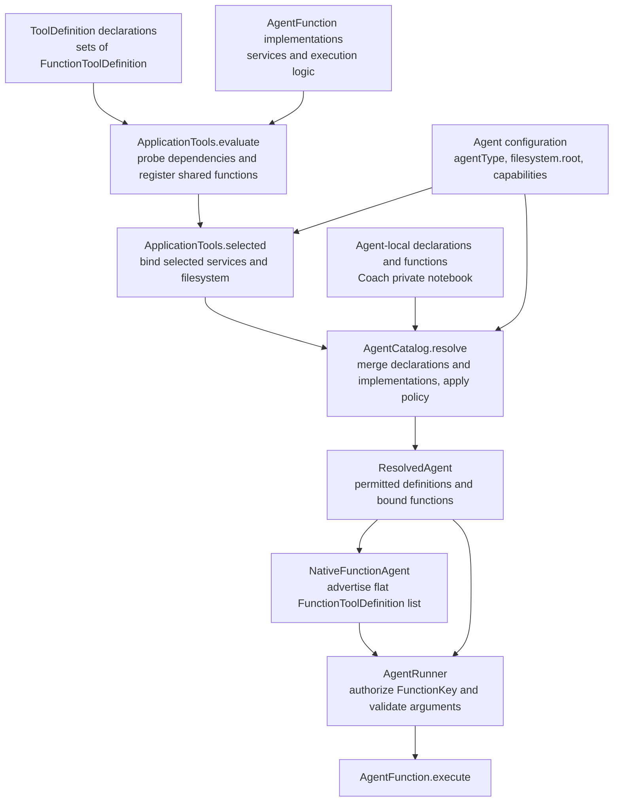

# Agent tool wiring

**Parent:** [Service wiring and component boundaries](SERVICE_WIRING.md).

This page describes how tool declarations become callable functions for a selected agent, and what those functions depend on.

## Definitions versus execution

The contracts `ToolKey`, `ToolDefinition`, `FunctionKey` and `FunctionToolDefinition` live in `fmgp.yallmo.tool`, with their sources in the shared `model` module. A tool groups complete function definitions:

```scala
trait ToolDefinition {
  def name: ToolKey
  def functions: Set[FunctionToolDefinition]
}
```

| Type | Responsibility |
| --- | --- |
| `ToolKey` | Opaque identifier for a tool group, such as `sdlc` or `coach`. |
| `FunctionKey` | Opaque identifier for one callable operation, such as `sdlc_read_task`. |
| `ToolDefinition` | Declares a tool's name and the functions it exposes. Contains no execution logic. |
| `FunctionToolDefinition` | A function's name, description and input schema. The same type is used in declarations, orchestration and native model requests. |
| `AgentFunction[R]` | Binds one `FunctionToolDefinition` to an `execute` implementation and its required environment. |
| `AgentTool[R]` | Groups bound `AgentFunction[R]` implementations under a `ToolDefinition`. |

The built-in objects in [the model's tool declarations][declarations] implement `ToolDefinition` and own their function keys and schemas. `FunctionKey` itself contains no built-in catalog or tool back-reference. Membership comes from `ToolDefinition.functions`, never from parsing a name prefix.

The former `AgentToolDefinition` and `AgentFunctionDefinition` types have been removed.

## Configuration → agent tools



1. **Declare:** each `ToolDefinition` exposes a set of complete `FunctionToolDefinition`s. For example, `SdlcToolDefinition` exposes the five planning operations; `CoachToolDefinition` exposes the three notebook operations.
2. **Register:** [`ApplicationTools.evaluate`][registration] probes dependencies and supplies available shared `AgentFunction`s. `ApplicationTools.ToolDefinitions` is the shared declaration catalog; Coach is agent-local, not part of that shared catalog.
3. **Bind:** [`ApplicationTools.selected`][registration] binds read functions to the agent filesystem, otherwise the workspace. Bash/Git keep the workspace; SDLC keeps server storage. Coach constructs its own private notebook functions. A binding can also select a schema variant, such as filesystem-enabled Scala.
4. **Select:** [`AgentCatalog.resolve`][catalog] merges shared and local declarations and implementations, then resolves the capability policy. Local function implementations replace shared ones with the same `FunctionKey`; local tool declarations replace shared ones with the same `ToolKey`.
5. **Keep definitions aligned:** [`ToolDefinition.available`][tool-definition] retains declared functions that have available implementations and uses their bound schemas. Tools with no remaining functions are omitted. Permission filtering narrows both the flat function list and the sets exposed by tool declarations.
6. **Expose:** `ResolvedAgent.context.functions` contains the permitted flat `FunctionToolDefinition` list; `context.tools` contains the matching `ToolDefinition`s. `ResolvedAgent.functions` carries the bound implementations, and `.tools` provides their `AgentTool` grouping. Registration alone does not grant permission.
7. **Advertise:** [`NativeFunctionAgent`][native] puts the same permitted definitions into `AgentTurnRequest.tools` without converting them to another definition type. `request.toolGroups` carries host-only membership metadata for direct-request filtering; provider mappers do not send that catalog.
8. **Execute:** [`AgentRunner`][runner] resolves the requested `FunctionKey`, requires an effective advertised definition and a registered implementation, validates arguments against the selected schema, then calls `AgentFunction.execute`. Direct tool-call invocation uses the same checks without requiring model inference.

### What configuration controls

An agent-definition fragment can restrict tools and choose a read root:

```yaml
filesystem:
  root: /srv/private/reader
capabilities:
  tools: [filesystem]
  functions: [readFile, listFiles]
```

`capabilities.tools` names `ToolKey`s; `capabilities.functions` names `FunctionKey`s. Both restrictions must pass. A function allowlist can narrow a tool's available operations, but cannot re-enable a disabled tool.

This **selects existing capabilities**, not new implementations or dependencies. Explicitly naming an unknown or unavailable tool/function fails validation. Read functions must already be registered; an agent root alone does not install them.

| Configuration / agent | Result |
| --- | --- |
| `tools` and `functions` omitted | Inherit available functions, subject to the agent's built-in restrictions. |
| `tools: [filesystem]` | Permit the filesystem tool's available functions. |
| `functions: [readFile]` | Permit only this function, subject to any tool-group restriction. |
| `tools: []` or `functions: []` | Disable all callable functions. Other capability categories remain independent. |
| `CoachAgent` | At most the `coach` tool and its three private notebook functions; configuration can narrow, not widen, that policy. |
| `FolderStructureAgent` | No callable functions, including direct tool-call invocation. |

Old per-operation `capabilities.tools` lists must move to `capabilities.functions` to preserve their exact restrictions. For the full enforcement flow, see [Capabilities architecture](Capabilities_Architecture.md).

## Tool groups, functions and dependencies

Each row below is one callable function. A function must be both available and permitted by the selected agent.

| Tool group | Function | Description | Dependencies |
| --- | --- | --- | --- |
| `filesystem` | `readFile` | Read a UTF-8 file. | `FsRead`: agent root, otherwise workspace. Registration requires an accessible workspace. |
| `filesystem` | `listFiles` | List sorted direct directory entries. | Same `FsRead` binding and registration requirement as `readFile`. |
| `bash` | `bash` | Run a shell command and return bounded output/status. | `BashExecutor`, Bash on `PATH`, workspace working directory. |
| `repositoryChanges` | `repositoryChanges` | Inspect Git status, staged diff or unstaged diff. | `GitClient`, Git on `PATH`, workspace that is a Git work tree. |
| `scalamode` | `scalamode` | Evaluate restricted Scala code. | `ScalaCodeExecutor`, Scala CLI and provisioned compiler/runtime dependencies. Filesystem mode additionally needs an explicit trusted RPC route/endpoint and selected `FsRead`. |
| `sdlc` | `sdlc_list` | Search/page task and intent summaries. | Shared `SdlcService`, backed by server-storage `FsRead` / `FsWrite`. |
| `sdlc` | `sdlc_read_task` | Read task snapshots by ID. | Same shared `SdlcService`; task journal. |
| `sdlc` | `sdlc_set` | Create/update task snapshots with revision checks. | Same shared `SdlcService`; task journal and reference validation. |
| `sdlc` | `sdlc_read_intent` | Read intent snapshots by ID. | Same shared `SdlcService`; intent journal. |
| `sdlc` | `sdlc_set_intents` | Create/update intent snapshots with revision checks. | Same shared `SdlcService`; intent journal and task-reference validation. |
| `coach` | `coach_list_applications` | List application summaries and revisions. | Coach-private `FsRead & FsWrite` and notebook semaphore. |
| `coach` | `coach_get_application` | Read one complete application record. | Same Coach-private filesystem and notebook semaphore. |
| `coach` | `coach_save_application` | Save an application snapshot or unsent draft with a revision check. | Same Coach-private filesystem and notebook semaphore; appends to the notebook journal. |

### Scope matters

- **Read functions:** paths are relative to the selected root; the filesystem rejects absolute paths, parent traversal and symlinks. Selecting a private root works independently of Scala RPC wiring.
- **Bash/Git:** the workspace is their working directory. An agent's read root does not relocate them or sandbox Bash.
- **Scala:** pure execution needs no filesystem RPC. The filesystem-enabled binding allows explicit read-only effects; it uses the same `scalamode` function name with the selected schema, not another tool. See [Scala tool restrictions](tools/TOOL-SCALA-SCRIPT.md).
- **SDLC:** all five functions share server-storage journals at `sdlc/tasks.jsonl` and `sdlc/intents.jsonl`. They need no Bash/Git/Scala dependency. See [SDLC tools](sdlc/README-SDLC.md).
- **Coach:** only the selected Coach gets its notebook functions, backed by `applications.jsonl` under its agent root. Saving a draft does not send a message, submit an application or book an interview.

## Implementation references

- [ToolDefinition contract and availability filtering][tool-definition] · [FunctionToolDefinition schema][function-definition] · [built-in declarations][declarations].
- [AgentFunction and AgentTool execution types][execution-types] · [registration and selected-function binding][registration] · [agent selection][catalog].
- [Capability filtering][policy] · [native request assembly][native] · [runner permission/schema checks][runner].
- [Read/list implementations][filesystem] · [Bash][bash] · [Git inspection][git] · [Scala][scala].
- [SDLC implementation][sdlc] · [shared planning service][sdlc-service] · [Coach notebook implementation][coach].

[tool-definition]: ../model/shared/src/main/scala/fmgp/yallmo/tool/ToolDefinition.scala
[function-definition]: ../model/shared/src/main/scala/fmgp/yallmo/tool/FunctionToolDefinition.scala
[declarations]: ../model/shared/src/main/scala/fmgp/yallmo/model/tool/
[execution-types]: ../core/shared/src/main/scala/fmgp/yallmo/orchestration/Capabilities.scala
[registration]: ../server/src/main/scala/fmgp/yallmo/server/application/ApplicationTools.scala
[catalog]: ../core/jvm/src/main/scala/fmgp/yallmo/orchestration/AgentCatalog.scala
[policy]: ../core/shared/src/main/scala/fmgp/yallmo/orchestration/config/AgentCapabilities.scala
[native]: ../core/shared/src/main/scala/fmgp/yallmo/orchestration/NativeFunctionAgent.scala
[runner]: ../core/shared/src/main/scala/fmgp/yallmo/orchestration/AgentRunner.scala
[filesystem]: ../core/jvm/src/main/scala/fmgp/yallmo/tool/FileSystemTools.scala
[bash]: ../core/jvm/src/main/scala/fmgp/yallmo/tool/BashTool.scala
[git]: ../core/jvm/src/main/scala/fmgp/yallmo/tool/RepositoryChangesTool.scala
[scala]: ../core/jvm/src/main/scala/fmgp/yallmo/tool/ScalaTool.scala
[sdlc]: ../core/shared/src/main/scala/fmgp/yallmo/tool/sdlc/SdlcTools.scala
[sdlc-service]: ../core/shared/src/main/scala/fmgp/yallmo/tool/sdlc/SdlcService.scala
[coach]: ../core/jvm/src/main/scala/fmgp/yallmo/agents/CoachApplicationTools.scala
