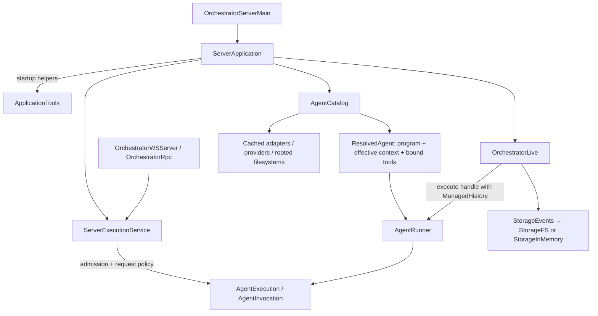
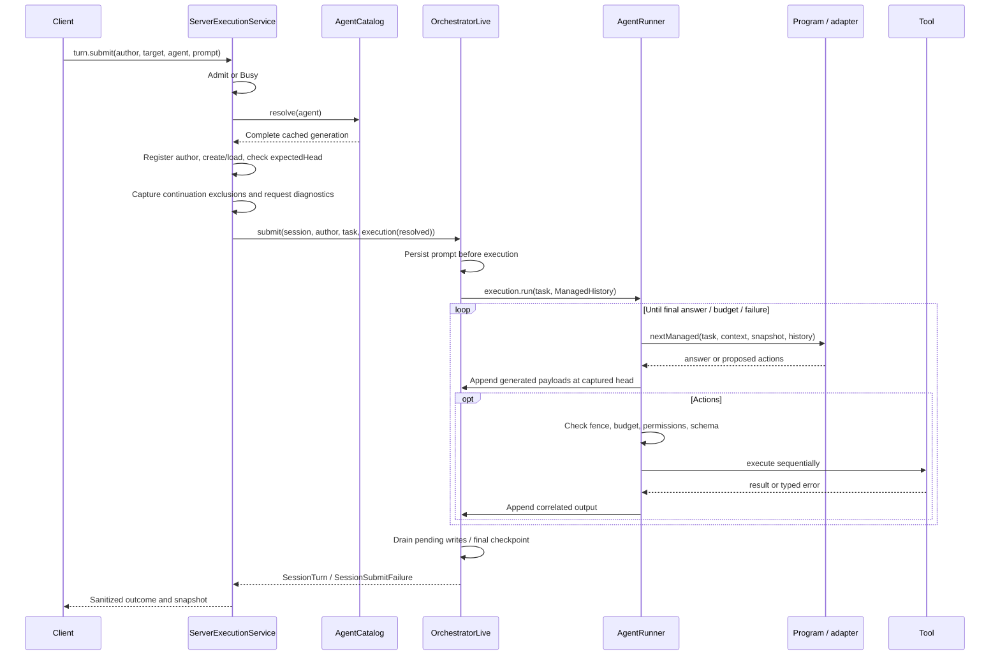

# Service wiring and component boundaries

The standalone server has one composition and lifetime owner, `ServerApplication`. Construction does not run agents.
The connected REPL is only a WebSocket client; retained embedded REPL adapters reuse application/core execution.

**Subdocument:** [Agent tool wiring](SERVICE_TOOLS_WIRING.md) — how tools become available to an agent, with a concise
tool/dependency table.

## Components



Arrows describe dependencies, not a linear runtime pipeline. The runner calls a program; native programs call an
adapter/provider for one turn. Programs propose actions, while the runner authorizes and executes them.

| Component | Owns | Does not own |
| --- | --- | --- |
| [`ServerApplication`][app] | Configuration, startup tools, one catalog/master, standalone storage lease and execution scope construction | Server request policy, provider protocols or the tool loop |
| [`ServerExecutionService`][execution] | Author/session/Busy/expected-head/continuation policy, application-owned execution, sanitized outcomes and request diagnostics over the shared application | Composition, storage lease ownership, provider protocols or the tool loop |
| [`AgentCatalog`][catalog] · core JVM | Lazy successful adapter/provider and complete executable-agent caches, registered human authors, rooted agent filesystems, explicit live credential replacement | Session storage, admission, inference during lookup, or server dependencies |
| [`ResolvedAgent`][resolved] · core shared | One immutable generation's bound program, effective `StaticContext`, executable tools, adapter/read capability and selection metadata | Session selection or persistence |
| [`ApplicationTools`][tools] · server | Ordinary startup probes and tool-binding functions; availability and omission reasons | Per-agent authorization or another runtime layer |
| [`AgentRunner`][runner] · core shared | Decision loop, budgets, fences, permission/schema checks and sequential action execution | Message identities, storage, session-head publication or provider transport |
| [`OrchestratorLive`][orch] · core JVM | Prompt acceptance, messages/sessions/branches/blobs, managed history and ordered persistence | Configured server request policy, model decisions or tool registration |

Core depends on model/filesystem/RPC, never on server composition. `AgentExecution`/`AgentInvocation` are opaque internal
contract plumbing between core execution and orchestration. Generic runner APIs still accept custom programs/context/tools
for tests and embedded callers; configured execution uses `AgentRunner.execution(resolved)` or `.invocation(resolved)`.

## Startup and selection

1. Main opens the server storage capability and one shared `SdlcService` for both tools and HTTP inspection.
2. `ServerApplication.open`/`openRpc` canonicalizes the existing storage root and acquires the scoped process/OS lease.
   Failed composition releases the lease immediately. Both entrypoints require a configuration path and return a
   `ServerExecutionService` backend; the RPC/WebSocket host derives its master from that backend.
3. Configured startup loads the configuration snapshot and evaluates workspace tool availability. Captured HTTP/tool
   services surround the whole application lifetime (`Client.default ++ ApplicationTools.live`).
4. All configured allowlists validate against available definitions before orchestration storage opens. This is not eager
   validation of every model setting, provider credential or agent root.
5. One `AgentCatalog` and one `OrchestratorLive` are retained. The catalog receives a server-bound tool-selection function
   and a read-only blob reader for that same master. A promise closes this construction dependency before returning;
   lookup does not use the blob reader or run tools/providers.
6. `catalog.resolve(agentId)` lazily constructs and caches a **complete** `ResolvedAgent`: decode native settings (except
   folder agents), bind the program/blob reader, select tools, add agent-private tools, and resolve effective context.
   Subsequent resolutions reuse the same complete object, not merely its adapter.

Initialization and credential publication share a catalog-local semaphore; inference is not serialized by it.
Failed construction is not cached as a successful resolution. Already-opened agent filesystems can remain cached after
later construction failure. Supplied agents remain as supplied on generic core seams; registered users are authors,
not executable agents. No arbitrary config reload is implied by editing the file.

Explicit ChatGPT login publishes a new provider connection and invalidates both adapter and resolved-agent entries of
its configured dependents under the same lock. Rooted filesystems are preserved without resolving roots again.
Existing/in-flight resolved objects retain the old program, context, tools and provider generation; later resolutions
see the replacement. Automatic refresh remains connection-local.

### Tool dependencies and read roots

For the agent-tool flow and tool/dependency table, see [Agent tool wiring](SERVICE_TOOLS_WIRING.md).

| Tools | Bound dependency / policy |
| --- | --- |
| `readFile`, `listFiles` | Configured agent `FsRead` when present, otherwise workspace; **independent of Scala RPC wiring** |
| `bash`, `repositoryChanges` | Workspace working directory and process services; agent read roots do not redirect them |
| `scalamode` | Restricted executor by default; filesystem effects require a caller-owned trusted RPC route/endpoint **and** the selected `FsRead` (agent root, else workspace) |
| SDLC tools | One shared server-storage `SdlcService`, never an agent/workspace planning store |
| Coach private tools | Bound only to that Coach's notebook/filesystem; matching private keys replace shared keys for that selection |

The same selected definitions and implementations travel together in `ResolvedAgent`. Availability is discovery, not
permission: a configured allowlist cannot install an unavailable tool. Startup installs no retrievers/skills/extensions.
Folder programs always disable tools, including direct invocation, and validate non-blank text-only output without native
model settings. Coach's built-in restriction intersects configured restrictions; direct adapter requests retain policy
checks through `ConfiguredAgent`.

## Execution and persistence



`ServerExecutionService` directly applies request policy and calls orchestration over its shared `ServerApplication`;
there is no additional submission-service/assembly/binding transition. Continuation exclusions affect provider requests
only, never stored history. Reset/agent change excludes old continuation identities; newly generated state remains usable
even after managed rebase. Branches start fresh continuation scope; retained embedded REPL offset filtering is resolved
against each submission's immutable initial history.

| Entry | Execution | Persistence |
| --- | --- | --- |
| Configured submit | Full bounded loop | Session prompt/results; best-effort head publication |
| Configured branch submit | Full bounded loop from validated persisted ancestry | No session creation/publication; verifies saved output before success |
| Configured invoke | One temporary-input turn; model-requested actions rejected. Explicit `ToolCall` executes one authorized/schema-checked tool without inference | Stores validated input and response; no session or inherited history |
| Deprecated core `turn` | Direct adapter request/response | No managed prompt/output persistence |

`ManagedHistory` allocates immutable IDs/timestamps/parents once. Runner appends enqueue generated objects; they are not
pre-side-effect durability barriers. The ordered writer saves parent-first, then attempts session-head CAS. Head conflicts
do not overwrite a competing session; branch objects can remain inspectable. Runner fences stop stale continuation without
replaying effects. Pending writes drain on success, typed failure, timeout or interruption; saves remain best effort, with
suffix retries and warnings, not a crash transaction. Accepted prompts/tool effects are not rolled back, and no exactly-once,
automatic resubmission, replay ledger or general cancellation API is promised.

Default execution budget: 12 turns, 24 actions, two minutes. It does not bound admission, prompt persistence or final draining.
Tool typed failures become correlated error outputs; defects do not take that typed-error path. Capability checks are not
an OS sandbox. Optional approval is an explicit tool wrapper, not an automatically installed service.

## Lifetime and concurrency

```text
ServerApplication scope: HTTP/tool services + storage lease
  ├── AgentCatalog: generation caches + rooted capabilities
  ├── OrchestratorLive: one storage owner
  └── ServerExecutionService execution scope: admitted submit / branch / invoke work
        └── per-operation runner / managed history and writer
Client connection scope: interruptible wait only
```

Same-session submissions receive nonwaiting Busy rejection. `expectedHead` is checked before prompt submission; core/storage
still retain their independent fences/CAS semantics. Independent sessions/invocations need not serialize. Storage has short
root-local mutation locks, never a lock around inference/tool work. Admitted operations outlive caller disconnect; application
shutdown interrupts and finalizes them before tool services/storage ownership are released. Results are not retained in a
new run registry. Embedded `make`/`workspace` factories open their own single master but do not claim the standalone lease.

See [mental model](MENTAL_MODEL.md), [capabilities](Capabilities_Architecture.md), and [server guide](../server/README-SERVER.md).
Regression coverage: `AgentCatalogSuite`, `ResolvedAgentSuite`, `ServerCompositionSuite`, `ConfiguredProgramSuite`, `ServerSubmissionSuite`,
`AgentsInvokeSuite`, `ReplSessionSubmissionSuite`, and the orchestration managed-history suites.

[app]: ../server/src/main/scala/fmgp/yallmo/server/application/ServerApplication.scala
[execution]: ../server/src/main/scala/fmgp/yallmo/server/application/ServerExecutionService.scala
[catalog]: ../core/jvm/src/main/scala/fmgp/yallmo/orchestration/AgentCatalog.scala
[resolved]: ../core/shared/src/main/scala/fmgp/yallmo/orchestration/ResolvedAgent.scala
[tools]: ../server/src/main/scala/fmgp/yallmo/server/application/ApplicationTools.scala
[runner]: ../core/shared/src/main/scala/fmgp/yallmo/orchestration/AgentRunner.scala
[orch]: ../core/jvm/src/main/scala/fmgp/yallmo/orchestration/OrchestratorLive.scala
