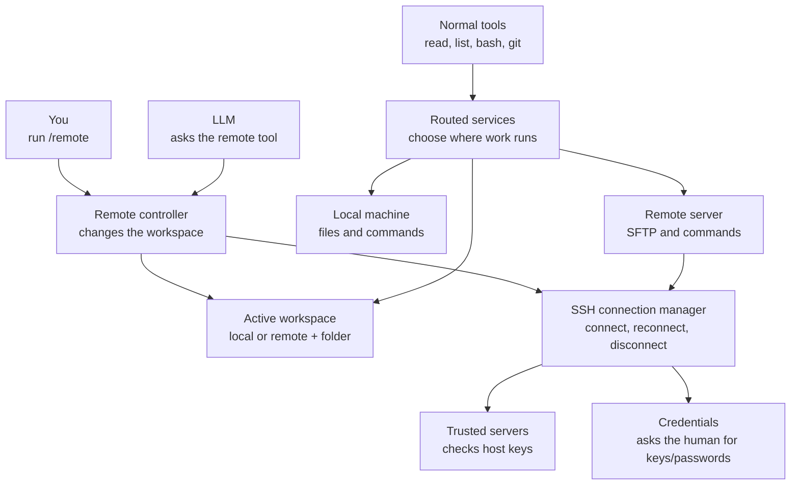

# SSH Remote Workspace Tool — Architecture

## Goal

Yallmo gains one **active workspace**. It starts local; `/remote connect` makes
it remote. After that, the agent keeps calling the existing tools:

```text
readFile · listFiles · bash · repositoryChanges
```

Those tools run against the active workspace without the agent wrapping every
command in `ssh ...` or tracking another working directory. `/remote` is the
human control plane. A small, approved `remote` agent tool may inspect or
request workspace changes, but never receives credentials.

This takes the routing model of `pi-ssh-remote`, adapted to Yallmo's Scala 3
and ZIO architecture.

## Non-negotiable design rules

- Keep the existing tool keys and their definitions stable for the lifetime of
  the REPL. Do **not** unregister/re-register tools after connecting.
- Route every **workspace-dependent** operation: filesystem, command execution,
  and Git. Keep unrelated local I/O local (LLM HTTP calls, terminal UI,
  configuration, known-hosts, and credential prompts).
- The routing decision happens **when an operation runs**, not when a tool is
  created. ZIO layers build stable service instances; they are not mutated to
  switch workspace.
- Passwords, passphrases, private-key contents, and open connections are never
  stored in model context, tool arguments, logs, or persisted session state.
- A remote failure must return a remote error or reconnect; it must never make
  the requested operation run locally.

## Scope

### Phase 1

- `/remote connect <user@host[:port]> [--cwd <path>] [--identity <key-path>]`
- `/remote status`, `/remote cd <path>`, `/remote reconnect`,
  `/remote disconnect`, and `/remote forget`
- strict host-key verification, in-memory SSH/SFTP connection, and one remote
  cwd (default: remote account home)
- routed `readFile`, `listFiles`, `bash`, and `repositoryChanges`
- bounded output, cancellation, timeouts, and one serialized reconnect attempt

### Deferred

- writes/edits (Yallmo has no such tools yet)
- port forwarding, jump hosts, SSH config aliases, and full OpenSSH parity
- more than one active workspace
- endpoint/session persistence across a process restart
- server-specific model memory

Deferred work must extend the routed services below, never bypass them with a
locally spawned `ssh` command.

## Why a routed service is required

`ReplTools` currently constructs tools once. `ReadFileTool` and `ListFilesTool`
capture a local `Path`; `BashTool` depends on `BashExecutor`; and
`RepositoryChangesTool` depends on `GitClient`. Their definitions are advertised
through `ReplMain`'s `StaticContext`.

The **tool definitions** must remain fixed. The system-prompt text cannot: the
current `ReplSession` holds one fixed `StaticContext`, so it must be refactored
to obtain a per-turn context with the current workspace notice while retaining
the same tool definitions.

Replacing `WorkspaceFileSystem` with an SSH implementation after connection is
therefore insufficient:

1. `bash` and Git do not use `WorkspaceFileSystem`.
2. the file tools have already resolved paths from a local root;
3. changing a ZIO layer does not replace an already-created service.

Instead, provide stable routed implementations for all workspace-dependent
services. Each implementation reads the current target from a shared `Ref` and
delegates to its local or SSH backend.

```text
WorkspaceFileSystem  -> routed filesystem -> local filesystem OR SFTP
BashExecutor         -> routed executor   -> local Bash       OR SSH exec
GitClient            -> routed Git        -> local Git        OR SSH exec
```

`RoutedWorkspaceFileSystem` is a better name than
`SshWrapWorkspaceFileSystem`: it owns the local-or-remote decision, not merely
an SSH wrapper.

## Component architecture



Read the diagram as two simple flows:

1. `/remote` (or an approved agent request) changes the **active workspace**.
2. Normal tools use the routed services, which send each operation to the local
   machine or the remote server according to that workspace.

### Workspace state

The state describes the intended execution target, not credentials or an open
socket:

```scala
sealed trait WorkspaceTarget
object WorkspaceTarget:
  final case class Local(root: Path) extends WorkspaceTarget
  final case class Remote(endpoint: RemoteEndpoint, cwd: RemotePath) extends WorkspaceTarget
  final case class RemoteUnavailable(
      endpoint: RemoteEndpoint,
      cwd: RemotePath,
      reason: String
  ) extends WorkspaceTarget

trait WorkspaceSession:
  def current: UIO[WorkspaceTarget]
  def set(target: WorkspaceTarget): UIO[Unit]
```

`WorkspaceSession.live` is a `Ref.Synchronized[WorkspaceTarget]`, initially
`Local(Path.of("").toAbsolutePath.normalize)`. `RemotePath` is a POSIX path
type, not `java.nio.file.Path`. The latter has local-platform semantics and
must never be sent directly to SFTP or a remote shell.

`RemoteUnavailable` is important: after a failed reconnect, Yallmo remains
visibly targeted at the remote workspace and returns a remote error. It does
not quietly fall back to local execution.

### Routed services and path handling

All three routed services snapshot `WorkspaceTarget` at the start of an
operation. That snapshot determines both path resolution and the connection
used for the operation, so a simultaneous `/remote disconnect` cannot send one
half of an operation locally and the other half remotely.

Before implementing routing, move path resolution behind the routing boundary:

- tool input is a logical `WorkspacePath`, not an already-resolved local
  `Path`;
- local mode resolves a relative path from the local root;
- remote mode resolves a relative path from the remote POSIX cwd;
- absolute remote paths stay absolute;
- `/remote cd` validates the path remotely and stores its canonical `pwd -P`
  result before later tool calls can use it.

Similarly, refactor `BashTool` and `RepositoryChangesTool` so they do not
capture a fixed local workspace at construction time. Their routed executors
obtain the active cwd from the same operation snapshot.

Existing behaviour permits `..` traversal. Retain that behaviour in both modes
for Phase 1, or introduce a separate, explicit containment policy for both;
do not make remote mode accidentally stricter or looser.

### Connection manager, transport, and ownership

```scala
trait SshConnectionManager:
  def connect(request: ConnectRequest): IO[SshConnectError, ConnectedRemote]
  def active(endpoint: RemoteEndpoint): IO[SshConnectionError, ConnectedRemote]
  def reconnect: IO[SshConnectError, ConnectedRemote]
  def disconnect: UIO[Unit]
```

`SshConnectionManager` owns the SSH client, SFTP channels, credential cache,
and a closeable connection scope. Its public `connect` method must **not**
return a connection tied to the short-lived scope of a `/remote` command;
otherwise that command would close the connection as soon as it returned.
The manager closes its connection on disconnect and REPL shutdown.

`ConnectedRemote` exposes only SFTP stat/read/list and SSH command execution.
Agent tools do not access the transport directly. Use a maintained JVM
SSH/SFTP library (evaluate Apache Mina SSHD first), rather than the local
`ssh` executable. It must support host-key verification, key/password/agent
authentication, SFTP, channel close/cancellation, and test-server support.

The controller serializes connect, reconnect, and disconnect. A routed
operation retries once only for a classified reconnectable transport failure;
all callers share that one reconnect rather than creating parallel clients.

### Trust and credentials

```scala
trait KnownHostsStore:
  def verify(endpoint: RemoteEndpoint, presented: HostKey): IO[HostKeyError, VerifiedHostKey]
  def trust(endpoint: RemoteEndpoint, presented: HostKey): IO[HostKeyError, Unit]

trait CredentialProvider:
  def credentialsFor(endpoint: RemoteEndpoint): IO[CredentialError, SshCredentials]
```

Unknown and changed host keys require an explicit human decision showing the
endpoint and SHA-256 fingerprint. Store accepted keys locally with
user-only permissions (for example, `~/.yallmo/known_hosts`), keyed by host and
port.

An explicit identity file is exclusive. Otherwise, try configured/default keys
and an SSH agent before prompting the human for a password. Cache prompted
passwords/passphrases in memory only; `/remote forget` clears that cache.
An agent may name an endpoint or identity **path**, but cannot provide secret
text as a tool argument.

### Remote operation semantics

- **Files:** use SFTP for stat, reads, and lists; do not emulate file transfer
  with `cat` or `scp` through a command channel.
- **Commands:** execute through an SSH exec channel in the snapshotted remote
  cwd. Quote the cwd in a fixed shell wrapper; the user/agent command itself
  remains the intentional shell program. Never concatenate untrusted endpoint
  fields into a locally executed shell command.
- **Git:** retain Yallmo's fixed `GitClient` operations, but execute their fixed
  Git argument shapes remotely when remote mode is active.
- **Bounds:** stream output into a bounded buffer. Preserve the current result
  contract—exit code, timeout state, output, and truncation—with a 30-second
  default timeout and 64 KiB output maximum initially.
- **Cancellation:** an interrupted operation closes its SFTP/exec channel.

## Control-plane API and model context

```text
/remote connect <user@host[:port]> [--cwd <path>] [--identity <local-key-path>]
/remote status
/remote cd <path>
/remote reconnect
/remote disconnect
/remote forget
```

Add a typed `ReplCommand.Remote(RemoteCommand)` and let `ReplApplication`
delegate it to `RemoteWorkspaceController`. The controller emits remote status
or failure events; terminal rendering stays in the UI.

After the slash-command behaviour is proven, add an approved `remote`
`AgentTool` with closed actions: `connect`, `status`, `chdir`, `reconnect`, and
`disconnect`. State-changing actions require the existing `ToolApproval`
mechanism or an equivalent explicit human-confirmation policy.

Before every agent turn, inject a small dynamic workspace notice:

```text
Workspace: SSH developer@build.example:22 at /srv/api.
readFile, listFiles, bash, and repositoryChanges operate there.
```

It must say `Workspace: local ...` after disconnect and `unavailable` after a
failed reconnect. This prevents the model from confusing local and remote
paths.

## Source and runtime file layout

Keep the feature under `tool/`: workspace routing and SSH are backends for
agent tools, not general Yallmo subsystems. Keep REPL command/UI code under
`repl/`. The following is the intended incremental structure; existing files
are modified rather than duplicated when they already own the public API.

```text
core/src/main/scala/fmgp/yallmo/tool/
├── ToolServices.scala                  # Modify: local implementations remain behind routed services
├── FileSystemTools.scala               # Modify: accept logical workspace paths, not fixed local paths
├── BashTool.scala                      # Modify: remove fixed local workspace capture
├── RepositoryChangesTool.scala         # Modify: use routed Git/cwd
└── remote/                             # New: remote-workspace tool implementation
    ├── WorkspaceTarget.scala           # Local, Remote, RemoteUnavailable; endpoint/path value types
    ├── WorkspaceSession.scala          # Ref.Synchronized-backed active-target service
    ├── WorkspaceRouter.scala           # snapshots target and selects a backend
    ├── RoutedWorkspaceServices.scala   # WorkspaceFileSystem, BashExecutor, GitClient adapters
    ├── RemoteTool.scala                # New later: approved agent-facing remote control tool
    └── ssh/                            # SSH/SFTP backend; no REPL or AgentTool classes
        ├── SshModels.scala             # ConnectRequest, errors, host-key and credential types
        ├── SshTransport.scala          # JVM SSH-library boundary
        ├── SshConnectionManager.scala  # connection ownership, reconnect, and cleanup
        ├── KnownHostsStore.scala        # local host-key persistence and verification
        ├── CredentialProvider.scala     # SSH-agent/key/password discovery and human prompting
        └── SftpWorkspaceBackend.scala  # SFTP stat/read/list plus SSH command/Git backend

repl/src/main/scala/fmgp/yallmo/repl/
├── grammar/
│   ├── ReplCommand.scala               # Modify: add ReplCommand.Remote
│   ├── ReplGrammar.scala               # Modify: parse and complete /remote
│   └── RemoteCommand.scala             # New: typed connect/status/cd/reconnect/disconnect commands
├── remote/
│   ├── RemoteWorkspaceController.scala # New: control-plane orchestration and serialized transitions
│   └── WorkspacePromptContext.scala    # New: renders the dynamic per-turn workspace notice
├── ReplApplication.scala               # Modify: delegate typed remote commands
├── ReplSession.scala                   # Modify: obtain context per turn; definitions remain stable
├── ReplEvent.scala                     # Modify: add remote status/failure events
├── ReplTools.scala                     # Modify: build stable routed services/tools
├── ReplMain.scala                      # Modify: wire tool/remote layers and context provider
└── terminal/
    └── TerminalEventRenderer.scala     # Modify: render remote events

core/src/test/scala/fmgp/yallmo/tool/remote/
├── WorkspaceRouterSuite.scala          # New: routing, path-resolution, and no-local-fallback tests
└── ssh/                                # New: host-key, SFTP, timeout, cancellation, reconnect tests

repl/src/test/scala/fmgp/yallmo/repl/remote/
└── RemoteWorkspaceControllerSuite.scala # New: grammar, controller, prompt-context, and event tests
```

Runtime data is local to the user, outside the repository:

```text
~/.yallmo/ssh/known_hosts               # Phase 1: trusted host keys, user-only permissions
~/.yallmo/ssh/endpoints.json            # Future: non-secret endpoint preferences only
```

Do not place passwords, passphrases, private-key copies, or active connection
state in these files.

## Lifecycle

1. Start in local mode and register stable routed tools.
2. Parse and validate `/remote connect`; it is not a free-form local shell
   command.
3. Verify/trust the host key, obtain credentials through the human UI, connect,
   and validate the requested cwd remotely.
4. Atomically set `WorkspaceTarget.Remote` only after all preceding work
   succeeds.
5. On a reconnectable operation failure, perform one serialized reconnect and
   retry the operation once. If it fails, set `RemoteUnavailable` and return an
   error.
6. On disconnect or shutdown, close remote resources, clear the in-memory
   connection, and set `WorkspaceTarget.Local`.

Phase 1 is process-scoped. A later phase may persist only a non-secret
`RemoteWorkspaceSnapshot(endpoint, cwd)` per named REPL session and reconnect
interactively after resume.

## Security and acceptance checks

- Host-key verification is mandatory for first use and key changes.
- Never log or persist passwords, passphrases, private-key contents, or open
  connection state.
- Keep known-host/config/output files user-readable only.
- Validate structured endpoint, port, identity-path, and cwd values.
- Limit remote output before it enters model context; avoid broad listings and
  whole-log reads.
- Before connection, existing tools behave exactly as they do today.
- After connection, all workspace-dependent tools operate only on the selected
  remote endpoint and cwd.
- `/remote cd` changes the cwd used by later normal tools.
- Unknown/changed host keys cannot be used without human trust.
- Remote failure never causes a local fallback.
- Tests cover local/remote routing, path resolution, host-key rejection, SFTP,
  bounded output, cancellation, timeout, reconnect, and disconnect cleanup.

## Delivery order and open decisions

1. Add workspace domain types/state and refactor path resolution out of the
   current tool constructors.
2. Add routed local adapters for filesystem, Bash, and Git, with no behaviour
   change in local mode.
3. Add the SSH/SFTP transport, known-host store, credential UI, and connection
   manager; test against a disposable SSH server.
4. Add remote adapters, `/remote` grammar/controller/events, then dynamic model
   context.
5. Add the approved agent tool only after human control works.

Settle before implementation:

1. Which JVM SSH library meets the required host-key, agent, SFTP, cancellation,
   and test-server needs?
2. Does Phase 1 require password authentication, or can it begin key/agent-only?
3. Is process-wide state acceptable initially, or must named sessions have
   independent remote targets immediately?
4. Must every agent-originated connection request receive separate human
   approval, even for an already-trusted endpoint?
