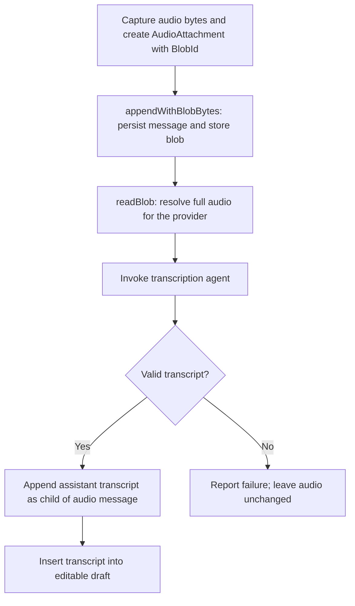
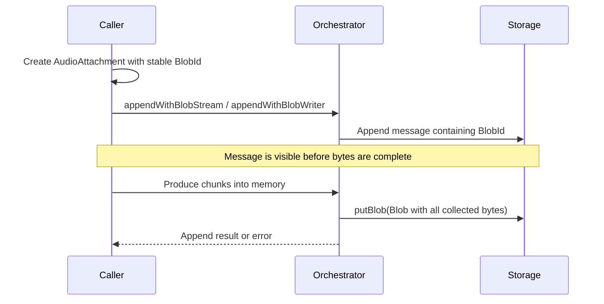

# Attachments and blob storage

Status: implemented, with one open message-append failure-path finding recorded below. This is the single design/implementation record for the change.
Keep this plan active until that finding and a permanent regression are addressed; see [Plans and delivery status](../PLANS.md).
Generic bounded session-independent uploads now live on Orchestrator and JSON-RPC `blobs.upload`; no separate storage service was introduced.
The Scala audio type is `MessagePayload.AudioAttachment`, with the JSON discriminator `AudioAttachment` and no override. Only the current schema is supported; there are no legacy decoders, migrations, or hash-verification exceptions.

## Goal

Preserve audio and other attachments without embedding their bytes in `objects.jsonl`.
Store blob content separately. Support messages referencing recordings/uploads before their bytes are complete.
Replace destructive audio redaction with references; keep the implementation small.

## Model

- Keep `MessageData` as the envelope: author, parent, timestamp, payload.
- Audio content is `MessagePayload.AudioAttachment(blobId: BlobId, format, description)` inside the payload companion.
- Put references inside payloads, not an additional `MessageData.attachments` field.
- Only `MessagePayload.AudioAttachment` is implemented for now. The generic `Attachment` payload has been removed; future file/image/document payloads can reuse `BlobId`.
- Allocate the blob ID when constructing the payload, before calling Storage.
- Generating an ID allocates identity only; it does not create storage or require complete content.
- `BlobId.fresh()` generates a UUID, distinct from `MessageId`; `BlobId.from` and JSON decoding require a canonical lowercase UUID safe as a path segment. It is not a content hash.
- Keep format and optional description on the audio payload.
- Keep blobs minimal: identity and bytes only. No blob metadata, lifecycle status, stored size, or duration.
- Do not mutate an already-persisted message as recording progresses.
- A future text-plus-attachments message should compose content inside its payload, not its envelope.

## Reading blobs (interface refinement)

Expose `readBlob(id, awaitTimeout = Duration.Zero): IO[YallmoError, Blob]` through shared `BlobOps` on `Storage` and `Orchestrator`; return all stored bytes in memory, not a stream.
Implemented model:

```scala
final case class Blob(id: BlobId, bytes: Chunk[Byte])
```

Storage owns duplicate-ID enforcement, missing-file reporting and the bounded process-local registry for the generic upload API (below). Orchestrator forwards blob operations; legacy sessionful ingestion is unchanged.
Stored blobs have no metadata or lifecycle/completeness/integrity tracking. Legacy sessionful ingestion preserves bytes from failed or cancelled producers; generic uploads publish only after successful Complete.
Whole-blob reads are an intentional initial simplification; providers still enforce their own input-size limits.

## Append API

Keep ordinary message `append`. The three ingestion operations live directly on `Orchestrator`:

```scala
appendWithBlobBytes(sessionId, agentId, message, bytes)
appendWithBlobStream(sessionId, agentId, message, stream)
appendWithBlobWriter(sessionId, agentId, message, write => produce(write))
```

- The extra argument is respectively `Chunk[Byte]`, `ZStream`, or a producer callback receiving `write: Chunk[Byte] => IO[YallmoError, Unit]`.
- Orchestrator obtains the blob ID from the supplied payload; callers do not repeat it.
- These legacy sessionful forms remain compatible; generic uploads below provide a separate bounded Begin/Append/Complete/Abort workflow.
- Initially require exactly one blob reference in the supplied message; defer multiple-blob binding APIs.
- Preserve producer environment requirements, sequential chunk consumption, scoped writers, and typed errors. Streams must be finite and fit in memory. Generic ingestion has no enforced size limit; callers must bound input before buffering. Provider limits are checked later, after storage.
- The writer is valid only during its callback; Orchestrator buffers the bytes and owns completion.
- There is no `BlobAppend`, `BlobReader`, or `BlobWriter` trait; read/write dependencies are plain functions.
- Storage has `putMessage(message)` for standalone messages, `putMessagesAndUpdateSession(id, expectedHead, messages)` for preconstructed session batches, and `putBlob(blob: Blob): IO[YallmoError, Unit]` / `getBlob(id)` for blobs. Orchestrator retains public `append` / `readBlob` and privately validates authors before standalone persistence; `putMessage` is Storage-only. Storage does not accept streams or producers.
- `StorageFS` and `StorageInMemory` implement blob persistence directly alongside messages; there is no separate blob storage service.
- `Blob`, `BlobId`, and `Message` stay in the model package, not inside Storage.
- `AgentTurnRequest.readBlob: BlobId => IO[YallmoError, Blob]` is an explicit read function, not serialized content. `Orchestrator.turn` and the REPL runner supply it; direct adapter callers can supply their own function.
- Capture uses a REPL-local `CapturedAudio(input, bytes)` value; only `input` is a message payload.

## Lifecycle and storage

1. Validate the message and its single blob ID in the Orchestrator.
2. Persist the message containing that reference.
3. Collect the bytes, stream, or writer callback into memory; do not write chunks to Storage.
4. Close the writer and append one `Blob` containing all collected bytes to Storage.

Failed, cancelled, and defective producers still persist the bytes collected so far, then propagate their original outcome after successful storage. Stored bytes carry no lifecycle status.
Until step 4, the blob is not stored, so all reads report Missing. Storage rejects duplicate IDs when the full blob is submitted.
Message and blob appends are separate: if Storage refuses a duplicate blob, the already-appended message remains and existing blob content is unchanged.
If the process exits before step 4, the message remains but buffered bytes are not recoverable.
If storing the blob fails, that storage error is returned instead of the producer outcome; message persistence is not rolled back.
See the open finding below for the current deviation when the message append itself fails.

The message is visible before ingestion finishes. The append effect returns after ingestion finishes; callers can fork it for concurrent production.
Producer failure after message persistence keeps both the message and collected bytes; it is not converted into a successful ingestion result.
Filesystem Storage uses `<storage>/blobs/<BlobId>` as the filename and stores exactly the raw bytes inside it. No JSON encoding, framing, per-blob directory, or metadata file.
Blob files are now published exclusively from fully written, forced temporary files via hard links, then the directory is forced. This preserves duplicate rejection without exposing partial targets on write failure or restart. Hard links and directory forcing must be supported by the filesystem; no unsafe fallback is used. Temporary names are not valid BlobIds and are ignored on reads/listing/reopen; crash leftovers are not automatically collected. Temporary files use JDK temporary-file permissions; published files retain those permissions. Existing object-store protections on the storage root remain unchanged. This does not validate old partial files or add blob integrity checking.
In-memory Storage stores blobs in memory.
Providers resolve references at request construction and report missing content or invalid audio input.
Do not imply that this storage change alone adds provider audio-streaming support.

## Filesystem concurrency contract

- Exactly one Storage service owns each root; no other process writes to it. There is no shared lock registry.
- One root-local semaphore coordinates all session/object read-modify-write operations, complete object batches and head publication, and actual blob writes. Session/list reads acquire coherent snapshots; historical traversal can release the permit because indexed objects are immutable and append-only. Blob reads coordinate with byte writes.
- Provider/tool execution and blob producer callbacks do not hold the storage permit. Independent sessions may execute concurrently; only their storage operations coordinate.
- Committed message batches finish publication before honoring interruption. Failures still need not roll back objects; atomic session replacement and the semaphore are not crash transactions.
- The standalone root lease coordinates only cooperating processes. Legacy owners and other services/processes writing the same root remain unsupported; this semaphore does not add cross-process ownership or locking.

## Generic bounded upload and dependency wait

See [wire contract, examples and limits](../../server/PROTOCOL.md#generic-binary-upload).
`Storage` and `Orchestrator[-R]` extend shared `BlobOps`. `beginBlobUpload(blobId, totalBytes)` returns a
`BlobUploader` capability exposing `blobId`, `append(offset, bytes)`, `complete` and `abort`. Storage instances own
active registries and create uploaders; stateless shared `storage.BlobOpsUtils` implements the common filesystem/memory
lifecycle (also on Scala.js). OrchestratorLive only forwards BlobOps. There is no owner parameter or second upload ID.
The server's connection-local `Map[BlobId, BlobUploader]` is the sole lookup for Append/Complete/Abort; knowing another
connection's BlobId confers no capability, even for the same human. Begin echoes the caller's BlobId on the wire.
The transport checks trusted-operator policy, decodes bounded canonical base64, and serializes admission with disconnect,
which aborts unfinished capabilities. Terminal connection entries have bounded no-traffic cleanup, not a replay ledger.
No session ID, message append, audio validation or provider is involved.

The object-only constants in `BlobUploadLimits` reserve at most 16 uploads, 4 MiB each and 16 MiB total declared bytes.
Decoded chunks are at most 65536 bytes; JSON base64 is limited to 87384 characters before decoding. Automatic per-upload
timers enforce **10 seconds idle** since Begin/last accepted Append and **60 seconds absolute lifetime** from Begin.
Rejected chunks refresh neither deadline; accepted chunks refresh only idle. These deadlines do not preempt an
in-progress uninterruptible filesystem publication holding the registry/storage permits; blocked publication can delay
expiry and terminal cleanup. Timers stop on terminal outcomes, and there is no perpetual sweep. Internal monotonic-clock/expiry seams support deterministic tests without configurable limits.
Byte reservations bound staging content, not the whole heap: transport/decoder buffers and copying have overhead;
completed Storage content retains its existing memory/read behavior.

Begin registers identity before content is complete, allowing references without rewriting immutable messages.
Unified `readBlob(id, awaitTimeout = Duration.Zero)` returns completed content immediately. Zero timeout returns missing
for active/missing content; positive finite timeout waits only for a known active upload outside storage/registry permits;
unknown IDs fail immediately. Negative/infinite durations are explicitly invalid. `invoke` uses the existing bounded
2-minute await constant. Timeout cancels only the waiter, not the upload; no public `awaitBlob` remains.
Abort/expiry/disconnect/publication failure fail captured waiters with typed `BlobUploadFailed` reasons and release staging
buffers and count/byte reservations even if a caller retains the terminal uploader. Completion promises retain no bytes.
New waits on failed uploads see missing, not retained failure history. A later Begin may reuse an unstored BlobId;
old handles, captured waiters and timers are bound to their original state identity and cannot affect the replacement.
Ordered wire commands are still required: stale same-connection requests cannot be distinguished from commands for a
replacement using the same ID. Successful Complete publishes only exact declared bytes, including empty blobs.

No automatic retry/replay/resume guarantees or durable pending registry are provided. Complete/Abort/disconnect races
serialize; successful completed blobs remain. Blob persistence is independent of message persistence and can leave
orphaned blobs. Legacy sessionful producer partial-byte preservation and the existing message-append finding below
are unchanged. `agents.invoke` now explicitly consumes the dependency seam: it saves a root user/audio Message without
a session, awaits blobs, runs the configured runner and saves a final assistant Message linked directly to the input.
Ordinary reads and current REPL/sessionful behavior are unchanged. The [browser dictation UI](../../web-harness/README.md#dictation)
now uses this path; general agent execution cancellation remains separate work. See [independent invocation](../../server/PROTOCOL.md#independent-agent-invocation).

## Legacy REPL transcription flow

The web-independent `agents.invoke` path above does not use these sessionful ingestion operations. Legacy REPL ordering: append audio with bytes, invoke transcription, then append the transcript.



The generated transcription session stays separate from active chat. An inference failure leaves the audio message/blob unchanged; it does not create a successful transcript or change the draft.
Append/storage failures are reported before inference or draft insertion, as applicable.

For streaming ingestion, message visibility does not wait for the full recording:



## Persistence and identity

- `objects.jsonl` stores complete message envelopes with references, never blob bytes.
- Message IDs remain hashes of immutable `MessageData`, including references; hashing does not resolve blob content.
- Verify new audio message hashes normally; remove the new-format audio-only exception.
- Verify every message hash using the current schema. No old-format compatibility path is maintained. Old inline/redacted `AudioInput` envelopes cannot be decoded: back up the old store and use a fresh storage root; no automatic migration is supplied.
- These hashes protect message envelopes/references, not blob contents. Blob modification is not detected by message verification.
- Recordings remain stored after inference failure, interruption after ingestion, or draft discard. There is no automatic blob cleanup, garbage collection, or public recording-deletion API. Protect the whole storage root and its backups.
- `Orchestrator.append` accepts payloads, validates registered authors/session membership and nonempty turns, and constructs author/parent/timestamp using `Clock.instant`. Storage validates the entire content-addressed chain and compares the expected head before writing; stale conflicts write nothing and orchestration rebuilds/retries against the latest session. Participant additions are retained; storage batches may contain multiple authors. Filesystem publication is serialized and interruption-masked once writes begin, not a crash transaction or rollback on I/O failure (orphan objects can remain).
- Existing envelopes are not lost on reload, but re-appending their payloads does not preserve original timestamps, parents, or IDs.
- A separate envelope-preserving import API is outside this change.

## Remove audio-redaction methods and assumptions

Paths below are relative to their module's `src/main/scala/fmgp/yallmo/` directory.

| Location | Change |
| --- | --- |
| `model: model/Message.scala` | Use nested `MessagePayload.AudioAttachment` with a blob reference; messages have no destructive projection methods. |
| `core: orchestration/storage/CanonicalArtifactHash.scala` | Stop projecting retained values; verify new reference-based audio normally. |
| `core: orchestration/storage/StorageJson.scala` | Remove redaction during both encoding and decoding. |
| `core: orchestration/storage/StorageInMemory.scala` | Retain messages unchanged; support process-local blob content. |
| `repl: repl/voice/Transcriber.scala` | Replace identity-before-redaction assumptions and ordinary audio append with blob-aware append. |
| `core: provider/oai/OAILlmProvider.scala` and `OAIChatCompletionsMapper.scala` | Resolve blobs instead of reading `audio.bytes`; replace empty/redacted-audio checks with availability checks. |
| `core: LlmProviderPayloadDebug.scala` | Replace audio stripping with reference-based diagnostic capture, then remove `redactAudio`. |
| `repl: repl/debug/ReplDebug.scala` and `repl/terminal/TerminalMessageRenderer.scala` | Show references and metadata without resolving bytes. |

Provider wire JSON still contains resolved/base64 bytes. Audio debug requests are built from references before wire encoding; accidental inline-audio capture is refused rather than stripped.
Keep credential protection in `ProviderConfig.scala` / `OpenAiCodexAuth.scala`, and continuation-ciphertext protection in provider/REPL debug output.
Do not remove the shared debug `redact` helper while it still protects unrelated sensitive fields.
Audit remaining byte accesses, redaction calls, comments, and tests across model/core/repl during implementation.

## Documentation and verification

Documentation targets: `docs/REPL.md`, `browser-STT-TTS/README.md`, and the active
[debug-by-message-ID plan](../transcriber/DEBUG_BY_MESSAGE_ID_PLAN.md).
The transcriber/browser design and execution records are now [archived](../../completed/README.md#browser-audio-and-transcription)
under `completed/transcriber/`; their annotations mark old discard/hash-exception decisions superseded without rewriting historical results.
Update affected model, storage, provider, voice, rendering, and debug tests.
Cover all three append forms, early message visibility, stable IDs, persistence/reopen, failure/cancellation, duplicate IDs, missing blobs.
Assert no blob bytes in JSONL or default diagnostics, unchanged credential/continuation protection, and working new-format message hash verification.
Run focused suites, downstream compilation, and targeted formatting; no real-device/provider-streaming claims without manual verification.

## Validation record

- Post-format `sbt --batch 'model/testOnly *; core/testOnly *; repl/testOnly *'`: 24 model + 205 core + 206 REPL tests passed (435 unique tests), with the old-format compatibility test removed.
- Targeted scalafmt ran on changed Scala sources; `git diff --check` passed during implementation.
- Covered independent full-blob Storage appends, buffering before persistence, bytes/stream/writer ingestion, producer environments, early visibility, failed/cancelled/defective producers, closed writers, duplicates, full reads/reopen, opaque raw-byte files, missing content, private storage-root permissions, hash checks, provider resolution, and reference-only diagnostics.
- No real microphone/device or external-provider verification is claimed.

### Documentation review validation

- Re-ran `sbt --batch 'model/testOnly *; core/testOnly *; repl/testOnly *'`: **24 model + 205 core + 206 REPL = 435 unique tests passed**. This compiles affected main/test sources; no live provider or microphone verification was performed. Log: `/tmp/yallmo-attachments-doc-review-tests.log`.
- Browser checks: `node --test browser-STT-TTS/*.test.js` passed **42 tests**; all browser JavaScript passed `node --check`. Log: `/tmp/yallmo-attachments-doc-review-node.log`.
- Audited **39 repository Markdown documents** (excluding ignored archives/dependencies); all **87 local link targets** resolve. Both `git diff --check` and `git diff --cached --check` passed. No Scala sources were changed by this review, so no formatter run was needed.
- Reviewed repository Markdown for affected contracts and moved links. Updated user guides, configuration/capability and orchestration references, visualization/future transport boundaries, and historical-plan annotations without rewriting past validation results.
- Review changes are documentation-only; no implementation fix is included for the finding below.

### Generic upload validation

- `sbt --batch 'core/testOnly *BlobUploadsSuite; core/testOnly *; server/testOnly *'`: upload suite **14 passed**,
  full core **285 passed / 2 existing skips**, full server **145 passed**. Covers both backends, a 960044-byte multi-chunk
  upload, empty content, one-byte chunks, pending waits, ownership, bounds, abort/expiry/disconnect, publication failure,
  abandoned staging/reopen and terminal races; real WebSocket control continues while an orchestrator dependency waits.
- Model JVM and JS: **36 passed each**; core JS: **14 passed**. Protocol JVM and JS goldens/invalid shapes: **24 passed each**.
- Post-targeted-format revalidation: protocol JVM/JS **24 each**, upload + existing blob suites **30**, server submission
  + logging **35**, and `repl/Test/compile` passed. TRACE tests cover actual uploaded content, reads, batches, escaped
  field names and malformed JSON without logging binary base64.
- An initial broad server run timed out in the existing invalid-UTF8/oversized-frame transport test; its independent
  suite rerun (**14 tests**) and the later full server rerun (**145 tests**) passed. No timeout thresholds were changed.
- Targeted `scalafmtOnly` and `git diff --check` passed; no browser/provider/device behavior is claimed.

## Open review finding: failed message append still submits an empty blob

**P2 — `core/src/main/scala/fmgp/yallmo/orchestration/OrchestratorLive.scala`, `appendWithBlobWriter`.**
The captured `exit` currently includes both message append and production. If the message append fails after initial
validation, the producer never runs, but finalization still calls `storage.putBlob(Blob(blobId, Chunk.empty))`.
This consumes the ID without a successfully appended message, so retrying that reference can fail with `BlobAlreadyExists`.
If that blob append also fails, it can mask the original message-persistence error.

Confirmed with a temporary fault-injection suite outside the repository: after opening a valid empty filesystem session,
replace `objects.jsonl` with a directory, invoke blob ingestion, and observe a failed message append, no producer call,
an empty session, and a readable empty blob. The probe passed (reproducing the bug); it is not part of the 435-test gate.
Log: `/tmp/yallmo-blob-append-failure-review-probe.log`.

Follow-up: append the message successfully before capturing the producer's exit/finalizing its buffer; add a permanent
regression asserting that a failed message append never submits a blob or consumes its ID. Retain partial-byte
preservation for producers that fail **after** successful message persistence.

## Compatibility summary

Source compatibility changes: the audio subtype is now `MessagePayload.AudioAttachment` (formerly top-level `AudioInput`) and accepts a reference rather than bytes; REPL capture/transcription uses `CapturedAudio`. Direct structured adapter calls supply `AgentTurnRequest.readBlob`; prompt-based audio inference accepts an optional `readBlob` function. `Orchestrator.turn` and REPL native-runner binding supply the read function automatically.
