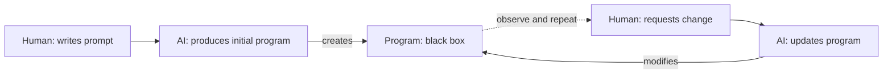
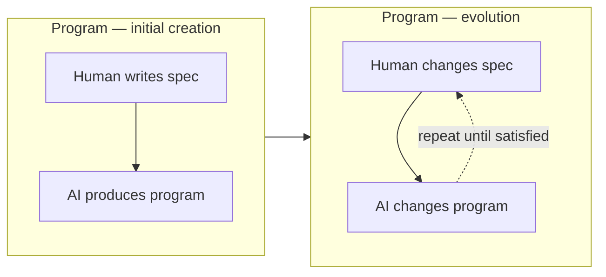
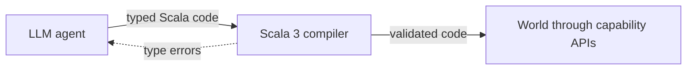
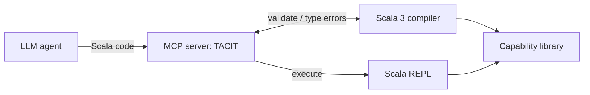
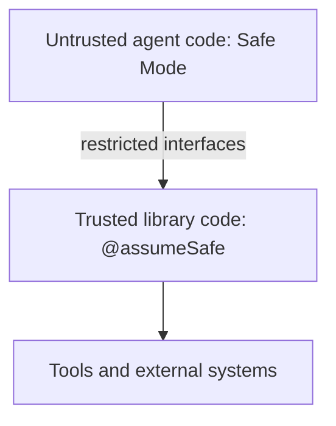
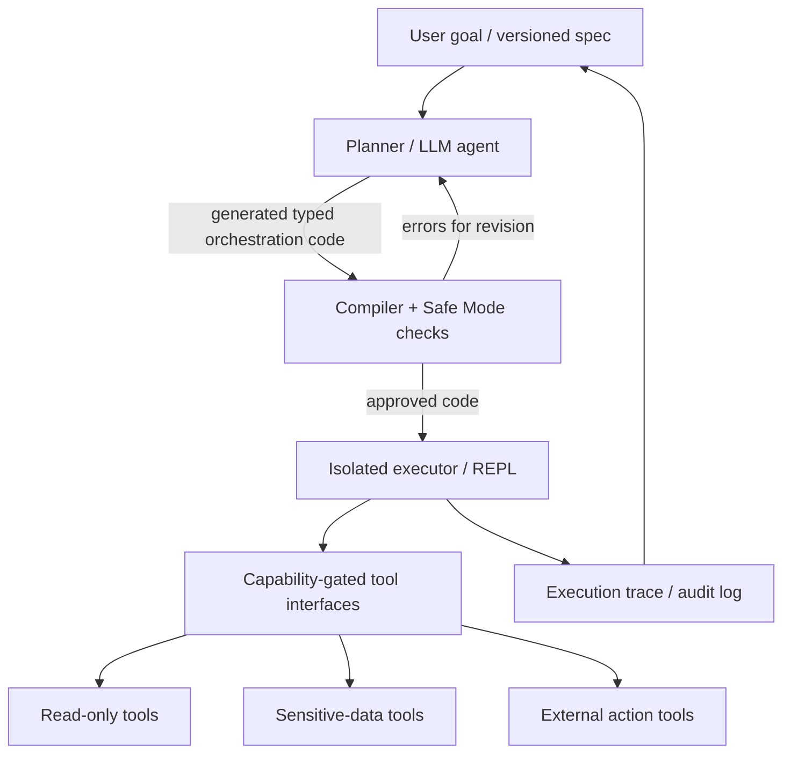

# ScalaDays Keynote Notes — Inspiration for Agent Orchestration with Tools

> **Purpose:** Capture concepts from the ScalaDays keynote and turn them into design inspiration for an agent orchestration system that invokes tools safely.
>
> **Status:** Working reference, not an implementation specification. Sections labeled **Keynote concept** summarize the slides; sections labeled **Design inspiration** are proposed extrapolations.

## 1. The conventional agent workflow

**Keynote concept:** A human writes an initial prompt, an AI generates a program, and the human observes the resulting program and requests changes. The initial prompt and accumulated change requests form an *informal specification*, while the resulting program is treated as a black box.



**Design inspiration:** Preserve the human's intent and changes as first-class, versioned artifacts rather than relying on an ephemeral chat transcript.

## 2. Spec Strings — prompts in programs

**Keynote concept:** Instead of leaving prompts and revisions outside the program, organize the program so its human-authored specification and AI-generated implementation live together. When requirements change, update the specification and regenerate or revise the program.



**Design inspiration:** Store a durable `spec` alongside generated code, tool permissions, validation results, and revision history. Treat the spec as an auditable input, not as a security policy by itself.

## 3. The Lethal Trifecta

**Keynote concept:** An agent is particularly vulnerable to prompt-injection-driven data exfiltration when it combines:

1. Access to **private data**.
2. Ability to **communicate externally**.
3. Exposure to **untrusted content**.

An attacker can place malicious instructions in untrusted content, hoping the agent will read private data and send it out.

**Design inspiration:** Separate data-reading capabilities from external communication capabilities. Classify tool outputs, retrieved documents, and web content as untrusted inputs; never promote their instructions into authority. Require explicit authorization for sensitive data flows.

## 4. Make the medium safe, not the model trustworthy

**Keynote concept:** Replace direct agent-to-world tool calls with an intermediary that validates typed code before execution.



The security objective is for the **compiler and the surrounding execution environment** to enforce restrictions, rather than trusting the model to comply with prompts.

**Design inspiration:** Use generated code as a constrained orchestration language; compile/check before running. Do not confuse successful type-checking with a complete security guarantee: runtime isolation, authorization, resource limits, and trusted API implementations still matter.

## 5. Scala 3 tracked capabilities

**Keynote concept:** Capabilities are a known security mechanism. The keynote's emphasis is on **tracking capabilities in types**, enabling:

- Fine-grained, context-dependent permissions.
- Static distinctions between pure and side-effecting code.
- Defense in depth rather than a single enforcement point.

Examples shown on the slide (illustrative notation):

```scala
// Pure value and pure function
String
Int -> Int

// Values/functions tracking the io capability
File^{io}
Int ->{io} Int

// Capability-polymorphic examples
File^
Int => Int
```

**Design inspiration:** Define a small, explicit set of capabilities (e.g. `ReadPublicWeb`, `ReadPrivateDocs`, `WriteFiles`, `SendExternalMessage`) and make tool interfaces require only the capabilities they need. Capability naming here is illustrative, not copied from a library.

## 6. Capabilities for agents: classified data

**Keynote concept:** An agent may transform or combine classified data without being allowed to reveal it. The slide used an interface similar to:

```scala
class Classified[T]:
  // Only authorized code can unwrap the value
  def reveal(using CanAccess[T]): T

  // Transform without revealing the classified wrapper
  def map[U](f: T -> U): Classified[U]

  // Combine classified values
  def aggregate[U](other: Classified[U]): Classified[(T, U)]
```

The slide labels the mapping function as **pure, with no retained capabilities**. This is a conceptual excerpt, not a complete compilable library implementation.

**Design inspiration:** Return opaque handles or protected values from sensitive tools. Permit safe transformations and aggregation, but require an explicit capability to unwrap or export their contents. Audit declassification and outbound transmission separately.

## 7. TACIT — Tracked Agent Capabilities in Types

**Keynote concept:** TACIT is an agent harness using an MCP server, Scala 3 compiler, REPL, and capability library.



The slide describes three components:

- **Compiler:** validates generated code.
- **REPL:** executes code.
- **Capability library:** gates access to tools and resources.

**References from the slide:**

- Project: [TACIT](https://github.com/lampepfl/tacit)
- Paper: *Securing Agents With Tracked Capabilities*
- Authors: Martin Odersky, Yaoyu Zhao, Yichen Xu, Oliver Bračevac, Cao Nguyen Pham
- Venue cited: ACM Conference on AI and Agentic Systems (CAIS 2026)

## 8. Tool interfaces and implementation languages

**Keynote concept:** Agents invoke tools using code snippets. Tools are exposed through **type-safe, capability-safe Scala 3 interfaces**, while implementations can be written in compatible languages/runtimes (the slide names Scala 3, Java, and WASM components). Interfaces can also guard sandboxes that host implementations in other languages.

**Design inspiration:** Keep orchestration-facing contracts small and strongly typed. Put heterogeneous backends behind adapters. An MCP server can expose a single constrained execution interface instead of granting the model unrestricted access to every low-level tool.

## 9. Safe Mode — closing escape hatches

**Keynote concept:** Full Scala 3 has features that can undermine capability checks. The presented **Safe Mode** restricts agent-generated code:

1. No unchecked type casts or pattern matches.
2. No `caps.unsafe` module.
3. No `@unchecked` annotations.
4. No runtime reflection.
5. Capture checking and explicit nulls enabled.
6. Global references only if verified safe.

Trusted library code may use `@assumeSafe`, analogous in spirit to Rust's `unsafe`, but agent-generated code cannot use that escape hatch.



**Design inspiration:** Make the trust boundary explicit. Only audited library code can implement privileged operations. Do not let agent code import unsafe modules, use reflection, or bypass the approved tool interfaces.

## 10. Candidate architecture for our agent orchestration system

> **Design inspiration — not a claim about the keynote's implementation.**



### Suggested design principles

- **Spec-first:** Persist the goal, constraints, and revisions with the generated program.
- **Least privilege:** Provide capabilities per task and execution, not globally.
- **Compile before execute:** Reject unsafe or invalid code before it can invoke tools.
- **Constrain tool contracts:** Prefer typed wrappers and opaque sensitive values over raw unrestricted tool calls.
- **Separate read from send:** Avoid combining private-data access and external communication without explicit policy.
- **Isolate execution:** Limit time, memory, network, filesystem, and process access at runtime.
- **Human approval for consequential actions:** Require approval for sensitive exports, writes, and irreversible operations where appropriate.
- **Auditability:** Retain specs, generated code, compiler diagnostics, capabilities granted, tool invocations, and outcomes.

### Questions to explore later

1. Will the orchestrator itself be written in Scala 3, or will Scala be a restricted tool-execution layer behind another agent runtime?
2. How do we represent capabilities for MCP tools, and how do we revoke them between steps?
3. How can the type system distinguish data transformation from disclosure or exfiltration?
4. How should the system handle compiler errors, retries, and agent-generated code revisions?
5. What sandbox guarantees are needed beyond static checking?
6. How do we store and evolve specs alongside code and execution traces?

---

*Compiled from the ScalaDays keynote slides and accompanying notes shared in this conversation. This is an inspiration/reference document, not a verified description of a production-ready security architecture.*
