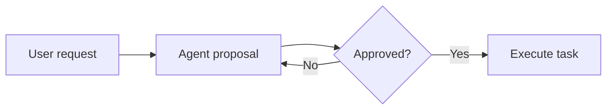

# Shared SDLC tools

Implementation: `core/shared/src/main/scala/fmgp/yallmo/tool/sdlc/`.
Models, storage and handlers use the same `fmgp.yallmo.tool.sdlc` package;
simplified models live in `.llm`. The design rationale is in [plan.md](plan.md).

## Availability

Configured server workspaces automatically register these tools alongside Bash,
filesystem and Scala tools. No extra tool service or configuration entry is
required for agents inheriting the available tool catalog. Explicit agent
`capabilities.tools` allowlists still apply; add the desired keys there when needed.

The captured filesystem is the **server storage directory** supplied through
`--storage`, shared across all authorized agents and sessions. The SDLC directory
is `<server-storage>/sdlc`, independent of `--workspace` and per-agent
`filesystem.root`.

For example, from the server's working directory:

```sh
mkdir -p ./server-storage
sbt 'server/run --storage ./server-storage --config ./private/server.json --workspace .'
```

The journals are `./server-storage/sdlc/tasks.jsonl` and
`./server-storage/sdlc/intents.jsonl`. Relative storage paths are resolved from
the server process working directory, not the configuration file.

If an agent has an explicit tool allowlist, add the tool keys to its existing
configuration (keep any other tools it should retain):

```yaml
agents:
  bob:
    # Keep the existing agentType, providerIds, config, etc.
    capabilities:
      tools: [bash, sdlc_list, sdlc_set, sdlc_read_task, sdlc_set_intents, sdlc_read_intent]
```

Omitting `capabilities.tools` inherits available tools; an empty list disables
them. No per-agent SDLC root is needed or supported. Restart the server after
editing its configuration; live reload is not implemented.

The server storage root must already exist. Embedded callers with no disk
storage root do not expose SDLC tools. Missing/inaccessible server storage
disables only SDLC, not workspace tools. Startup creates no planning files;
write permissions are checked by actual filesystem operations.

## Discovery

Use `sdlc_list` with `{}` to discover the first 50 nonarchived tasks and intents:

```json
{"query": "authentication", "limit": 20, "includeArchived": false}
```

Results contain `items` with ID, a title (explicit for tasks; first line for intents, at most 160 characters),
`expectedRevision`, optional task state and archived flag. This is a summary,
**not replacement content**: use ReadTask/ReadIntent before editing.

When `nextAfterId` is present, pass it as `afterId` with the same search/filter
to continue. Ordering is deterministic by ID; pages reflect current state, not
a frozen snapshot. Limits are 1–100 and the query is at most 200 characters.
Use `includeArchived: true` to discover archived records.

## Set

Tool key: `sdlc_set`.

Arguments (a JSON array, not a JSON-encoded string):

```json
{
  "tasksJson": [
    {"id": "", "title": "Investigate authentication failures"}
  ]
}
```

An empty ID creates a task. The tool allocates `T-1`, `T-2`, etc. and returns
the simplified snapshots with their allocated IDs. Nonempty IDs must already
exist; use ReadTask first and preserve fields when editing. Read and Set return
an `expectedRevision` token. Echo it on updates; omitted/zero is accepted only
for a new record with an empty ID.

Each supplied object **replaces its task's planning content**, not the entire
project. Omitted defaulted fields reset to `open`, empty lists or `false`;
unmentioned tasks remain unchanged. Empty input is a no-op. The runtime preserves
`createdAt` and supplies `updatedAt`; clients may not submit either timestamp.

For example, updating the minimal task created above at revision 1:

```json
{"tasksJson": [{"id": "T-1", "title": "Investigate authentication failures", "description": "Document the failure and completion conditions.", "expectedRevision": 1}]}
```

**Stale versions reject the whole batch before any write**, even when other
records in that batch are fresh. Re-read, preserve the latest fields and decide
how to merge before retrying. A successful changed snapshot advances its revision;
a no-op at the current revision does not. Retrying an already-committed update
with its old revision yields a conflict rather than guessing that the retry is safe.

Task `refs` are ordered `[relationship, ID]` tuples, for example:

```json
"refs": [["subtask", "T-2"], ["dependsOn", "T-3"], ["leftoverOf", "T-4"]]
```

Relationships are `subtask` (contained work), `dependsOn` (prerequisite work),
and `leftoverOf` (origin of remaining work). A target may occur under different
relationships, but duplicate pairs and self-links are rejected. Task IDs use the
opaque Scala type `PlanTaskId`, encoded as ordinary JSON strings. `PlanTaskId.New`
encodes as `""` to request allocation; it cannot be a reference target or stored ID.

Task references must exist after the batch is applied. Dependency and subtask
graphs must each be acyclic; leftover origins do not imply dependencies.
Containment may have multiple parents. Contributions must reference existing
intents; intent dependencies must reference existing tasks. The shared service
serializes these cross-journal checks with mutations.

## Markdown and task steps

Tasks have a required plain-text `title` (nonblank, single-line, at most 160
characters) and a Markdown `description` (at most 8000 characters, default `""`).
Intent `text` remains Markdown. Tasks may also include an ordered `steps`
checklist; step descriptions are Markdown and step titles are single-line plain text:

```json
{
  "tasksJson": [{
    "id": "",
    "title": "Improve authentication",
    "description": "Make session renewal **reliable**.",
    "steps": [
      {"done": true, "title": "Reproduce the failure"},
      {"done": false, "title": "Implement renewal", "description": "Add **regression tests**."}
    ]
  }]
}
```

Each step requires `done` (boolean) and `title`; `description` defaults to `""`.
Use at most 100 steps, each with a nonblank single-line title of at most 160
characters and a description of at most 2000 characters. Steps are lightweight
checklist items, not independently addressable tasks linked with `subtask` refs. Completing all steps
does not automatically change task state.

Stored and simplified tasks expose `toMarkdown`, combining an escaped title
heading, the Markdown description, and a `## Steps` section using `- [x]` / `- [ ]`
checkboxes and nested descriptions. The generated Markdown is not stored or
included as a duplicate JSON field. The HTTP inspector renders descriptions and
steps, offers Copy Markdown, and places Raw JSON beside the expand/collapse control.

Legacy stored task `text` migrates to `description` verbatim, deriving `title`
from its first nonblank line (heading markers removed, limited to 160 characters).
New task inputs require `title` and must use `description`, not `text`; mixed
old/new content fields fail explicitly. Existing journals without `steps` decode
with an empty checklist. Legacy stored
`subtasks`, `dependsOn`, and `leftoverOf` task lists migrate to `refs` on read;
new writes/checkpoints use only `refs`. Mixed old/new relationship fields fail
explicitly. Agent task inputs must use `refs`; intent `dependsOn` and task
`contributesTo` remain unchanged. As with other
planning fields, replacement updates that omit `steps` clear the checklist:
read first and preserve it when editing. Discovery searches step titles and
descriptions as well as the main narrative.

## ReadTask

Tool key: `sdlc_read_task`.

```json
{"taskIds": ["T-1", "T-2"]}
```

Returns simplified tasks in request order, including archived tasks. IDs must be
unique and known; missing IDs fail explicitly. Empty input returns `[]`.

Both operations return JSON arrays of `PlanTaskSimplifiedModel`, without storage
timestamps. There are no separate create/update command models.

## Intents

Tool keys: `sdlc_set_intents` and `sdlc_read_intent`.

```json
{"intentsJson": [{"id": "", "text": "Authentication stays reliable", "dependsOn": ["T-1"]}]}
```

```json
{"intentIds": ["I-1"]}
```

Intent creation allocates permanent `I-n` IDs. Replacement/default, timestamp,
`expectedRevision` checks, archive visibility and unknown-ID behavior match the task tools.
Intent tool results use `PlanIntentSimplifiedModel`, not stored metadata.

## HTTP inspector

Open the website at **`#/sdlc`** (navigation shortcut `8`). Cards show their ID,
task state, a text-only completed/total step count, and title inline, with archive
badges where relevant. Copy Markdown and Raw JSON are adjacent header controls,
available even when the card is collapsed. Expand to read
sanitized Markdown, ordered read-only steps, assumptions, and linked relationships.
Copy the combined Markdown or use Raw JSON beside the +/− control to inspect
the complete stored object (including timestamps, revision, and unknown fields)
independently of the description's expanded state.
Search and task-state filters run locally; archived records are hidden until
included. Relationship buttons reveal and focus their target, including archived
records. Tasks and intents have independent loading, empty, and error states and
a manual refresh. The page is read-only: checklists do not update storage.

Fenced `scala` blocks in narratives and step descriptions receive syntax
highlighting using the shared renderer also used by Chat and other message
cards. Unknown/unlabeled languages and Scala blocks over 50,000 characters
remain plain code. Fenced `mermaid` blocks render as diagrams,
with a **Diagram source** disclosure. Diagrams match the application's dark
palette, preserve their intrinsic scale, and fit within the card width and a
compact height cap. **Expand diagram** removes that cap; **Fit diagram** restores
it. Copy Markdown and Raw JSON retain the original source for agent editing. For example:

````markdown

````

Rendering is local and lazy-loaded, with strict security, HTML labels disabled,
and sanitized SVG displayed only as an inert image. Diagram links/callbacks are
not enabled. Invalid diagrams, configuration directives/frontmatter, raw HTML,
image/icon nodes, custom CSS (`classDef`, `style`, `linkStyle`), backslash escapes,
oversized sources (>50,000 characters), or library failures fall back to readable
source. Resource-bearing features are excluded before temporary rendering;
Mermaid also limits edges to 500. Other code fences remain literal code.

The page reads same-origin HTTP endpoints, never WebSocket/RPC data:

- `GET /api/sdlc/tasks` returns all current full `PlanTask` objects.
- `GET /api/sdlc/intents` returns all current full `PlanIntent` objects.

Both responses are bare JSON arrays, include archived records, use `no-store`
headers and do not invoke an agent or create conversations/files. HTTP mutation
methods are rejected. Failures return a sanitized JSON error with status 500.

The standalone main creates one `SdlcService` and passes that same owner to agent
tools and `SdlcHttpRoutes`. Viewer-only server mode also exposes the inspector.
Embedded hosts opt in by supplying their shared `SdlcService`.

**Trusted environment only:** HTTP inspection requires no WebSocket identity or
agent selection and exposes planning content to anyone who can reach the host.
Agent tool allowlists do not authorize or filter these read-only HTTP requests.
Do not publish the server/proxy on an untrusted network. The app shell still
uses WebSocket for other pages; SDLC loads even when that connection is down.

## Storage and guarantees

- Uses explicit `FsRead` and `FsWrite` capabilities, not raw filesystem handles.
- Fixed server-storage-relative paths: `sdlc/tasks.jsonl` and `sdlc/intents.jsonl`; no agent-supplied paths.
- Creates directories lazily on the first nonempty mutation.
- Each JSONL line is an array of complete **changed** snapshots of that journal's entity type from one Set operation. Replay applies batches in order; latest snapshot wins.
- The service serializes reading, reference checks and synced appends across HTTP and all five tools. Replay cannot accept only half of a serialized batch.
- Corrupt, blank, trailing-content, non-LF-terminated or oversized journals fail
  closed. The tool does not truncate, reset or silently repair them.
- Limits per entity type: 100 records per mutation/read operation; 1000 **active** records; 5000 retained current records, including closed/archived records; 2 MiB of current planning content. Task active means nonarchived `open`/`doing`; intent active means nonarchived. Completing/dropping/archiving tasks or archiving intents frees active slots without deleting or recycling IDs.
- A live journal is capped at 10000 snapshots / 4 MiB. Explicit checkpointing retains history elsewhere and restores journal headroom; these are not lifetime revision limits. Retained-record/content limits remain deliberate resource ceilings, not an unlimited storage promise.
- Tool arguments are limited to 128 KiB; text to 8000 characters; assumptions to 100 nonblank strings of at most 2000 characters.

**This is not transactional or cross-process storage.** Use one live planning
storage owner per server storage root. Separate processes/owners and external edits are
not coordinated. An I/O failure may leave an incomplete record or an uncertain
successful append; recover manually rather than retrying blindly.

Optimistic revision checks prevent stale replacements within the shared service.
They do not coordinate independently created storage owners/processes.
Creating with an empty ID is still **not retry-idempotent**: a lost response
followed by a retry can create another record. Bare provider call IDs can collide
across conversations, so they are deliberately not used as deduplication keys.
A durable namespaced runtime request identity, audit actors/reasons, project
selection and custom macro generation remain future work.

Existing journals at the former workspace path `.yallmo/sdlc/tasks.jsonl` are
not automatically moved or deleted. If needed, migrate manually with the server
stopped and check that the destination journal does not already contain data.

## Explicit maintenance

Stop the server, then run:

```sh
sbt 'server/runMain fmgp.yallmo.server.SdlcMaintenanceMain ./server-storage'
```

The command acquires the existing server-root lease (it refuses to race a running
standalone server) and checkpoints both journals. The same operation is available
to trusted embedded code as `SdlcService.checkpoint`, under its service gate.
It is not an HTTP or agent mutation tool.

Each checkpoint keeps a synced, byte-verified original history copy in
`sdlc/history/`, writes/verifies a temporary current-state journal and replaces
the primary. All current records, including archived ones, retain their IDs,
timestamps and revisions. Old journals without revision fields infer versions
during replay; checkpoints persist those versions. History backups are never
automatically deleted. Operators must budget disk space for them.

The `*.maintenance` marker is created **before** changing the primary and removed
only after verifying the replacement. On uncertain failure, normal operations for
that journal fail closed, even if the primary is missing or syntactically valid.
Do not blindly delete the marker: inspect its backup/temporary paths, recover a
verified complete journal, preserve IDs/revisions, then remove the marker only
after recovery. No automatic truncation, rollback or power-loss atomicity is
claimed by the underlying filesystem capability.

Legacy current content larger than the new 2 MiB write budget remains readable
and accepts strictly size-reducing edits, allowing incremental cleanup. Growth is
rejected until the current content fits the budget. A genuinely oversized/corrupt journal
requires explicit recovery, not a checkpoint that silently skips invalid data.

## Tests

```sh
sbt 'core/testOnly fmgp.yallmo.tool.sdlc.*'
sbt 'coreJS/testOnly fmgp.yallmo.tool.sdlc.PlanModelsSuite'
sbt 'server/testOnly fmgp.yallmo.server.SdlcHttpRoutesSuite fmgp.yallmo.server.application.ApplicationToolsSuite'
sbt 'webHarness/testOnly *Sdlc*Suite *ViewWebSuite'
```
