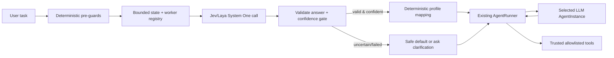

# System One orchestration research

> Start with the concise [System One overview](System_One_Overview.md).

## 2.1 Correct composition

Jev should select from a **closed, trusted registry**; it must not generate an agent ID, arbitrary model ID, system prompt, tool set, or budget policy. Code owns all of those things.



This preserves Yallmo's trust boundary. `AgentRunner` still performs tool lookup, schema validation, approvals, action/turn/time budgets, and transcript recording. Jev only influences a bounded selection that the host validates.

## 2.2 Concrete worker-selector design

Create an orchestration service such as `WorkerSelector`, not an `AgentInstance`:

```scala
final case class WorkerProfile(
  key: WorkerKey,
  description: String,
  agent: AgentInstance[Agent[Any]],
  staticContext: StaticContext[Agent[Any]],
  // These are host-owned values, never model-produced:
  model: String,
  allowedTools: Set[String],
  tags: Set[String]
)

trait WorkerSelector:
  def select(input: SelectionInput): IO[SelectionError, SelectedWorker]
```

For each new user task or explicit phase boundary, build a small `state` such as:

```json
{
  "task": "User request text",
  "conversation_summary": "bounded host-produced summary or last N messages",
  "available_workers": [
    {"id": "coding", "purpose": "implement/debug with repository tools"},
    {"id": "research", "purpose": "research with approved web/search capability"},
    {"id": "review", "purpose": "review changes read-only"}
  ],
  "run_constraints": {"remaining_turns": 8, "tools_available": ["readFile", "bash"]}
}
```

Ask narrow independent questions in one call:

* `worker`: **Choice** over the registry IDs, with precise descriptions. This is the only answer that may select a profile.
* `complexity`: **Score** over a short rubric (`trivial`, `bounded`, `multi-step`, `architectural`).
* `needs_clarification`: **Noul**. Do not launch a worker blindly when critical information is absent.
* optional `needs_external_research`: **Noul**, if it controls whether the research profile is eligible.

Then compose in ordinary code:

1. Remove profiles unavailable due to deterministic policy, workspace state, feature flags, user permissions, or required tools *before* forming Choice criteria.
2. Validate that the returned Choice is still a member of that exact eligibility set.
3. If `needs_clarification` is near its uncertain middle or above the configured action threshold, ask a clarification or choose a read-only triage worker.
4. Apply conservative thresholds to `worker.confidence`; use a default general worker, a confirmation UI, or a more deliberate planner when it is below threshold.
5. Map the resulting `WorkerKey` to the entire host-owned `WorkerProfile`: agent type, LLM model, model options, system prompt, static context, and advertised tools. Do **not** treat a Jev Score as a model name or allow it to override a worker profile.
6. Invoke the existing `AgentRunner.runWithContext(profile.agent, task, profile.staticContext, ...)`.

Call the selector once per user task/phase, not every LLM turn. Re-selection on every loop would add latency/cost, make the worker flip while its transcript grows, and invalidate prompt-cache locality. A multi-step workflow should use explicit stages (for example `triage -> research -> implementation -> review`) whose transitions are deterministic or separately evaluated with an auditable System One question.

## 2.3 Model/task routing use case

The Pi package `pi-jev-model-router` demonstrates the right separation of concerns:

* Jev receives four atomic questions: task kind (Choice), complexity (Score), capability deserved (Score), and deep reasoning (Noul).
* deterministic code combines them into a tier and then applies confidence, budget, availability, quota, and prompt-cache rules;
* a closed model/worker candidate chain is selected; and
* if Jev fails, it fails open and leaves the current model in place.

For Yallmo, translate that idea to **worker profiles**, not directly to raw models:

```text
Jev task-kind + complexity + reasoning
              │
              ▼
trusted code: choose eligible worker profile / tier / fallback
              │
              ├── CodingWorker(modelrunner-coder, read/write/test tools)
              ├── ResearchWorker(modelrunner-reader, web/retrieval tools)
              ├── ReviewWorker(modelrunner-reviewer, read-only tools)
              └── GeneralWorker(default model, limited tools)
```

The registry can give each profile a configured LLM model override. This is how Jev influences “model according to input” without asserting that Jev is the LLM or accepting an untrusted arbitrary model string. Budget, availability, provider support, and tool permission remain deterministic policies owned by Yallmo.

The current code supports the lower half of this design already:

* `LlmDecisionAgent` accepts an optional model override.
* `NativeFunctionAgent` takes a concrete model and uses provider-native calls.
* `AgentRunner` owns execution and checks that a tool is both globally registered and advertised in the selected `StaticContext`.
* `RunContext` is immutable and can be passed to the selected profile.

It does **not** yet contain an agent/profile registry or a selector. Those are the missing orchestration features, not a reason to alter the Chat Completions provider.

## 2.4 Failure, safety, and observability policy

| Condition | Required behavior |
| --- | --- |
| Local validation failure / 422 | Fail selection; do not send the malformed request. |
| 401 | Report misconfiguration; do not retry. |
| Timeout, connection issue, 429, 529 | Retry boundedly only where appropriate, then select deterministic fallback or retain current worker. |
| Missing/invalid answer, wrong answer type, or returned worker not eligible | Treat as protocol failure; never select it. |
| Low Choice confidence | Safe default, ask user, or planner/reviewer according to policy; no expensive automatic escalation merely because a low-confidence answer named it. |
| High-risk worker/tool profile | Require a stronger threshold and/or approval. The selection never bypasses `AgentRunner`/`ToolApproval`. |
| Laya `usage.truncated: true` or non-empty `truncated_questions` | Treat result as unsuitable for automatic routing until a deliberate policy is added; log a bounded diagnostic. |

Record a compact, redacted selection event alongside the run: endpoint/provider label, returned Jev model, question schema version, selected and fallback profile IDs, confidence/probabilities or score, latency, input/output usage, and the reason for the final deterministic decision. Do not record authorization headers; be deliberate about retaining user prompts/state because provider debug captures may contain them.

## 2.5 Proposed delivery sequence

1. **Protocol foundation:** introduce System One request/answer ADTs and JSON codecs, including validation and error types. Unit-test request encoding and response validation without HTTP.
2. **HTTP adapter:** implement `JevSystemOneClient` over ZIO HTTP and `JevConfig`; test auth present/absent, URL normalization, timeout/cancellation, 401/422 non-retry, and 429/529 retry. Add a local Laya contract test profile that expects the extra fields to be tolerated and does not call `/v1/models`.
3. **Live smoke test (optional/manual):** against `host.docker.internal:8000/v1/systemone`, run the three-primitive request and save only non-sensitive expected stable fields. Do not make CI depend on the local service.
4. **One selector vertical slice:** register `general`, `coding`, and `review` profiles; use only the `worker` Choice plus a conservative confidence fallback. Verify selected `StaticContext` cannot gain unregistered/unadvertised tools.
5. **Richer routing:** add complexity/Noul questions, deterministic profile/tier mapping, clarification/approval behavior, events/metrics, and an offline labelled evaluation set. Tune thresholds from that data before enabling automatic multi-agent routing.
6. **Explicit multi-stage workflows:** add named hand-offs with narrow artifacts and separately bounded budgets. Do not create an open-ended “agents pick agents” recursion.

---

## Sources and inspected code

Official TypeSafe documentation (accessed 2026-10-13):

* [API reference](https://docs.typesafe.ai/api) — endpoint, request/response schema, error/retry semantics.
* [Jev with coding agents](https://docs.typesafe.ai/introduction/coding-agents) — Jev is explicitly not a coding-agent/chat replacement.
* [State](https://docs.typesafe.ai/concepts/state) — state shapes and content/question separation.
* [Primitives](https://docs.typesafe.ai/primitives) — Choice, Score, Noul and parallel independent questions.
* [How to build with TypeSafe](https://docs.typesafe.ai/concepts/how-to-build-with-system-one) — code-owned workflow, atomic questions, confidence gates.
* [Models](https://docs.typesafe.ai/models) — `jev-latest`, model listing, input/context/rate-limit information.
* [Confidence](https://docs.typesafe.ai/confidence) — interpretation and thresholding.

Reference implementation inspected:

* [`pi-jev-model-router`](https://github.com/da-vinci-noob/pi-jev-model-router), especially `extensions/pi-jev-model-router/jev.ts` and `router.ts`. It is a useful design example, not a Yallmo dependency or authority on the official protocol.

Yallmo code inspected:

* `model/src/main/scala/fmgp/yallmo/model/llm/LlmProvider.scala`
* `model/src/main/scala/fmgp/yallmo/model/Agent.scala`
* `model/src/main/scala/fmgp/yallmo/model/llm/AgentTurn.scala`
* `core/src/main/scala/fmgp/yallmo/provider/modelrunner/ModelRunnerClient.scala`
* `core/src/main/scala/fmgp/yallmo/orchestration/AgentInstance.scala`
* `core/src/main/scala/fmgp/yallmo/orchestration/NativeFunctionAgent.scala`
* `core/src/main/scala/fmgp/yallmo/orchestration/AgentRunner.scala`
* `core/src/main/scala/fmgp/yallmo/provider/OPENAI_COMPATIBLE_PROVIDERS_PLAN.md`
