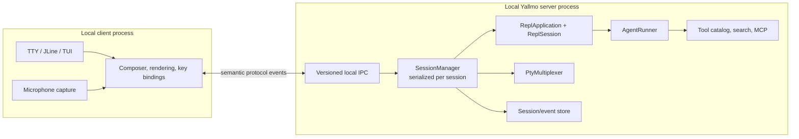
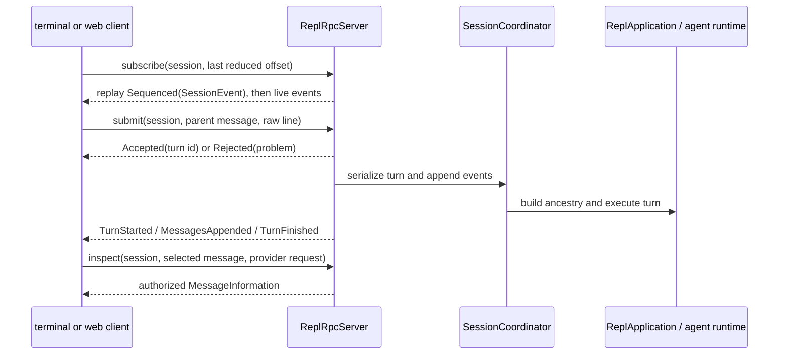

# Local REPL client/server and TTY/PTY plan

## Recommendation

Adopt a **local-first client/server split**, similar in spirit to sbt's client and background server. It is a strong fit for Yallmo once sessions become long-lived and the TUI, PTY workspace, research workers, and browser client need to share one trusted runtime.

Start with one user, one machine, and a local IPC transport. Do **not** expose the REPL server over TCP or treat it as a remote shell. The split is valuable even without remote access:

- a terminal/TUI client can reconnect without losing an active run or PTY process;
- a server owns expensive model/provider/MCP connections and tool initialization once;
- JLine, future TUI, and later browser clients share the same session semantics;
- server-side sessions, transcripts, budgets, cancellation, and audit events have one owner;
- PTY processes can survive a display/client restart under an explicit detach/reap policy;
- protocol tests no longer need a real terminal, while TTY/PTY tests are isolated at the edges.

## Scope and boundaries

The server owns Yallmo execution state and privileged integrations. The client owns the user's local terminal and presentation.



### Client owns

- acquiring/restoring the local TTY, raw-mode setup, resize events, JLine line editing, and TUI rendering;
- draft text, local input history, focus/layout, and terminal keybindings;
- client-local microphone capture. The client handles the voice UI action locally, transcribes/captures locally, and submits only the resulting text through the normal prompt path; the initial session protocol has no server-targeted microphone request;
- rendering typed conversation/diagnostic events and, later, terminal-emulator rendering for attached PTY output.

### Server owns

- `ReplApplication`, `ReplSession`, immutable `ReplState` transitions, `AgentRunner`, tool availability, and provider clients;
- session identity, transcript/event persistence, budgets, cancellation, request serialization, and audit metadata;
- trusted configuration, credentials, web-search/MCP connections, child research agents, and all tool policy/approval decisions;
- PTY creation, process lifecycle, input leases, output limits, detach/reap policy, and process audit records.

A client must never gain a new tool capability because it can render a button or send a protocol message. The server is the sole authorization point.

## Protocol design

This plan is stored in `repl.grammar` because the existing grammar already provides client-neutral input semantics. Production wire models should be introduced in a dedicated `fmgp.yallmo.repl.protocol` package once the contract is approved; terminal strings, JLine classes, and ANSI sequences are not protocol types.

Use a versioned, JSON-encoded local message envelope with a handshake before any session operation. A binary framing/codec can be evaluated later without changing the message model.

### Initial draft: session event protocol

The server owns **session state** and the append-only event log. It does not own any durable client state: no attached-client record, selected session, draft, terminal state, selected message, or “last request”. A client reconstructs its own state by replaying and then following a session event stream.

The initial server port is deliberately small:

```scala
trait ReplRpcServer[-R] {
  def submit(command: SubmitTurn): ZIO[R, ReplRpcError, SubmitResult]

  /** Replays events after `after`, then remains live. */
  def subscribe(sessionId: SessionId, after: EventOffset): ZStream[R, ReplRpcError, Sequenced[SessionEvent]]

  /** Returns authorized diagnostic data for a client-selected message. */
  def inspect(request: InspectMessage): ZIO[R, ReplRpcError, MessageInformation]
}
```

```scala
final case class SubmitTurn(
    commandId: CommandId,
    sessionId: SessionId,
    parentMessageId: Option[MessageId],
    line: String
)

enum SubmitResult {
  case Accepted(turnId: TurnId)
  case Rejected(problem: SubmissionProblem)
}

final case class Sequenced[+A](offset: EventOffset, value: A)
```

`commandId` is generated by the client and retained in the session log for retry de-duplication; it is not client state owned by the server. `parentMessageId` selects the transcript node from which to take the turn. Submitting two turns with the same parent intentionally creates two branches.

The client sends a raw `line`. The server continues to apply `ReplGrammar.parse` as the validation authority. A client may use the shared grammar for local completion and intercept presentation-only commands such as `/help`, but it cannot bypass server validation by doing so. The grammar itself is never sent on the wire.

`subscribe` replaces a transcript/snapshot RPC. A new client uses the initial event offset; a reconnecting client supplies the last offset it has reduced. The server replays subsequent events and then keeps the subscription live.

```scala
enum SessionEvent {
  case TurnStarted(turnId: TurnId, parentMessageId: Option[MessageId])

  /** `messages` is an ordered chain: the first node is a child of `parentMessageId`,
    * and every later node is a child of the preceding node.
    */
  case MessagesAppended(
      turnId: TurnId,
      parentMessageId: Option[MessageId],
      messages: Chunk[SessionMessage]
  )

  case TurnFinished(turnId: TurnId, outcome: TurnOutcome)
}

final case class SessionMessage(id: MessageId, payload: MessagePayload)

enum TurnOutcome {
  case Completed
  case Failed(message: String)
}
```

Only the server creates `SessionMessage` identifiers and `MessagesAppended` events. A client submits `SubmitTurn`; it never claims that a model-generated message was appended. The server first appends the user message below the requested parent, then appends the agent-produced messages below it. On a later turn, the client selects one of those returned message IDs as `parentMessageId`. The coordinator reconstructs the selected ancestry when building the linear `RunContext` needed by the current agent runner.

A rejected line is a direct `SubmitResult.Rejected`, not a durable `InputRejected` session event: it did not change the session. Likewise, `SessionClosed` is not part of the initial domain protocol; a closed socket is transport-level. Explicit session deletion/retention policy can add a durable lifecycle event later.

Information that is large, sensitive, or not needed to rebuild the conversation is requested explicitly for a message selected by the client:

```scala
final case class InspectMessage(
    sessionId: SessionId,
    messageId: MessageId,
    kind: MessageInformationKind
)

enum MessageInformationKind {
  case ProviderRequest
  case ProviderResponse
  case ToolTrace
}
```

For example, the client determines its own “latest request” by selecting its latest relevant message ID, then requests `ProviderRequest` for that message. The normal event stream never contains server filesystem paths or provider payloads.



Every request and server-originated event needs a session ID, request/turn ID where applicable, and ordering sequence number. The protocol must define replay/resume behavior before clients rely on reconnect.

## Session and concurrency model

The current `ReplApplication.submit` returns a new immutable `ReplState` only after a complete linear turn. A server introduces a `SessionCoordinator` that owns the session event log, materialized branch state, run metadata, and an explicit **one active turn per session** queue/lock. It does not own attached-client state.

Storage prerequisite: the current filesystem backend also requires serialization of **all message/session mutations
across one storage root**, including different sessions. Per-session queues alone do not satisfy that contract; the
server must add a shared storage-boundary writer coordinator before running sessions concurrently. See
[Attachments and blob storage](../../../../../../../../docs/orchestration/ATTACHMENTS_AND_BLOB_STORAGE_PLAN.md).
Message events carry attachment references, never blob bytes. A future authenticated blob transport needs its own
access/size/lifecycle policy; `readBlob` is not implicitly a public network endpoint.

Rules:

- serialize submitted turns and later cancellation requests for a session; never race state transitions;
- a turn receives a stable `turnId`; duplicate client retries are deduplicated by `commandId` in the session log;
- the submitted `parentMessageId` identifies the ancestry used to construct the agent's linear `RunContext`; it permits explicit branches rather than relying on a server-side “current client transcript”;
- a subscription is read-only and independent: several clients may replay and follow the same session without being registered as session owners;
- a disconnected client only loses its subscription. The server's policy for an already accepted turn is independent of that disconnection;
- cancellation is an application contract, not a client disconnect or terminal-thread kill;
- emit progress only after `AgentRunner` and tool lifecycle events have a typed contract;
- persist appended events before publishing them to live subscribers when durable sessions are enabled.

## TTY versus PTY

A **TTY** is the client process's own user terminal. It is local UI infrastructure and never crosses the protocol as terminal escape sequences.

A **PTY** is a server-managed child process with terminal semantics. It is a separate privileged capability from the existing bounded non-interactive `bash` tool.

```text
TTY client input/rendering                Server-managed PTY workspace
──────────────────────────                ────────────────────────────
JLine/TUI owns terminal mode              PtyMultiplexer owns process group
Client sends semantic REPL requests       Server enforces command/cwd/env policy
Client restores its terminal              Server reaps descendants and records audit
No tool authority implied                 One explicit, auditable input lease
```

For PTY support, transmit typed lifecycle events plus a bounded byte/text output stream suitable for a terminal emulator. Do not send a client's raw terminal device over the wire. The server validates pane IDs, attachment permissions, input lease ownership, size bounds, and signals. On client disconnect, PTYs become detached; their configured lifecycle policy determines whether they continue or are terminated. A new client may attach only when local authorization and the input lease allow it.

Initial PTY policy remains the existing TUI plan's Level 2: configured/allowlisted programs, operator-owned input, no agent keystroke authority. `ProcessBuilder` pipes are not a PTY substitute.

## Transport, discovery, and local security

### First implementation

- Use a per-user local Unix-domain socket where the platform supports it; use a loopback fallback only with an unguessable per-start token and explicit warning/permissions review.
- Place endpoint metadata and token in a private user directory (for example `~/.yallmo/server/`), with owner-only permissions and atomic write/replace.
- Require a protocol handshake with version negotiation and the endpoint token even for a local socket. Treat filesystem permissions as defence in depth, not the only authentication control.
- Provide explicit `yallmo server` and `yallmo connect`/default-client modes first. Add automatic server discovery/start only after stale endpoint, concurrent startup, upgrade, and shutdown behavior are tested.
- Never listen on a non-loopback interface in this plan. Remote access requires a separate authentication, authorization, TLS, tenancy, rate-limit, and audit design.

### Server lifecycle

Like sbt, the client may eventually discover and reuse a compatible server. It must not blindly connect:

- endpoint metadata includes server PID, start time, protocol range, server build/version, endpoint, and token reference—not the secret in logs;
- clients reject incompatible protocol versions with a clear restart/upgrade action;
- stale PID/socket detection and cleanup are race-safe;
- server shutdown refuses while active sessions/PTYs exist unless an explicit force policy records the consequence;
- configuration/tool/provider changes require an explicit server reload/restart policy so a new client cannot silently change a running server's capabilities.

## Benefits and trade-offs

| Benefits | Costs to design explicitly |
| --- | --- |
| reconnectable sessions and PTYs | versioned protocol and compatibility tests |
| shared expensive clients/connections | daemon lifecycle/discovery/upgrade handling |
| one authorization and audit boundary | local IPC authentication and secret handling |
| multiple presentation clients | session ownership and backpressure rules |
| clean TTY/PTY separation | PTY attach/input-lease/disconnect semantics |
| testable core without a terminal | persistence and cancellation contracts |

The first milestone should therefore **not** attempt browser access, shared concurrent editing, remote control, or a full PTY multiplexer. Establish the local session protocol and cancellation semantics first.

## Delivery milestones

1. **Protocol extraction:** define codec-free `SubmitTurn`, event subscription, message inspection, IDs, errors, and JSON compatibility tests. Keep JLine REPL behavior unchanged.
2. **In-process server seam:** add `SessionCoordinator` around `ReplApplication` with serialized state transitions, append-only `SessionEvent`s, and scripted replay/branch tests. Implement a client adapter in the same JVM/process before adding sockets.
3. **Local IPC MVP:** add endpoint metadata and handshake/token validation; transport `submit`, `subscribe`, and `inspect`; and support replay after a client reconnects. Use one session and no persistence initially if necessary, but retain the event model.
4. **Lifecycle and durability:** add cancellation contract, progress events, append-only session/event store, reconnect/replay policy, stale-server handling, graceful shutdown, and redacted diagnostics.
5. **TTY/TUI clients:** move `TerminalRepl` and the future TUI behind the protocol client while keeping terminal acquisition/rendering local. Preserve the existing client-local voice flow.
6. **PTY service:** implement the separately planned PTY backend and policy on the server; then add attachment/output/resize/input-lease protocol support and a local TUI pane client.
7. **Additional clients:** consider a localhost WebSocket bridge only after local server authorization, lifecycle, capability policy, and session sharing are mature. It is not an automatic consequence of local IPC.

## Test strategy and definition of done

Test protocol codec/golden compatibility, handshake/version rejection, endpoint permission/token failures, stale discovery, request deduplication, per-session ordering, disconnect behavior, cancellation, backpressure/output bounds, session replay, and server shutdown with active work. Use fake `ReplApplication`/agent/tool/PTY services for deterministic tests; run a small platform matrix for Unix sockets and eventual Windows fallback.

The first usable release is complete when:

- a separately launched local server retains one REPL session while a line client disconnects and reconnects;
- the client sees the same grammar and tool-availability semantics as today's in-process REPL, while deriving its transcript from `SessionEvent` replay;
- only the server holds provider/tool/MCP credentials and executes tools;
- one session processes operations in a documented deterministic order;
- no remote listener is opened, terminal mode is always restored by the client, and `sbt test` passes without external services.
